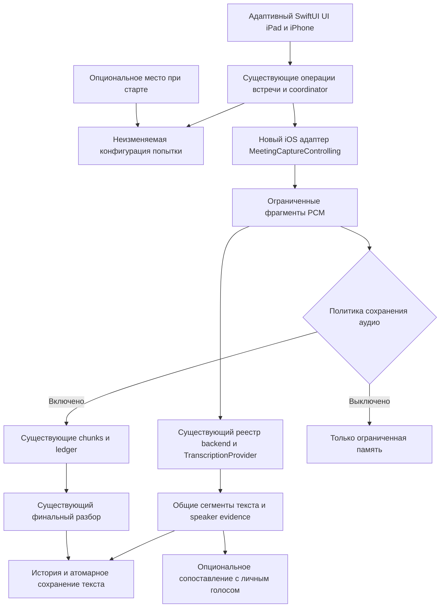

# План Pichi Voice для iPad и iPhone

Первый мобильный выпуск предназначен для записи офлайн-встреч представителя с врачом. Представитель запускает встречу, переходит в презентацию и затем возвращается к расшифровке. Основная платформа: iPad примерно 2021 года и новее. iPhone использует те же операции встречи с отдельной компактной компоновкой. Точные устройства и длительность встреч ещё предстоит уточнить.

Рабочая рекомендация: отдельный iOS target в этом репозитории, существующие контракты встреч и провайдеров, новый адаптер микрофона для iOS и адаптивный SwiftUI UI. Полный перенос macOS target одной настройкой платформы невозможен: приложение зависит от AppKit, ScreenCaptureKit, CoreAudio и desktop-сервисов.

## Подтверждённые требования

- Русский и английский равноправны и могут смешиваться в одной встрече. Распознанный текст сохраняется на языке речи.
- На стартовом экране встречи язык разговора не отображается и не выбирается.
- После загрузки моделей распознавание работает локально без отправки аудио и текста на сервер.
- По умолчанию сохраняются текст и аудио. Срок хранения аудио нужно выбрать отдельно; текущее macOS значение по умолчанию составляет 7 дней.
- Когда сохранение аудио выключено, приложение не создаёт аудиофайлов, включая временные. Это отдельная семантика от существующего удаления после расшифровки.
- Активная запись продолжается при переходе в презентацию. UI показывает текст, когда приложение открыто. Непрерывность при блокировке, другом звуке и аппаратных прерываниях проверяется на устройстве.
- Интерфейс без мигающих элементов. По последующему запросу добавлен тот же аудиоиндикатор, что в панели диктовки: общий Canvas/Timeline renderer и исходная spring simulation. Статичный статус, таймер, кнопка завершения и системная индикация микрофона остаются.
- История встреч, выбор и загрузка локальных моделей, минимальные настройки приватности и распознавания.
- Основная навигация: «Встречи», «История», «Настройки». Модели и приватность остаются внутри настроек приложения, без самостоятельных пунктов sidebar/tab bar.
- Выбран вариант A: «Встречи» содержит только текущую встречу, история открывается отдельно. Мобильная версия содержит только ASR, без AI-улучшения текста и генерации итогов.
- Переключатель определения говорящих. При уверенном совпадении с добровольно зарегистрированным личным голосом участник получает метку «Вы». Остальные получают исходные метки «Участник 1», «Участник 2». Неуверенное совпадение не превращается в «Вы».
- Место встречи опционально: ручное название или однократное получение местоположения при старте, без отслеживания маршрута.
- На iPad крупные основные действия. На iPhone компактная композиция с читаемым текстом и зонами нажатия не менее 44 пунктов.

## Что уже есть в репозитории

Аудит относится к исходному commit `10c5f84a2495142cada2d97f54703f7e84868dcf`. Пути и номера строк ниже относятся к этой версии.

| Требование | Существующая реализация | Следствие для переноса |
| --- | --- | --- |
| Офлайн-встреча с микрофона | `Sources/Fluid/Services/Meeting/MeetingModels.swift:9`, `MeetingCaptureEngine.swift:146`, `MeetingCaptureEngine.swift:1991` | Переиспользовать `.inRoom`, события захвата, writer и передачу PCM в live-контур. |
| Живой текст | `LiveTranscription/MeetingLiveTranscriptionCoordinator.swift:73`, `PichiMeetingBufferedTrackEngine.swift:121` | Есть streaming и buffered-контуры, но текущая политика памяти требует адаптации для мобильных устройств. |
| Финальный текст и говорящие | `Backend/MeetingProviderBackedBackend.swift:9`, `Backend/MeetingTranscriptAssembler.swift:661` | Переиспользовать сборку результата и нейтральные метки говорящих. |
| Регистрация провайдеров | `Backend/MeetingTranscriptionBackendRegistry.swift:23`, `PichiMeetingProviderFactory.swift:79` | Выбор движка остаётся в регистрации backend/provider, а не в мобильном координаторе. |
| Фиксация модели на попытку | `MeetingSessionCoordinator.swift:398`, `:415`, `:428`, `:457` | Модель, backend и fingerprint фиксируются после разрешений и допуска к захвату. |
| История и восстановление | `MeetingSessionStore.swift:44`, `:100`, `:136`, `:195` | Сохранить существующие manifest, атомарную запись и recovery-состояния. |
| Хранение аудио | `MeetingModels.swift:830`, `Persistence/SettingsStore.swift:2060`, `MeetingSessionStore.swift:183` | Уже есть 7 дней, 30 дней, бессрочно и удаление после расшифровки. |
| Освобождение ресурсов | `MeetingModelResidencyCoordinator.swift:144`, `:183`, `PichiMeetingBufferedTrackEngine.swift:80` | Сохранить владение, joined cancellation и восстановление ресурсов на всех исходах. |
| Общее оформление | `Sources/Fluid/Branding/brand-package.json`, `Theme/AppTheme.swift`, `Theme/FluidTypography.swift` | Переиспользовать бренд-пакет, светлую/тёмную палитру и роли текста. |

Сокращённые пути в таблице относятся к `Sources/Fluid/Services/Meeting/`, кроме явно указанных `Persistence/`, `Theme/` и `Branding/`, которые находятся в `Sources/Fluid/`.

Текущие live-метки `you/them` обозначают источник микрофона или приложения, а не распознанного человека (`LiveTranscription/MeetingLiveModels.swift:5`). При офлайн-встрече один микрофон записывает всех. Во время первой реализации показываем исходную метку «Микрофон» и предварительный текст, пока отдельная потоковая диаризация не пройдёт проверку. Финальный разбор говорящих уже существует.

Существующий `MeetingSpeakerVoiceMatcher` связывает голос внутри дорожки и эпох обработки, но не хранит личный голос между встречами (`Backend/MeetingSpeakerVoiceMatcher.swift:77`, `:96`, `:164`). Сейчас canonical assembler устанавливает `isLocalUser = false` (`Backend/MeetingTranscriptAssembler.swift:676`). Настройка «Мой голос» потребует небольшой отдельной операции регистрации и versioned local store.

Переключатель диаризации существует для файлов (`Persistence/SettingsStore.swift:1505`, `UI/FileTranscriptionView.swift:300`). В настройках встреч показана готовность модели определения говорящих, но отдельного общего переключателя нет. Это запрошенное будущее расширение: оно требует неизменяемой политики попытки и поддержки зарегистрированного backend. Текущий Parakeet требует Nemotron; GigaAM допускает неизвестных участников. В текущем UI сохраняется оригинальная карточка модели, без неработающего переключателя.

## Почему не использовать браузерную версию

В соседнем web-репозитории уже есть `/transcribe`: `apps/landing/public/js/transcribe/recorder.js:1` использует `getUserMedia`, `AudioContext`, `ScriptProcessor` и `MediaRecorder`; `transcribe-worker.js` выполняет локальное распознавание через WebGPU/WASM. Подтверждён существующий UX и bounded PCM window, но браузерный worker не даёт приложению нативный background audio lifecycle iPadOS. Перенос в WKWebView сам по себе этот контракт не обеспечивает.

Переиспользуем продуктовый опыт web-версии, а native запись строим через существующую инфраструктуру Swift. Браузерная DSP-диаризация на pitch/MFCC не заменяет проверенную идентификацию личного голоса. Локальный web checkout был просмотрен только для чтения; его текущие изменения не затрагивались.

## Варианты интерфейса

Все варианты сохраняют текущий Pichi brand package и системную типографику с кириллицей, включая Ё/ё. Различается структура, а не продуктовая идентичность.

| Вариант | Композиция | Подходящий сценарий | Цена дальнейшего развития |
| --- | --- | --- | --- |
| A Рабочее пространство | Навигация и история слева, встреча и транскрипт справа; основные действия в устойчивой нижней области. | Работа со многими встречами и переход от записи к истории. | Наиболее естественный путь к полному приложению; близок к текущему Pichi Meet. |
| B Экран встречи | Одна большая область разговора, спокойный статус, нижняя навигация. | Максимальный фокус на текущем визите; минимум элементов во время разговора. | История требует отдельного перехода, но хорошо адаптируется к телефону. |
| C Панель визитов | Быстрый старт, карточки последней встречи, параметров записи и состояния; транскрипт отдельной большой областью. | Несколько визитов в день и контроль готовности перед встречей. | Больше экранных компонентов и больше продуктовых решений для будущей версии. |

Выбран A: sidebar и текущая встреча на iPad, отдельная вкладка истории. История не занимает вторую колонку экрана «Встречи». На iPhone используется stack/tab navigation, без уменьшения всей iPad-композиции. Проверяем обычную и увеличенную Dynamic Type, VoiceOver, light/dark, portrait/landscape и узкое окно многозадачности.

Во всех композициях выбор модели и приватность находятся в «Настройках». На detail-экранах есть возврат к настройкам; основная навигация не расширяется за счёт этих подразделов.

Набор текущих макетов: старт встречи, запись с предварительным текстом, готовая расшифровка, история, настройки записи, приватности и распознавания речи. Личный голос и место остаются явно запрошенными будущими расширениями в плане. Прототип не объявляет модели установленными; текущий synthetic replay без speaker evidence даёт «Неизвестный участник».

## Сверка с оригинальным Pichi Meet

Повторная сверка выполнена по оригинальным экранам и текущему `main` `0295cd82`. Исходные настройки и контракты встреч совпадают с базой аудита `10c5f84a`. Мобильный UI является подмножеством существующего пути: старт -> запись и предварительный текст -> остановка -> обработка -> документ.

| Исходная часть | Решение для выбранного A |
| --- | --- |
| `MeetingSetupCanvas` | Те же заголовок, краткий план микрофонной записи и «Начать запись». Нет новой анкеты названия, выбора языка или повторных значков хранения. |
| `MeetingRecordingSettingsSheet` | «Запись» содержит «Источники звука» и «Метки говорящих». «Распознавание речи» и пользовательская «Приватность» остаются в настройках приложения. |
| `MeetingModelSettingsSection` | Используются «Определять участников по голосу» и «О модели». Nemotron является существующей зависимостью определения участников, а не четвёртым ASR-провайдером. Готовность не подменяется личным голосовым профилем. |
| `MeetingAudioRetentionPolicy` | Те же четыре значения, по умолчанию 7 дней. Неизменённый enum выделен в отдельный portable файл и напрямую компилируется прототипом. Срок хранения применим к прошлым аудиозаписям. |
| Strict audio OFF | Отдельная запрошенная политика для новых встреч. В макете она фиксируется на старте; наличие аудио старой встречи определяется самой встречей. Она не заменяет удаление после расшифровки. |
| Новая встреча | Доступна после результата, скрыта при записи и обработке, как в оригинале. |
| Live UI | Исходные composer/renderer и аудиоанимация. Pause/replay, поворот и технические пояснения относятся к Mac-host прототипа и документации. |
| Необязательные новые функции | Постоянный «Мой голос», место и переключатель диаризации требуют отдельных подтверждённых расширений существующих операций; сейчас не выдаются за готовые возможности оригинала. |

Онлайн-источники, автоматическое обнаружение Zoom/Teams, browser detection, AI-итоги и интеграции не входят в текущий мобильный сценарий. Отдельные Visit/OfflineMeeting, mobile store, installer и parallel pipeline не нужны. Универсальный iOS target должен вызывать те же сервисы, которые описаны ниже.

## Минимальная архитектура

Первое выделение общего кода ограничивается источниками, реально необходимыми двум target. Большой новый portable framework до проверки компиляции не нужен. Предлагаемые seams решают конкретные препятствия:

1. Вынести **существующий** `MeetingCaptureControlling` и связанные capture contracts из macOS файла в нейтральный файл. Новый iOS adapter владеет `AVAudioSession`, capture engine, interruption/route notifications и background lifecycle. Он передаёт те же события и PCM, не выбирает модель.
2. Использовать уже инъецируемые store/capture/processing/audio arbiter seams координатора. Desktop source discovery остаётся в macOS. Только там, где canonical processing напрямую требует AppKit-зависимый `ASRService`, выделить минимальный host capability для существующих операций подготовки и residency.
3. Регистрация backend описывает платформу, языки, доступный путь live/final, бюджет памяти, compute policy и вход из файла/PCM. Она создаёт inference adapter через существующий provider boundary. Общий coordinator не получает `if gigaam`, `if whisper` или отдельные factory-параметры на каждую модель.
4. Сервис установки/активации и проверки artifact один для onboarding, настроек и файлов. Скачивание атомарное, с размером, checksum и cancellation; model files остаются вне Git. UI читает metadata и generic operation state.
5. В shared theme и font resolver выделить только AppKit/NSFont части для macOS и UIKit части для iOS. Portable brand package, роли body/title, String Catalogs и trust boundaries остаются общими. Bundle identity, Keychain, analytics и update policy не меняются импортом бренда.
6. Однократное место приходит через CoreLocation adapter с ручным fallback. Метаданные добавляются совместимо со старой историей. Не требуется новый координатор встреч или background location mode.

Кандидат deployment target: iOS/iPadOS 18. Он позволяет переиспользовать текущий SwiftUI renderer с `onScrollGeometryChange`, без второго scroll-контроллера для старой OS. Устройства стартового парка 2021+ поддерживают эту версию. Прототип компилирует этот renderer напрямую; весь service dependency graph пока не перенесён.

## Общее приложение на разных платформах

Один репозиторий содержит macOS target и universal iOS target для iPad/iPhone. На первом этапе Xcode target membership ссылается на одни и те же исходные файлы. Отдельный Swift Package имеет смысл после доказанной portable dependency closure, если он упрощает сборку и общие тесты. Новые `MobileMeetingSession`, `MobileProcessingPipeline` и независимый mobile model installer не нужны.

| Часть | Одна реализация для платформ | Различие платформ |
| --- | --- | --- |
| Встреча | `MeetingSession`, состояния, сегменты, speakers, immutable processing configuration. | Адаптивная навигация и расположение действий. |
| Оркестрация | Тот же `MeetingSessionCoordinator`, admission, generation guards, stop/finalization, recovery/retention. | Injected source discovery, permissions и audio handoff. |
| Распознавание | `TranscriptionProvider`, существующие GigaAM/Whisper/FluidAudio inference adapters, один backend registry и canonical assembler. | Runtime availability, device budgets и compute policy в descriptor/adapter. |
| Установка моделей | Общие prepare/install/import/activate/remove operations и operation state. | Native picker, supported probes и мобильный набор из трёх провайдеров. |
| Хранение | Один `MeetingSessionStore`, persistence queue, chunk ledger/writer и sidecar schema. | Sandbox root, iOS Data Protection/backup policy. |
| Живой текст | Те же snapshot, composer, renderer и String Catalog. | UIKit/AppKit theme/font bridge и adaptive widths. |
| Захват | Общий `MeetingCaptureControlling`, события и PCM consumer contracts. | Текущий macOS capture и новый iOS AVAudioSession adapter. |
| Необязательная обработка | Existing post-processing boundary сохраняется общей. | iOS не регистрирует AI-enhancement/summary providers и не показывает их UI. |

Реальные препятствия: `ASRService` импортирует AppKit/CoreAudio (`Sources/Fluid/Services/ASRService.swift:9`) и содержит lease/executor/preparation/residency, тогда как `MeetingProcessingPipeline` принимает этот конкретный класс (`MeetingProcessingPipeline.swift:1325`, `:1354`). Выделяем **существующую** lifecycle-реализацию в общего владельца, macOS `ASRService` делегирует ему, iOS использует того же владельца. Desktop participants, например PrivateAI/dictionary, инъецируются при сборке графа зависимостей (`ASRService.swift:4358`). Не отключаем residency ради успешной iOS-сборки.

`SettingsStore.SpeechModel` и meeting/model preferences находятся в AppKit-зависимом `SettingsStore.swift:1`, `:5077`. Выделяем существующие value/catalog и accessors с сохранением ключей и migration/default behavior. Onboarding/settings используют общий service/view-model state; `NSOpenPanel`/`NSWorkspace` остаются platform adapters, а не отдельной модельной lifecycle-логикой.

Whisper Tiny уже имеет общий provider, но ещё требует регистрации immutable meeting/provider configuration в `PichiMeetingProviderFactory.swift:19`, `:79`, `:91`. Наличие модели в dictation catalog не означает готовность canonical meeting backend или live-caption registration. Для новых моделей не добавляем switch/factory-параметр в coordinator.

Порядок extraction: общие values/contracts -> model catalog/preferences и общий lifecycle owner -> существующий coordinator/pipeline/store -> общие SwiftUI компоненты -> iOS capture. Первый функциональный milestone должен завершить синтетическую встречу на Mac и iOS Simulator через **одни и те же классы** coordinator/store/pipeline. Аппаратные capture/inference/background milestones идут затем.

Анимированный прототип уже проверяет небольшую часть этой схемы: девять production-файлов компилируются для macOS и iOS SDK, включая исходный renderer текста и общий renderer диктовки. Canvas/Timeline и неизменённая spring simulation выделены из `BottomWaveformView` в `AudioWaveformBars`; исходная панель использует тот же компонент. Desktop state, настройки и shimmer остаются в её wrapper. Theme bridge и synthetic replay остаются только в `Prototypes/`; они не заменяют сервисы приложения. Общие contract tests должны защищать preparation ownership, residency restoration, provider options, canonical publication, recovery/retention и live-row identity.

## Мобильный набор моделей

В мобильном каталоге три ASR-провайдера: Whisper Tiny multilingual, GigaAM v3 для русского и NVIDIA Parakeet TDT 0.6B v3 multilingual. AI-улучшение и генерация итогов не регистрируются. Whisper Tiny Q8 является самым маленьким текущим зарегистрированным вариантом. Ещё меньший [Tiny Q5_1](https://huggingface.co/ggerganov/whisper.cpp/blob/main/ggml-tiny-q5_1.bin), около 32.2 MB, можно проверить через тот же runtime и добавить как artifact descriptor при подтверждении совместимости и качества. Не объявляем Q8 самым маленьким существующим экспортом. `.en` варианты не подходят для равноправного русского.

| Кандидат | Размер существующего Q8 artifact в каталоге | Роль | Ограничение |
| --- | --- | --- | --- |
| Whisper Tiny multilingual | Около 43.9 MiB | Первый тест самого лёгкого профиля. | Термины и смешанная речь требуют измерения; размер файла не равен RSS. |
| Whisper Base multilingual | Около 81.0 MiB | Возможный последующий вариант, в первый мобильный UI не включён. | Задержка, нагрев и фоновые CPU-нагрузки пока не измерены. |
| GigaAM v3 INT8 | Около 214.5 MiB | Дополнительный русский профиль в следующем сравнении. | Не решает равноправный английский и смешанный разговор одним провайдером. |
| NVIDIA Parakeet TDT 0.6B v3 | Около 460.9 MiB в текущем Core ML каталоге | Мультиязычный кандидат для более мощных iPad. | 25 языков, включая русский и английский; память и фон измерить на устройстве. |

Мультиязычность проверена по [карточке NVIDIA v3](https://huggingface.co/nvidia/parakeet-tdt-0.6b-v3) и [описанию Whisper](https://github.com/openai/whisper). Parakeet v2 и realtime English-only варианты не подменяют v3 в мобильном каталоге. Поддержка двух языков не доказывает качество их смешивания в одной встрече.

Pinned TranscribeCpp `0.1.2` содержит реальные iOS arm64 и simulator slices с minimum OS 16.0. Pinned FluidAudio исходники объявляют iOS 17. Наличие поддерживаемой платформы в зависимости не доказывает, что текущие wrapper, настройки, dictionaries или весь app target компилируются для iOS. Используем имеющийся движок прежде, чем добавлять WhisperKit как второй runtime. WhisperKit рассматриваем только если измерение показывает конкретное преимущество, оправдывающее новую зависимость.

Для смешанной речи фиксируется **один** совместимый multilingual provider/artifact на встречу и политика распознавания языков. Не переключаем большие модели после каждой фразы. Нужна проверка передачи auto/multilingual policy в существующий adapter вместо текущей обязательной фиксации одного languageCode. UI language не определяет язык распознавания и не переводит пользовательские данные.

Текущий live admission требует 8 GiB (`MeetingLiveTranscriptionCoordinator.swift:14`, `:92`, `:179`). Его нельзя просто снизить. Нужна capability-aware политика по измеренному runtime/device: одна микрофонная дорожка, bounded queue, ограниченная видимая часть текста и сохранённые сегменты вне UI snapshot. При аудио ON сбой live-ASR не должен останавливать или терять саму запись.

## Приватность без аудиофайлов

Название настройки: «Сохранять аудио», по умолчанию включено. Когда выключено, подпись ясно объясняет отсутствие воспроизведения и повторного распознавания. Existing «Удалять после расшифровки» остаётся отдельной политикой для пользователей, допускающих временные файлы; она не удовлетворяет строгому режиму.

Текущая capture всегда пишет chunks, а финальный pipeline перечитывает их (`MeetingCaptureEngine.swift:64`, `MeetingProcessingPipeline.swift:1408`, `:1566`). Live snapshot сейчас не сохраняется как результат (`MeetingLiveModels.swift:36`). Поэтому строгий режим требует capability для обработки PCM из памяти и записи завершённых текстовых сегментов в существующее хранилище по мере готовности. Это расширение входа существующего backend и transcript assembly, а не копия meeting pipeline.

Аудио хранится только в ограниченном буфере и очереди. Завершённый фрагмент даёт текст, timestamps и, при доступной диаризации, speaker evidence, затем PCM освобождается. Text checkpoint атомарный. На остановке обрабатывается ограниченный хвост, joined cancellation дожидается завершения владения inference. При crash восстановим только сохранённый текст; незавершённый хвост утрачен. Не используем audio chunks, временные WAV/CAF, audio export, audio log или disk materializer в этом режиме.

Если CPU не успевает, строгий режим не может бесконечно копить аудио и не может отложить всю встречу на возвращение в foreground. Он честно сообщает перегрузку и завершает/приостанавливает приём по согласованному правилу, сохраняя текст и отмечая границу. Запрещены тихая потеря реплик и скрытый fallback в запись файлов. Эта политика допуска измеряется на базовом устройстве до объявления режима доступным.

Требуется отдельная операция удаления личного голосового профиля. Отключение сохранения аудио не означает автоматического удаления embeddings из manifest/sidecar (`MeetingModels.swift:762`, `Backend/MeetingBackendEvidence.swift:216`). Для строгого режима минимизируем сохраняемое speaker evidence; долговременный личный embedding хранится только при явном включении «Мой голос». Отмена регистрации уничтожает её PCM, а версия модели и embedding format фиксируются с профилем.

Для iOS storage отдельно проверяем Data Protection, backup exclusion и создание файлов после блокировки. Обычные POSIX permissions текущего store недостаточны, чтобы подтвердить запись под lock screen (`MeetingSessionStore.swift:513`). Фото/точное место, аудио и голосовой профиль не попадают в telemetry; локальное хранение само по себе не означает отсутствия системного backup.

## Фоновая запись и презентация

Apple документирует продолжение записи через активную audio session и `UIBackgroundModes = audio`, включая блокировку экрана. [AVAudioSession record](https://developer.apple.com/documentation/avfaudio/avaudiosession/category-swift.struct/record) также предупреждает о прерывании звонками и другими nonmixable audio sessions.

Категория `.record` заглушает воспроизведение. Для презентаций с видео/звуком рассматриваем `.playAndRecord` с проверенным mixing и обычным mode; не выбираем `.voiceChat` автоматически. Правильная конфигурация зависит от маршрута, AirPlay, Bluetooth и поведения Keynote/PowerPoint. [Apple Voice Memos для iPad](https://support.apple.com/guide/ipad/make-a-recording-ipadf455678zz/26/ipados/26) отдельно указывает остановку записи при звуке из другого приложения; это причина включить такой сценарий в тестирование нашего adapter, а не обещать совместимость заранее.

Пока запись активна, foreground и background принадлежат одной встрече. В фоне приоритет у capture. Для компактного Whisper проверяем CPU execution без desktop `.metal` default. Тяжёлое финальное распознавание обычного режима допускается после возвращения в приложение. Строгий режим без файлов требует успевающего фонового incremental ASR.

Новые механизмы background GPU/inference не являются обязательной базой MVP для парка устройств. [Background Inference](https://developer.apple.com/documentation/bundleresources/entitlements/com.apple.developer.background-tasks.continued-processing.inference) в актуальной документации относится к iOS/iPadOS 27 и отмечен beta. Доступ к ускорителям, поддержка entitlement и OS cancellation проверяются отдельно. Background audio не даёт обещания неограниченного вычисления или продолжения после force quit.

Apple требует явного consent пользователя и понятной индикации записи: [App Review Guidelines 2.5.14](https://developer.apple.com/app-store/review/guidelines/#software-requirements). UX предусматривает осознанный старт встречи и спокойный статичный статус. Индикацию микрофона, разрешения и сообщения о прерывании не скрываем. Юридический порядок согласия собеседника определяется отдельно для фактического места использования и не заменяется системным microphone permission.

## Диаризация и личный голос

Первый проверяемый шаг: включаемый final speaker separation в обычном режиме. Потоковый текст может быть без speaker label до финальной обработки. Следующий шаг: ограниченная incremental диаризация через зарегистрированный inference adapter, совместимая со строгим режимом без файлов. Вся встреча не удерживается в RAM ради финального разбиения.

«Мой голос» необязателен и не блокирует старт приложения. Предлагаемый onboarding: короткое объяснение локального профиля, несколько фраз с разной интонацией, проверка достаточности речи и сохранение embedding без исходного аудио. Русские и английские задания локализуются ресурсами; распознавание личности не выбирается по языку UI.

Speaker matching использует проверенные similarity threshold и margin, связывает короткие фрагменты через уже существующую matching-инфраструктуру и допускает неопределённость. Метка «Вы» появится только после отдельной проверки: повторная встреча, другая комната, другой микрофон, английский/русский, похожий голос, шум, пересечение реплик и удаление профиля. Обещание «узнаёт где бы ни говорил» заменяем на измеряемое качество и возможность исправить метку.

## Последовательность реализации после выбора UI

1. **UI и архитектурный допуск.** Выбрать A/B/C, navigation, набор первых экранов и компактную адаптацию. На текущем этапе изменяется только отдельный макет и документация.
2. **Самый маленький native capture spike на базовом iPad.** Новый iOS target и existing capture contract adapter. Проверить 30/60 минут в foreground, Keynote/PowerPoint, lock screen, resume, interruption, low battery и disk pressure. Длительности являются предлагаемыми тестами, а не известной длительностью встреч.
3. **Обычная встреча end-to-end.** Загрузка одной multilingual модели, mic-only capture, existing history/final assembly, live buffered text с resource admission. Измерить mixed ru/en и термины. Одни service operations для mobile settings/onboarding.
4. **Строгая приватность как обязательный выпускной сценарий.** PCM input capability, incremental text persistence, bounded memory, overload/failure/cancel, проверка отсутствия любых audio-file writes. Добавить ту же политику в macOS через общий контракт, не дублировать сервис.
5. **Говорящие и место.** Переключатель diarization, optional local enrollment, уверенные метки «Вы», ручное/однократное место. Если speaker runtime не укладывается в старый iPad, capability сообщает ограничение, запись без speaker labels доступна.
6. **iPhone и выпуск.** Тот же iOS target с compact navigation. Проверить малый экран, Dynamic Type, телефонные прерывания, safe areas, shared brand/language contracts. Signing/TestFlight и распределение моделей идут отдельным проверяемым шагом.

Полный desktop dictation, hotkeys, ввод через Accessibility, menubar overlay, online-call app capture, local HTTP API и тяжёлые meeting summaries не входят в первый мобильный выпуск. Их будущие экраны используют те же существующие сервисные границы, где платформа допускает соответствующий сценарий.

## Критерии проверки реализации

| Область | Проверка |
| --- | --- |
| Устройство | Минимум базовый A-series iPad около 2021 года и M-series iPad; затем один iPhone. RAM/OS и tested revision фиксируются. |
| Фон | Реальный микрофон, презентация со звуком и без, AirPlay, lock screen, Bluetooth route changes, звонок/другой microphone app, Smart Folio. Прерывания и пропуски отражены в истории. |
| ASR | Offline после model install, ru/en отдельно и mixed, names/термины, тишина, WER/CER, latency, real-time factor, RSS peak, thermal и battery. |
| Приватность | При audio OFF нет audio files в Documents/Library/tmp и storage sidecars; text survives restart; failure/cancel не создают WAV/CAF. Профиль голоса удаляется отдельно. |
| Ресурсы | Queue bounded, long-session UI projection bounded, model immutable per attempt, joined cancel и ownership/restoration на успехе и ошибке. |
| Говорящие | False self match, unknown voices, overlap, cross-session/cross-language, correction и profile deletion. |
| UI | Native screenshots каждого шага с tested revision; light/dark, кириллица Ё/ё, компактная ширина, portrait/landscape, Dynamic Type и VoiceOver. |
| Архитектура | Независимый review интегрированного commit: existing extension reuse, отсутствие model/brand/language hardcoding в common layer, storage semantics, upstream merge impact. |

## Проверки текущего этапа

Отдельное родительское рабочее дерево: `/Users/sabbah/.codex/worktrees/ipad-voice-design/pichi-voice`, ветка `codex/ipad-voice-design`. Источник дизайна: существующий versioned brand package. Production-приложение на этом этапе не меняется.

`bash scripts/dev/setup.sh` выполнен в этом worktree: portable checks и 6 проверок String Catalog прошли. Установлен Xcode 27.0 с iOS/macOS SDK. Simulator runtimes отсутствуют. UI-прототип можно скомпилировать под iOS SDK и смотреть как native SwiftUI preview на Mac; это не запуск на iPad и не проверка background microphone capture. Подробные команды и итоговая визуальная проверка находятся в `Prototypes/iPadMeetingConcepts/README.md`.

Вариант A выбран пользователем и уточняется анимацией записи. Функциональные capture/inference сервисы на этом этапе остаются неподключёнными.

Подготовлена [полная таблица моделей iPad](ipad-device-matrix.md): 20 моделей с 2021 года и 25 более старых. Целевой hardware профиль полного сценария предлагается от Air M1/8 ГБ, а iPad 9 служит проверкой нижней границы. Это предварительное решение о тестовой матрице, не измеренный минимум приложения.
