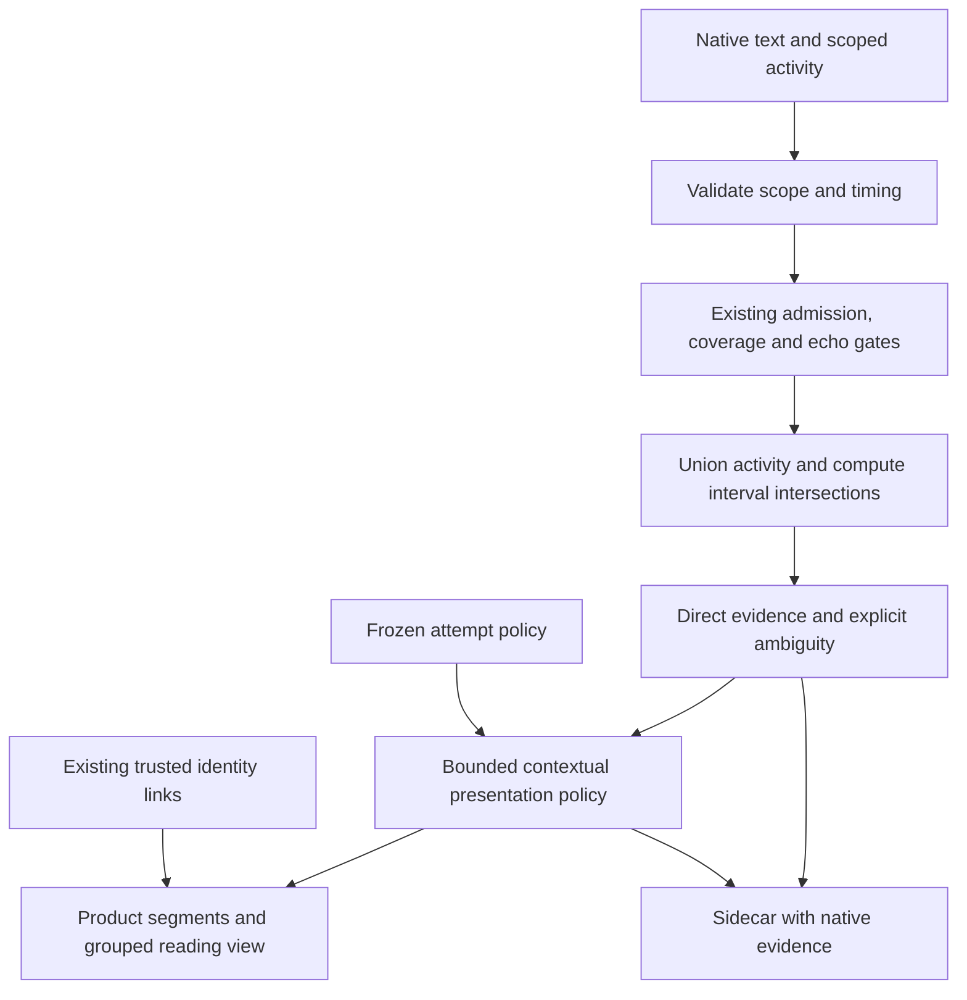

# Generalized meeting speaker attribution

Attribution joins native ASR text intervals to anonymous diarizer activity. It does not separate
mixed audio, recognize a person's name, or create word timestamps that an ASR provider did not
return. These distinctions are necessary for short interruptions, uncertain turn boundaries and
recovery after a restart.

The current reading contract assigns every admitted, readable speech fragment a participant
when speaker labels are enabled. Acoustic uncertainty remains evidence, not an empty participant
caption. A brief unsupported slot must not create another person just to fill a caption.
Punctuation-only artifacts do not open participants; their original timed evidence is retained.
This contract applies to live publication, Stop and saved-session reading.

## Contracts and extension point

The shared attribution stage consumes `MeetingFinalTextUnit`, `MeetingBackendSpeakerActivity`
and scoped `MeetingBackendSpeakerToken` values. It belongs beside the existing canonical
assembler. Engine adapters retain responsibility for probability decoding, model cadence,
artifact selection, ASR timing generation and embedding extraction. No model switch belongs in
the common coordinator.

Keep three kinds of information separate:

| Information | Meaning | Permitted use |
| --- | --- | --- |
| Native source evidence | Anonymous track, epoch, generation and slot; actual activity intervals; native ASR precision | Acoustic support and direct context anchors |
| Identity evidence | Existing explicit identity links, confirmed owner evidence, or a separately marked tentative proposal | Resolve an admitted source to a product identity without changing its source token |
| Attribution decision | A direct selection, contextual inference, foreground presentation choice or abstention | Display and text ownership, with the rule and supporting unit IDs retained |

A relative embedding score is not a calibrated person-identification probability. A tentative
identity proposal cannot become an acoustic anchor or index another slot's activity. Display
names, language, model names and fixture-specific counts never participate in attribution.



## Decision rules

All time intervals are half-open seconds in their declared analysis domain. Duplicate and
fragmented intervals for one source are unioned before measuring support. True simultaneity is
the intersection of actual activity from every participating source. Two voices occurring
sequentially inside a coarse ASR interval do not establish simultaneous speech.

Acoustic support duration, ASR envelope duration and presentation ownership are distinct.
Extending only a silent ASR tail must not change acoustic membership or manufacture confidence.
A brief interrupter who owns a mixed text fragment contributes only its actual voice activity
to speaker admission, not the whole fragment's duration or all its words.

Context is local to a track, epoch and generation. Quarantine, excluded capture, uncertain timing,
echo and gaps remain barriers. Interleaving another track cannot change a same-track decision.
Overlapping text units cannot act as sequential neighbors. Inferred decisions never become
direct anchors for later decisions.

The user-selected reading policy permits these bounded inferences:

- A short unresolved run between direct A and A may inherit A.
- A short unresolved run between direct A and B may inherit incoming B, provided actual evidence
  does not contradict it. A real continuing tail from A takes precedence over blindly choosing B.
- If independent A anchors enclose a bounded mixed bout, the readable turn continues as A,
  including a brief B interruption and adjacent unresolved words. This final continuation rule
  takes precedence over the earlier per-word interruption selection. It does not claim which
  person's words an ASR model extracted from the mixture. An unknown-only run or an ordinary
  clean B reply cannot activate this rule. The nearest preceding independent anchor owns the
  bout; an older A cannot cross a newer B anchor to claim B's interruption.
- When that continuation cannot be established, the earlier interruption stage may select B
  for an indivisible mixed word only with its own per-word acoustic support. A few milliseconds
  at a neighboring word's edge cannot take the whole word. Otherwise uncertainty is retained.

Independent anchors include the native sole-source assignment and policy-admitted acoustic
selection such as residual suppression or dominance. Contextual neighbor and continuation
inferences cannot become anchors for later inferences. The attempt freezes whether independent
acoustic selection is admitted; missing flags in older attempts retain their former behavior.

These are presentation heuristics, not separated ASR of the interrupting voice. Their duration,
gap and residual tolerances are named, versioned policy parameters. They are not universal facts
about human speech. Missing support, ambiguous roles, three or more simultaneous sources,
conflicting evidence and utterances without word timing retain explicit acoustic uncertainty.
They still receive a reading participant through the completion operation below. Native text,
IDs and times remain unchanged.

The policy is immutable for an attempt and participates in its configuration fingerprint.
Resumed and uninterrupted processing of the same finalized evidence must use the same policy.
Unsupported policy versions or incompatible checkpoints must fail explicitly.
Policy version 2 adds this per-word interruption eligibility. Its fingerprint differs from
version 1, and decoding a version 1 attempt policy fails before checkpoint adoption rather than
replaying old decisions with different ownership semantics. The pipeline and backend formats
are unchanged; the frozen configuration already includes and validates the attribution policy.

## Complete reading ownership

`MeetingReadingSpeakerResolver` owns the shared completion operation. The additive
`enableCompleteReadingAssignment` flag is frozen in the attempt fingerprint; missing or false
keeps the former policy when replaying older attempts. The ordinary default enables it.

1. Preserve independently assigned participants and explicit participant corrections, custom
   names and confirmed owner choices. Existing native continuation/interruption rules run first.
2. When an unresolved mixed native unit has a strictly leading duration of actual speaker
   activity, select that foreground participant for reading, including indivisible utterances.
   Preserve native ambiguity. This `foregroundDominance` rule cannot become an acoustic anchor
   or train identity; unsafe epochs and coverage barriers retain their diagnostic abstention.
3. For remaining unresolved text, compare independently assigned intervals in a 15-second
   surrounding window. Union intervals before counting, so duplicate/fragmented timestamps
   cannot inflate support. Prefer the continuing left participant on equal support. Word/ASR
   envelope support is a contextual heuristic, distinct from actual diarizer activity.
4. If local evidence cannot select anyone, reuse an already admitted participant from the same
   source, then an existing reading identity. A reset alone is not evidence of another person.
   This fallback carries `readingParticipantContext` with no selected acoustic token and never
   creates a native identity link across epochs or privacy barriers. Only when no usable person
   exists is one stable reading participant created for that source, reused across pauses and
   chunks. Explicit names/owner choices are preserved when later evidence arrives.

Excluded speech never enters this operation. Echo, manual/text edits, invalid timing, incomplete
rows and explicit gaps isolate contextual evidence. Tracks and observed epoch/generation
boundaries stay separate; tokenless words at a reset use the incoming scope. A source-roster
fallback is presentation only and cannot sponsor subsequent acoustic/contextual anchors.
The interval index queries all nearby participants, including a dominant speaker behind brief
intervening turns. Prefix sums over unioned intervals bound per-candidate support queries.

The protected tail retains and delays commitment for the complete 15-second reading horizon.
Stop reconciles the full admitted transcript, including both tracks of an online meeting, while
retaining each source scope and coverage barrier. Resource limits, atomic cancellation and
manual revision protection remain enforced by their existing owners.

Saved-session reading uses this same completion operation without rewriting original members,
native evidence, frozen policies or audio. Existing specific paragraph continuation rules remain
before completion. Captions, correction/playback member selection, summaries and portable export
consume the resolved reading owner. Fallback-only archives retain their durable participant ID
on reopen, and portable export includes any projected identity referenced by its turns.

The prior contract permitted blanks outside a 3.5-second run and 0.8-second neighbor gap. Stable
speaker opening then prevented those blanks from becoming extra provisional people. Those two
local rules did not satisfy total reading ownership, and tests explicitly expected unnamed
fragments. Keep their frozen replay tests distinct from current-default coverage tests.

## Verification and quality claims

Structural correctness and acoustic accuracy have different acceptance criteria.

| Layer | Required checks |
| --- | --- |
| Evidence preservation | Original text, IDs, precision and timestamps; exact candidate support; no source-to-identity namespace substitution |
| Determinism | Interval fragmentation and duplication, input ordering, slot renaming, time translation, transport chunking |
| Boundaries | Track, epoch and generation isolation; gaps; nested words; exact touching endpoints; invalid numeric geometry; no inferred-anchor cascade |
| Policy | Unknown runs, continuing tails, interruptions, sequential speech, three voices, absent background, contradictory or missing evidence |
| Integration | Admission and echo precedence; old saved sessions; manual corrections; redaction; exporter consistency; frozen policy and recovery |
| Scale | 10-minute, 1-hour and 8-hour synthetic timelines; many sequential source labels; dense overlap and long nested envelopes; cancellation |

Measure indexed interval-query operations and scratch memory separately from required output
storage. A fixed-density benchmark alone can hide a quadratic scan over all historical voices.

To assess recognition quality, use independently human-annotated recordings. Keep complete
recordings and their derived windows in the same split. Claims about unseen speakers also
require participant-disjoint splits. Enrollment and identification require separate sessions
and unknown-person probes.

First evaluate policy with fixed reference text, timing and activity. Then evaluate the real
pipeline. Report acoustic overlap-inclusive DER, overlap detection, identity false merges and
splits, wrong confident word assignments, assignment coverage, abstention and ASR omissions
separately. Accuracy on accepted words alone can improve simply by refusing difficult words.
Use session-level uncertainty estimates rather than treating thousands of correlated words from
one meeting as independent observations.

The five-minute private comparison is a diagnostic fixture. Its Fathom labels are automatic,
several examples have user feedback, and some original candidate identities and capture
provenance were not exported. Replaying newer activity against those words does not establish
end-to-end production accuracy, generalization to other recordings, or iPad memory consumption.
Synthetic acceptance tests establish defined behavior under their inputs. They cannot prove
the best possible diarization for every audio recording.

## Opt-in hour replay on a physical device

The existing `MobileMeetingEndToEndTests/testCombinedRussianMeetingPrivacySpeakersAndFootprint`
can admit a long fixture with all three gates enabled:

```text
PICHI_COMBINED_MEETING_E2E=1
PICHI_COMBINED_MEETING_PRIVATE_EVALUATION=1
PICHI_COMBINED_MEETING_LONG_EVALUATION=1
PICHI_COMBINED_MEETING_REPETITIONS=1
```

This test-only mode accepts 10 through 3900 seconds of mono 16 kHz audio, at most
128 MiB on disk. The ordinary test retains its 600-second, 64 MiB limits. Long
mode requires private evaluation and a single repetition. Reference limits remain
512 turns, 8 speakers and 128 KiB in private mode; coalesce adjacent identical
reference turns before staging an authorized long fixture. Reference provenance
remains explicit. Weak automatic labels are not a gold reference.

The test reads and delivers at most 1600 PCM frames at a time, paced to real time.
It uses the existing service composition and strict memory-only audio mode. This
measures inference and post-stop behavior, not microphone capture, background
execution, audio saving, interruption recovery or battery energy. The external
runner must set a deadline that covers both the capture and post-stop processing.

Long mode samples footprint and thermal state every second into a bounded 12000-row
buffer. Ordinary runs retain 250 ms and 10000 rows. Reports record the configured
period, observed largest gap, missed intervals, missing counters and omitted rows.
A completed run asserts that no samples were omitted. The long sampler can cover
three hours including post-stop work without exhausting its row capacity.

Every 60 seconds, including during post-stop processing, the long mode writes a
fixed JSON progress schema directly to XCTest stdout. Forced records also mark
post-stop begin and end. These records contain only phase, elapsed time, delivered
frame count, protected text counts, footprint and thermal state. The host must retain
stdout because an operating-system kill cannot execute a catch block or attach final
results. This progress output contains no transcript, speaker identity or audio.

Protected evaluation attachments remain full, post-privacy evidence without original
text, embeddings or contact identities. The ordinary cap stays 16 MiB; the explicit
long mode permits 64 MiB. Existing 100000-segment, 512-speaker and 4194304 UTF-16 text
limits remain unchanged. Exceeding a cap fails explicitly instead of silently
truncating evidence. Keep private fixtures, stdout, attachments and extracted reports
in ignored storage. This test does not change any production provider or policy.

The long mode skips the legacy on-device segment-time agreement scan. It reports
`attributionAgreement: null`, availability false and an explicit reason; native word
evidence remains available for offline scoring. Ordinary non-overlap fixtures keep
the existing numeric metric and quality assertions. Resource sampling ends after
inference and cleanup, before protected JSON serialization and attachment allocation;
the metadata records this scope explicitly.

## Reading old archives and complete speaker turns

The readable paragraph projection is separate from canonical timed evidence. A direct
word and a neighboring estimated word from the same foreground speaker belong to the
same paragraph. Per-word rule names, overlap and suppressed candidate lists remain available
in JSON and correction rows, but do not create extra speaker headers for that same foreground
participant. Visible labels use the participant's name without an estimated prefix. An unresolved
candidate set receives a reading participant through the shared completion operation; uncertainty
remains on the original correction/JSON members. Changes in foreground identity, source, status
or completeness remain paragraph boundaries.

Completed pre-canonical attempts with pipeline versions below 14 can contain short
unknown fragments without native precision, timing or speaker activity. They cannot
be replayed as current canonical word evidence. Their reading-only compatibility
projection can bridge an untouched unknown run between the same known speaker on the
same source. It reuses the canonical neighbor timing admission and default bounds.
The completed archive must have no known coverage gaps, failed attempt, incomplete
transcript or canonical sidecar. Every bridge and both anchors must remain final,
complete, unedited and without overlap or native/canonical attribution metadata.
The members must also be contiguous in the original archive, including hidden echo
rows, so filtering cannot remove a barrier. A full-source temporal overlap sweep also
blocks nested/enclosing envelopes and start ties, including an earlier hidden row;
half-open end touches remain admissible. Invalid source timing disables compatibility
bridging. Different-speaker gaps remain unknown.

This compatibility projection retains its estimated ownership in the evidence while displaying
the ordinary participant name. It does not assign a native speaker, fabricate word times,
change the stored pipeline/policy, rewrite an archive, or alter JSON evidence. The
mobile paragraph editor still opens the original independently revision-checked
members. Correcting a formerly unknown member makes it a compatibility barrier;
Undo restores its original eligibility through the existing correction operation.
Current attempts continue to use only their canonical attribution decisions.

Manual speaker aliases are user metadata. Privacy filtering applies to captured speech text and
speech-derived identity evidence, not explicit names entered by the user. Text edits have a
durable `isUserTextEdited` flag; such edits remain a contextual inference barrier after saving
and reloading, and Undo restores their prior eligibility.
