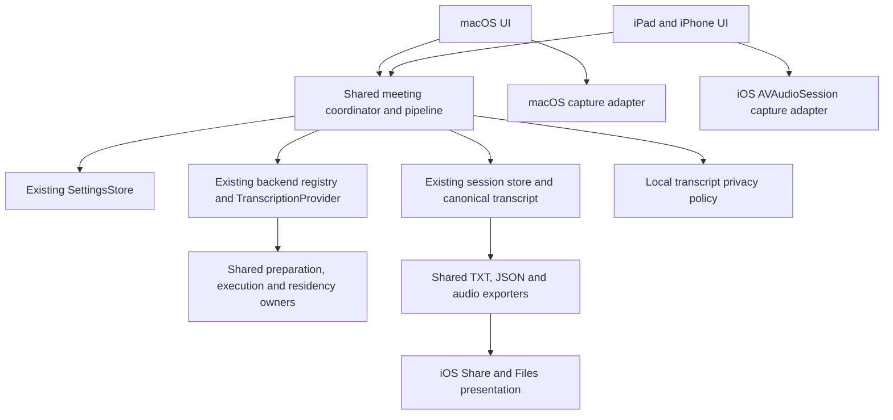

# Мобильные офлайн-встречи

Универсальная цель `PichiVoiceMobile` в существующем Xcode-проекте предназначена для iPad и iPhone. Минимальная версия в генераторе проекта и общей ONNX-пакетной зависимости задана как iOS 17.0. Основной сценарий сохраняет режим исходного приложения `In-room`: микрофон, текст во время встречи, остановка, определение участников, итоговая расшифровка и история. AI enhancement и итоги встречи исключены по решению пользователя.

Минимум понижен для проверки подключённого iPad `iPad7,1` с iPadOS 17.7.10. Три зарегистрированные модели MVP сохраняют прежние inference adapters: pinned FluidAudio поддерживает iOS 17, TranscribeCpp iOS 16, ONNX Runtime iOS 15. Cohere не входит в мобильный каталог; его provider требует iOS 18, shared metadata исключает его на iOS 17, а существующая meeting factory отклоняет незарегистрированный provider. Понижение минимума не подтверждает запись, фоновые режимы или скорость на этом устройстве. Ниже сохранены результаты прежней сборки с deployment iOS 18; совместимость и аппаратная проверка iPadOS 17 выполняются отдельно.

## Соответствие оригинальному приложению

Проверены категории `AppNavigationState`, отдельные параметры `SettingsSearch`, `SettingsView`, `MeetingRecordingSettingsSheet`, исходный экран `MeetingTranscriptionView`, каталог моделей, операции хранилища и экспорта. Мобильная версия является подмножеством этих функций.

| Раздел Mac | Решение для MVP | Общая реализация |
| --- | --- | --- |
| Pichi Meet, главная встреча | Текущая встреча без встроенного списка прошлых встреч | `MeetingSessionCoordinator`, прежние состояния и тексты |
| Запись в одной комнате | Только микрофон, явное начало и остановка | Платформенный `IOSMeetingCaptureEngine`, общие capture contracts |
| Текст в реальном времени | Готовые фразы и изменяемый предварительный текст | Исходные composer, renderer и live admission |
| Анимация звука | Та же анимация диктовки, реальные уровни микрофона | `AudioWaveformBars`, исходная математика пружины |
| Обработка после остановки | Сохранение, участники, распознавание, завершение | `MeetingProcessingPipeline`, backend registry, canonical assembler |
| Участники | Общая диаризация и сопоставление голосов между окнами | Nemotron, WeSpeaker, исходный matcher |
| Расшифровка | Время, участник, текст, копирование, исправление и аудио | Общие модели, player, операции исправления и Undo |
| История | Отдельный раздел: просмотр, поиск, статус, переименование, удаление | `MeetingHistorySnapshot`, `MeetingSessionStore` |
| Повторное распознавание | Доступно только при сохранившемся пригодном аудио | Исходная проверка `hasRetryableAudio`, общий coordinator |
| Экспорт | TXT, JSON и сохранённое аудио через Share и Files | Исходные transcript/audio exporters, мобильная presentation boundary |
| Распознавание речи | Три локальных модели и исходные операции жизненного цикла | `ASRService`, `TranscriptionProvider`, preparation/residency owners |
| Обзор и статистика | За пределами офлайн MVP | Не создаются новые сущности |
| AI Providers, стили обработки, итоги встречи | Исключены по запросу | Мобильного workflow нет |
| Личный словарь | Пользовательский UI отложен; качество названий препаратов требует отдельного корпуса встреч | Существующие словарные контракты остаются общими |
| Распознавание файлов | Не требуется для текущего сценария | Отложено |
| Режим команд, редактирование внешних полей и вставка текста | Desktop-функции | Не переносятся |
| История изменений и feedback | Не блокируют MVP | Отложены |
| Назначение фразы участнику и объединение участников | Следующая итерация UI | Общие операции уже существуют |
| Постоянный профиль «Ваш голос» и геолокация | Отдельные будущие возможности | В MVP нет новых профилей или сущностей мест |

Микрофонная метка во время записи обозначает источник. Она не доказывает личность пользователя. Определение участников сохраняет прежний flow после записи. Постоянный профиль голоса требует отдельного согласованного дизайна.

## Настройки

| Исходные настройки Mac | Мобильное подмножество |
| --- | --- |
| General: язык и оформление | «Общие»: язык интерфейса RU/EN и системная, светлая или тёмная тема |
| General: login item, Dock, updater, beta, rollback | Desktop-параметры не переносятся |
| Dictation: разрешения | Разрешение микрофона, реальная ошибка и переход в системные Settings |
| Dictation: activation, clipboard, insertion, silence/media, streak, analytics | Не нужны сценарию офлайн-встреч |
| Dictation Formatting: регистр, точки, символы, интервалы, fillers | Дополнительная обработка текста встречи не добавляется |
| Shortcuts | Не переносятся |
| Notifications | Ошибки записи и маршрута показываются в существующем flow; отдельный раздел не нужен |
| Audio: входы и приоритеты | «Запись»: доступные системные микрофоны и прежняя сохранённая настройка входа |
| Overlay: стили, размер, позиция, sensitivity, preview | Встроенный экран записи с общей waveform и расшифровкой |
| Data & Diagnostics: backup, settings import, ZIP, budget, logs | Срок хранения в «Приватности», экспорт конкретной встречи в «Ещё» |
| Experimental | Не переносятся |
| Voice Engine: каталог, фильтры, сортировка, download/import/activate/delete | «Распознавание речи»: три модели, установка, активация, удаление, поддерживаемый импорт и отмена. Фильтры каталога не нужны |
| Meet -> Recording: тип встречи, источники, язык, участники | «Запись»: `In-room`, микрофон, политика языка выбранной модели, участники и готовность их зависимостей |
| Meet -> Automation & storage: retention | «Приватность»: исходные значения срока хранения, по умолчанию 7 дней |
| Meet -> Automation & storage: autodetect, browser detection | Не переносятся |
| Meet -> Integrations | Не переносятся |
| Требования пользователя к хранению | «Приватность»: аудио включено по умолчанию, строгий режим без файлов при выключении, локальная PII по отдельному переключателю |

Модели и приватность находятся в настройках приложения. Язык разговора не запрашивается и не показывается на экране старта. Для смешанной русской и английской речи у мультиязычной модели используется `auto`. Явный язык в настройках остаётся явным выбором пользователя.

## Модели и ограничения

| Модель | Назначение | Мобильный runtime |
| --- | --- | --- |
| Whisper Tiny multilingual Q8 GGUF | Минимальная совместимая мультиязычная модель; RU и EN | Существующий TranscribeCpp, CPU на iOS |
| GigaAM v3 INT8 | Русская речь | Существующий ONNX Runtime; английский не заявляется |
| Parakeet TDT 0.6B v3 | 25 языков, включая русский и английский | Существующий FluidAudio/CoreML, CPU на iOS |
| Nemotron + WeSpeaker | Разделение участников и сопоставление между окнами | Общая независимая диаризация, не четвёртая ASR-модель |
| Tiny Russian NER INT8 | Русские имена и структурированные чувствительные данные | Локальная текстовая приватность, не AI enhancement |

Whisper Tiny даёт сегментные границы и заметные ошибки смешанной речи. На переходе двух голосов метка может остаться неопределённой; короткие хвосты не получают выдуманного участника. Parakeet на проверенных синтетических примерах дал более точный текст и временные границы. Это ограниченные пробы, а не оценка всех реальных встреч.

Whisper `.en` не используется. Уменьшенная Q5_1 `.bin` имеет другой формат GGML и не подходит текущему GGUF loader. Наличие мультиязычных weights не гарантирует правильность смешанной речи в одном окне. Проверки должны исполнять точные артефакты, выбранные для мобильного приложения.

Предварительный admission для buffered live/strict PCM: Whisper от 2 GiB физической памяти, GigaAM и Parakeet от 4 GiB. Эти пределы являются инженерными ограничениями допуска, не измерением быстродействия. Симулятор использует память и процессор Mac; модель iPad в его названии не эмулирует A13 или 3 GB RAM. Для iPad 9 и других старых устройств нельзя обещать все три модели в streaming без физических измерений.

## Общий код и платформенные границы



Новые платформенные файлы решают конкретные отличия: iOS audio session, UIKit Share, touch navigation и UIKit theme bridge. Общие классы не получают отдельный constructor argument или switch для каждой ASR-модели. Backend descriptor и inference adapter владеют engine-specific поведением и артефактами.

## Первая запись и модель

Свежая установка использует существующую политику packaged brand: русский first-run язык выбирает первый поддерживаемый маршрут GigaAM. Этот выбор сохраняется в прежнем ключе speech model. Явно выбранные Whisper Tiny или Parakeet v3 и прежние установки сохраняют выбор; язык интерфейса не меняет модель. GigaAM остаётся русскоязычным, для английской и смешанной речи выбираются мультиязычные модели в настройках.

Перед первой записью выбранная модель автоматически устанавливается и подготавливается через тот же `ASRService` model operation, который используют настройки. Выбор и provider фиксируются до ожидания транспорта. Установка и проверка завершаются до разрешений, capture admission и фиксации ASR artifact fingerprint. Ошибка транспорта или отмена не запускают микрофон; отмена дожидается освобождения ресурсов. Если выбор меняется во время подготовки или permission prompt, текущий start отменяется, а новый выбор остаётся сохранённым. AI enhancement не добавляется.

## Хранение и приватность

- Включённое аудио использует исходный chunk writer, историю и retention.
- Выключенное аудио использует ограниченную очередь PCM в памяти и сохраняет только обработанные текстовые checkpoints. Переполнение или ошибка checkpoint останавливают запись явно. Скрытого перехода к файлам и молчаливого пропуска звука нет.
- Для строгого режима восстановление после аварии ограничено уже сохранённым текстом. Повторно распознать утраченное аудио невозможно.
- Настройки и redactor фиксируются для конкретной встречи. Последующие изменения относятся к новым встречам. Retention по прежнему применяется к старому аудио.
- В строгом режиме PII удерживает целые последние сегменты, покрывающие минимум 32 текстовых токена, до следующего контекста. Общий предел хвоста: 16,384 UTF-16 и 128 сегментов; отдельный контекст: 1,024 UTF-16. Остановка выпускает отфильтрованный хвост один раз. Авария может потерять ещё не сохранённый хвост.
- PII выключена по умолчанию. При включении локальная модель должна быть готова; ошибка не допускает сохранения исходного текста вместо обезличенного.
- Фильтруются live publication, canonical evidence, word lexemes, обычные сегменты, исправления и экспортные копии. Экспорт старой встречи не переписывает её исходную историю.
- Сохранённое аудио содержит исходные голоса и чувствительную информацию. Обезличивание текста не изменяет аудио.
- iOS хранилище использует `completeUntilFirstUserAuthentication`, private permissions и исключение каталогов встреч из backup. Это позволяет продолжать запись после блокировки; фактические атрибуты файлов проверяются отдельно.
- Временные Share-копии принадлежат отдельной мобильной export boundary и удаляются после завершения. Скопированные пользователем файлы вне приложения не подчиняются retention.

Выбрана публичная INT8 Tiny NER-модель, соответствующая fallback исходного Pichi Transcribe. Для lowercase ASR перенесены словарь имён, person context и морфология. Синтетический probe из 8 русских полных имён исправлен с 0/8 до 8/8 exact spans без новых false positives на 10 отрицательных примерах препаратов, доз и обычных слов. Это малый regression probe, не оценка production recall. Два проверенных английских имени пропущены. Адресный fallback требует русских маркеров улицы и дома; свободные и английские адреса не покрыты. Неразмеченные числовые последовательности могут быть неоднозначны. Полного автоматического обезличивания или статуса «лучшая модель» без сравнительного корпуса не заявляем.

## Проверка

Обязательные уровни: portable checks, общий macOS regression, сборка реального iOS target, hosted integration tests, native UI tests в обеих ориентациях на iPad и iPhone, затем реальное устройство. ASR tests должны исполнять публичные weights; fake provider tests доказывают contracts, но не качество речи.

Проверенная производственная ревизия: `ef629c5d808fa88a30b8582f144e884cd10f81cc`, ветка `codex/ipad-voice-mvp`. Сборки и пакеты зафиксированы до запуска тестов; после начала проверки исполняемые копии не перестраивались.

| Проверка | Результат | Что подтверждено |
| --- | --- | --- |
| Portable checks | Пройдены, 2799 локализованных ключей и 17 plural entries | Конфигурация, скрипты, полнота RU/EN и форматные аргументы |
| Universal iOS build-for-testing | Пройдена, arm64 и x86_64 simulator, deployment iOS 18 | Настоящая мобильная цель и все hosted/UI test sources |
| iPad Simulator, iOS 27 | 27 тестов: 4 UI и 23 hosted, одна аппаратная проверка пропущена, ошибок нет | История, настройки, ориентация, русский UI, glyphs, реальные ASR/NER, диаризация, строгий PCM, storage и export |
| iPhone Simulator, iOS 27 | 27 тестов: 4 UI и 23 hosted, одна аппаратная проверка пропущена, ошибок нет | Те же настоящие ASR/NER, PCM, speaker/store/export checks и нативная компоновка телефона |
| macOS Debug build-for-testing и полный regression | 2589 тестов, 65 skip, ошибок нет | Объединённые backend/provider/coordinator, ресурсы, recovery, приватность и общий UI projection |
| Отдельная PII suite | 16 vendor tests, resource и context harness с настоящей ONNX NER, ошибок нет | Карта и имя между окнами, DOB/address между словами, соседние суммы/дозы, budgets, cancellation, IDs/times и отсутствие raw PII в checkpoints/exports |
| Независимый automated review | Существенных P0-P2 замечаний не осталось | Полный diff базовой ревизии, последующие исправления PII, factory/PCM admission, владение, отмена, общая архитектура и финальный display projection |

Полный macOS набор сохраняет upstream исключение нестабильного Whisper fixture. Остальные skips отражают отсутствующие отдельные opt-in/hardware fixtures; они не считаются пройденными проверками. Аппаратный атрибут iOS Data Protection симулятор не воспроизводит, поэтому ровно одна соответствующая hosted проверка пропущена. Функциональные запись CAF, чтение/воспроизведение, export, private permissions и backup exclusion проверены отдельно.

E2E использует настоящее мобильное `AppServices`, установку модели, coordinator, pipeline, Whisper Tiny, store и экспорт. Только источник микрофона заменён контролируемым синтетическим PCM. Проверки всех трёх моделей используют настоящие публичные артефакты: GigaAM для RU; Whisper Tiny и Parakeet v3 для RU, EN и смешанной речи. Проверены buffered live partials, финальный хвост, strict PCM и Nemotron/WeSpeaker на двух синтетических голосах, включая стандартные 8-секундные окна.

Нативные снимки сохранялись после UI-шагов. Проверены светлая и тёмная темы, RU/EN layout и прямые glyphs для 66 русских букв, включая Ё/ё. Исправлено перекрытие Start и storage caption плавающей панелью в landscape iPhone. Готовая расшифровка использует общую с Mac проекцию меток участников и lazy rows, сохраняя исходные IDs, время и данные.

В ignored `.build/mobile` находятся frozen products, `.xcresult`, native attachments, модельные отчёты и review logs. В Git нет весов, аудио, личных словарей или приватного корпуса. Review baseline `2d8bd22a` с последующими проверками `0992a313`, `0d0e23e5` и финального `ef629c5d` покрывает объединённый результат. macOS test copy подписана ad-hoc только для локального теста; упаковочные ссылки CTranscribe исправлены только в frozen copy при сохранении бинарных байтов. Это не проверка разрешений или подписи для распространения.

Фоновую запись рядом с презентацией, блокировку экрана, звонки, Bluetooth, thermal pressure и sustained throughput необходимо повторить на настоящем устройстве. Пользователь выбрал симулятор для текущего этапа и устройство для следующего.

```bash
python3 scripts/dev/update-mobile-project.py
bash scripts/dev/check.sh
bash scripts/dev/mobile.sh build-for-testing
PICHI_MOBILE_DESTINATION='platform=iOS Simulator,id=<device-uuid>' bash scripts/dev/mobile.sh test
```

Source membership мобильной цели хранится в `Sources/Mobile/shared-sources.txt`; generator обновляет только мобильные цели, сохраняя desktop membership.
