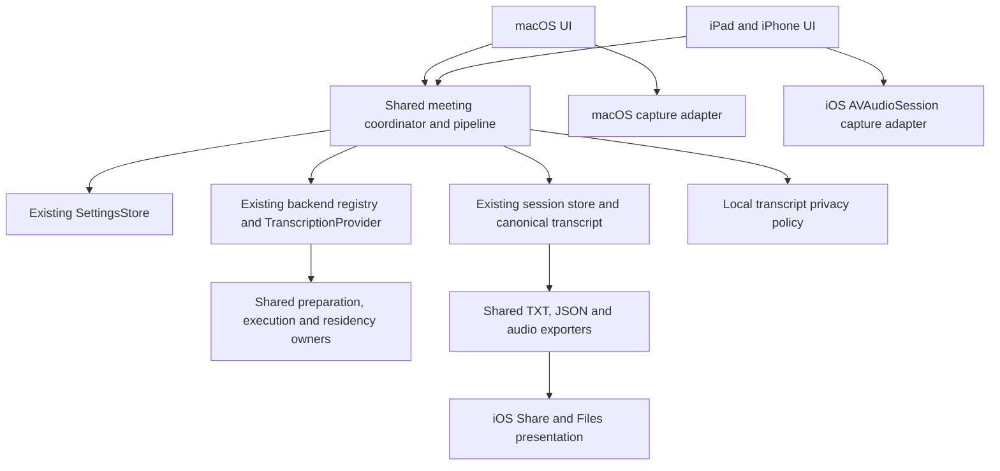

# Мобильные офлайн-встречи

Универсальная цель `PichiVoiceMobile` в существующем Xcode-проекте предназначена для iPad и iPhone. Минимальная версия в генераторе проекта и общей ONNX-пакетной зависимости задана как iOS 17.0. Основной сценарий сохраняет режим исходного приложения `In-room`: микрофон, текст во время встречи, остановка, определение участников, итоговая расшифровка и история. AI enhancement и итоги встречи исключены по решению пользователя.

Минимум понижен для проверки подключённого iPad `iPad7,1` с iPadOS 17.7.10. Три зарегистрированные модели MVP сохраняют прежние inference adapters: pinned FluidAudio поддерживает iOS 17, TranscribeCpp iOS 16, ONNX Runtime iOS 15. Cohere не входит в мобильный каталог; его provider требует iOS 18, shared metadata исключает его на iOS 17, а существующая meeting factory отклоняет незарегистрированный provider. Само понижение минимума не доказывает аппаратную работоспособность. Ниже сохранены результаты прежней сборки с deployment iOS 18 и отдельные последующие проверки настоящего iPadOS 17.

## Соответствие оригинальному приложению

Проверены категории `AppNavigationState`, отдельные параметры `SettingsSearch`, `SettingsView`, `MeetingRecordingSettingsSheet`, исходный экран `MeetingTranscriptionView`, каталог моделей, операции хранилища и экспорта. Мобильная версия является подмножеством этих функций.

| Раздел Mac | Решение для MVP | Общая реализация |
| --- | --- | --- |
| Pichi Meet, главная встреча | Текущая встреча без встроенного списка прошлых встреч | `MeetingSessionCoordinator`, прежние состояния и тексты |
| Запись в одной комнате | Только микрофон, явное начало и остановка | Платформенный `IOSMeetingCaptureEngine`, общие capture contracts |
| Текст в реальном времени | Готовые фразы и изменяемый предварительный текст | Исходные composer, renderer и live admission |
| Анимация звука | Та же анимация диктовки, реальные уровни микрофона | `AudioWaveformBars`, исходная математика пружины |
| Обработка после остановки | Сохранение, участники, распознавание, завершение | `MeetingProcessingPipeline`, backend registry, canonical assembler |
| Участники | Общая диаризация и сопоставление голосов между окнами | Nemotron, WeSpeaker, исходный matcher |
| Расшифровка | Время, участник, текст, копирование, исправление и аудио | Общие модели, player, операции исправления и Undo |
| История | Отдельный раздел: просмотр, поиск, статус, переименование, удаление | `MeetingHistorySnapshot`, `MeetingSessionStore` |
| Повторное распознавание | Доступно только при сохранившемся пригодном аудио | Исходная проверка `hasRetryableAudio`, общий coordinator |
| Экспорт | TXT, JSON и сохранённое аудио через Share и Files | Исходные transcript/audio exporters, мобильная presentation boundary |
| Распознавание речи | Три локальных модели и исходные операции жизненного цикла | `ASRService`, `TranscriptionProvider`, preparation/residency owners |
| Обзор и статистика | За пределами офлайн MVP | Не создаются новые сущности |
| AI Providers, стили обработки, итоги встречи | Исключены по запросу | Мобильного workflow нет |
| Личный словарь | Пользовательский UI отложен; качество названий препаратов требует отдельного корпуса встреч | Существующие словарные контракты остаются общими |
| Распознавание файлов | Не требуется для текущего сценария | Отложено |
| Режим команд, редактирование внешних полей и вставка текста | Desktop-функции | Не переносятся |
| История изменений и feedback | Не блокируют MVP | Отложены |
| Назначение фразы участнику и объединение участников | Следующая итерация UI | Общие операции уже существуют |
| Постоянный профиль «Ваш голос» и геолокация | Отдельные будущие возможности | В MVP нет новых профилей или сущностей мест |

Микрофонная метка во время записи обозначает источник. Она не доказывает личность пользователя. Определение участников сохраняет прежний flow после записи. Постоянный профиль голоса требует отдельного согласованного дизайна.

## Настройки

| Исходные настройки Mac | Мобильное подмножество |
| --- | --- |
| General: язык и оформление | «Общие»: язык интерфейса RU/EN и системная, светлая или тёмная тема |
| General: login item, Dock, updater, beta, rollback | Desktop-параметры не переносятся |
| Dictation: разрешения | Разрешение микрофона, реальная ошибка и переход в системные Settings |
| Dictation: activation, clipboard, insertion, silence/media, streak, analytics | Не нужны сценарию офлайн-встреч |
| Dictation Formatting: регистр, точки, символы, интервалы, fillers | Дополнительная обработка текста встречи не добавляется |
| Shortcuts | Не переносятся |
| Notifications | Ошибки записи и маршрута показываются в существующем flow; отдельный раздел не нужен |
| Audio: входы и приоритеты | «Запись»: доступные системные микрофоны и прежняя сохранённая настройка входа |
| Overlay: стили, размер, позиция, sensitivity, preview | Встроенный экран записи с общей waveform и расшифровкой |
| Data & Diagnostics: backup, settings import, ZIP, budget, logs | Срок хранения в «Приватности», экспорт конкретной встречи в «Ещё» |
| Experimental | Не переносятся |
| Voice Engine: каталог, фильтры, сортировка, download/import/activate/delete | «Распознавание речи»: три модели, установка, активация, удаление, поддерживаемый импорт и отмена. Фильтры каталога не нужны |
| Meet -> Recording: тип встречи, источники, язык, участники | «Запись»: `In-room`, микрофон, политика языка выбранной модели, участники и готовность их зависимостей |
| Meet -> Automation & storage: retention | «Приватность»: исходные значения срока хранения, по умолчанию 7 дней |
| Meet -> Automation & storage: autodetect, browser detection | Не переносятся |
| Meet -> Integrations | Не переносятся |
| Требования пользователя к хранению | «Приватность»: аудио включено по умолчанию, строгий режим без файлов при выключении, локальная PII по отдельному переключателю |

Модели и приватность находятся в настройках приложения. Язык разговора не запрашивается и не показывается на экране старта. Для смешанной русской и английской речи у мультиязычной модели используется `auto`. Явный язык в настройках остаётся явным выбором пользователя.

## Модели и ограничения

| Модель | Назначение | Мобильный runtime |
| --- | --- | --- |
| Whisper Tiny multilingual Q8 GGUF | Минимальная совместимая мультиязычная модель; RU и EN | Существующий TranscribeCpp, CPU на iOS |
| GigaAM v3 INT8 | Русская речь | Существующий ONNX Runtime; английский не заявляется |
| Parakeet TDT 0.6B v3 | 25 языков, включая русский и английский | Существующий FluidAudio/CoreML, CPU на iOS |
| Nemotron + WeSpeaker | Разделение участников и сопоставление между окнами | Общая независимая диаризация, не четвёртая ASR-модель |
| Tiny Russian NER INT8 | Русские имена и структурированные чувствительные данные | Локальная текстовая приватность, не AI enhancement |

Whisper Tiny даёт сегментные границы и заметные ошибки смешанной речи. На переходе двух голосов метка может остаться неопределённой; короткие хвосты не получают выдуманного участника. Parakeet на проверенных синтетических примерах дал более точный текст и временные границы. Это ограниченные пробы, а не оценка всех реальных встреч.

Whisper `.en` не используется. Уменьшенная Q5_1 `.bin` имеет другой формат GGML и не подходит текущему GGUF loader. Наличие мультиязычных weights не гарантирует правильность смешанной речи в одном окне. Проверки должны исполнять точные артефакты, выбранные для мобильного приложения.

Предварительный admission для buffered live/strict PCM: Whisper от 2 GiB физической памяти, GigaAM от 4 000 000 000 байт, Parakeet от 4 GiB. Эти пределы являются инженерными ограничениями допуска, не измерением быстродействия. Симулятор использует память и процессор Mac; модель iPad в его названии не эмулирует A13 или 3 GB RAM. Для iPad 9 и других старых устройств нельзя обещать все три модели в streaming без физических измерений.

## Общий код и платформенные границы



Новые платформенные файлы решают конкретные отличия: iOS audio session, UIKit Share, touch navigation и UIKit theme bridge. Общие классы не получают отдельный constructor argument или switch для каждой ASR-модели. Backend descriptor и inference adapter владеют engine-specific поведением и артефактами.

## Live Activity во время записи

На iPhone во время записи Lock Screen и Dynamic Island показывают знак продукта, статус `Meeting recording in progress` («Идёт запись встречи»), тип встречи и время записи. Время считает сама система через `Text(timerInterval:)`. Push и сеть не используются.

- `MobileRecordingActivityOwner` в `Sources/Mobile/MobileRecordingActivity.swift` единственный вызывает ActivityKit. `AppServices.shared` передаёт ему `state` и `activeSession` существующего `MeetingSessionCoordinator` и владеет conceal/restore границей приватного профиля; coordinator и pipeline о Live Activity не знают. Дополнительные compositions в тестах activity не создают.
- Чистый `MobileRecordingActivityPlan` запускает одну activity на сессию только в `recording` и `recordingDegraded`. Остановка, обработка, прерывание, ошибка и сброс сразу завершают её с немедленным скрытием. Отказ системы для той же сессии не повторяется.
- Activity запрашивается с `staleDate` через 5 минут. Пока идёт запись, приложение работает в фоне в audio mode и каждые 2 минуты переносит `staleDate` вперёд; обновление останавливается вместе с activity. Если процесс завершился без остановки (crash, нехватка памяти), система через несколько минут помечает activity устаревшей, и расширение показывает `Meeting recording was interrupted` («Запись встречи прервана») без таймера и без индикатора записи.
- Выход процесса: при `willTerminate` выполняется ограниченная попытка завершить activity, следующий запуск завершает все activities предыдущего процесса. Обычный `AppServices.shutdownForTermination` дожидается той же цепочки ActivityKit cleanup перед завершением остальных сервисов.
- Расширение `PichiVoiceMobileActivity` собирается из `Sources/MobileActivity`. Общий тип `MobileRecordingActivityAttributes` компилируется в приложение через `shared-sources.txt`. Приложение передаёт уже локализованный текст из String Catalog, имя из `AppBrand`, accent для светлой и тёмной темы и дизайн шрифта общих ролей. У расширения нет своего каталога, настроек или brand package; знак берётся из packaged `markAsset`, для импортированного оформления используется символ `waveform`.
- При недоступности ActivityKit или выключенных пользователем Live Activities запись идёт как раньше. Возможность определяется системным API, без исключения всех iPad.
- Генератор проекта создаёт target расширения, встраивает его в приложение, добавляет `NSSupportsLiveActivities` и берёт версии расширения из `Sources/Mobile/Info.plist`. Bundle ID расширения равен `$(PICHI_MOBILE_BUNDLE_IDENTIFIER).activity`. Для собственной подписи менять `PICHI_MOBILE_BUNDLE_IDENTIFIER`, а не `PRODUCT_BUNDLE_IDENTIFIER`: последний из командной строки применяется к обоим targets и ломает проверку встроенного расширения.
- В DEBUG `PICHI_UI_LIVE_ACTIVITY_REVIEW=1` запускает настоящий запрос activity с синтетической сессией без микрофона и модели. `PICHI_UI_LIVE_ACTIVITY_REVIEW_ELAPSED` задаёт прошедшие секунды, `PICHI_UI_LIVE_ACTIVITY_REVIEW_STALE_AFTER` отключает обновления, и показанная activity устаревает через заданное число секунд, как после crash. Уже устаревшую при запросе activity система не показывает.

## Аудио до появления текста

Общий `MeetingLiveBubbleScrollList` показывает фрагменты ожидающего аудио в macOS и iOS. Используются существующие `AudioWaveformBars` из панели диктовки и `FlowLayout` из настроек. Только последние три фрагмента анимируются с частотой до 20 кадров в секунду; остальные сохраняют форму. Системное уменьшение движения отключает анимацию.

Индикатор читает короткие статистики уже принятого PCM без копирования или сохранения аудио. Лёгкий фильтр подавляет тишину, ровный шум и отдельные щелчки, но может ошибаться на сложных звуках. Примерный темп составляет 150 визуальных фрагментов в минуту, общий предел 64. Это оценка активности, а не распознанные слова или определение говорящего. Состояние не сериализуется и не попадает в историю, копирование или экспорт.

Фрагменты заменяются только опубликованным текстом с известным временем покрытия. Обработка раннего аудио не удаляет более поздние блоки. При PII учитываются только полностью одобренные текстовые фрагменты; неизвестное время удерживает индикатор до следующего результата. Прокрутка следует за текстом и аудио, при чтении предыдущих строк приостанавливается и возобновляется у фактического нижнего края или по существующей кнопке перехода к последнему тексту.

Проверка 14 октября 2026 года, исходный commit `deeb661c2533743200b8e778759fd3855a9d22ca`: сборки macOS, iOS Simulator и подписанная iOS Release прошли. Симулятор iPad: 16 PASS, 1 SKIP; iPhone: 10 PASS, 1 SKIP. Пропуск касается механизма прокрутки iOS 17, который отдельно прошёл на физическом iPad вместе с остальными 11 нативными проверками. Проверены светлая и тёмная темы, замена волн текстом, изменение ширины и чтение предыдущего текста. Независимое ревью функциональных изменений завершено на `1539800552db5062eb3038e3e889c26b235bc0c6`; последующий commit добавляет только наблюдения физического теста.

Физический минутный тест строгого режима Tiny с диаризацией и PII подтвердил первый индикатор на первой секунде, предел 64 и обновление защищённого текста на 56-й секунде. Требования по скорости не выполнены: первый текст появился на 44-й секунде, всего два обновления. Тест завершил запись без аудиофайлов, после него установлена и открыта обычная подписанная Release того же исходного commit. Эта проверка не подтверждает быструю транскрибацию или работу в фоне.

Последующее исправление `c9ee9cb1f060d6ba7eaa2e2eb14cc29d27c78011` повышает визуальный порог RMS с 0.0015 до 0.006, требует 120 мс устойчивой активности и сбрасывает накопленный ритм после короткой паузы. После примерно пяти секунд без активности, заработавшей новый фрагмент, старые волны исчезают. Короткие повторяющиеся шумовые всплески не продлевают их жизнь. Это очистка визуальных оценок; PCM, приватность и реальные слова не меняются. Подготовка, проверка файла и освобождение Whisper выполняются через прежний `TranscriptionExecutor` вне MainActor с ожиданием завершения отмены. Для готовых абзацев переиспользована граница `Equatable`, а неизменяемые ресурсы установленного каталога локализации больше не открываются на каждом обновлении звука.

На этой общей ревизии симулятор iPad прошёл 24 проверки, iPhone 15, без ошибок; по одному пропуску относится к механизму прокрутки iOS 17. В iPad проверены реальные артефакты всех трёх моделей: GigaAM на русском, Tiny и Parakeet также на английском и смешанном аудио, исходный buffered engine и строгие PCM-окна без аудиофайлов. Отдельные нативные тесты проверяют прокрутку при блокирующей фоновой операции, отмену с ожиданием завершения, исправления предварительного текста, обе темы и очистку волн. Зарегистрированный `meeting_pending_speech` прогон проверяет реальный scalar PCM tee, пороги, паузы, источники и временное замещение. Независимое ревью общей ревизии завершено без существенных замечаний. Это не доказательство отсутствия зависаний на физическом iPad; новая сборка на устройство не устанавливалась.

Порядок дальнейшей проверки по указанию пользователя: обе симуляторные версии, нативные снимки или видео для его просмотра, затем финальные проверки на iPad/iPhone. Снимки короткого UI-сценария используют тестовый текст и сигнал; реальные модельные проверки выполняются отдельно.

Реальная симуляторная запись затем выявила ложное подавление тихой речи: при пороге 0.006 и непрерывном onset 120 мс волны не появлялись. Точечная корректировка устанавливает 0.0042 и onset 40 мс, сохраняя фильтры шума и очистку после паузы. Добавлены проверки речи с четырёхкратным ослаблением и коротких согласных. Это эвристика визуальной активности, а не универсальный VAD.

## Первая запись и модель

Свежая установка использует существующую политику packaged brand: русский first-run язык выбирает первый поддерживаемый маршрут GigaAM. Этот выбор сохраняется в прежнем ключе speech model. Явно выбранные Whisper Tiny или Parakeet v3 и прежние установки сохраняют выбор; язык интерфейса не меняет модель. GigaAM остаётся русскоязычным, для английской и смешанной речи выбираются мультиязычные модели в настройках.

Перед первой записью выбранная модель автоматически устанавливается и подготавливается через тот же `ASRService` model operation, который используют настройки. Выбор и provider фиксируются до ожидания транспорта. Установка и проверка завершаются до разрешений, capture admission и фиксации ASR artifact fingerprint. Ошибка транспорта или отмена не запускают микрофон; отмена дожидается освобождения ресурсов. Если выбор меняется во время подготовки или permission prompt, текущий start отменяется, а новый выбор остаётся сохранённым. AI enhancement не добавляется.

## Хранение и приватность

- Включённое аудио использует исходный chunk writer, историю и retention.
- Выключенное аудио использует ограниченную очередь PCM в памяти и сохраняет только обработанные текстовые checkpoints. Переполнение или ошибка checkpoint останавливают запись явно. Скрытого перехода к файлам и молчаливого пропуска звука нет.
- Для строгого режима восстановление после аварии ограничено уже сохранённым текстом. Повторно распознать утраченное аудио невозможно.
- Настройки и redactor фиксируются для конкретной встречи. Последующие изменения относятся к новым встречам. Retention по прежнему применяется к старому аудио.
- В строгом режиме PII удерживает целые последние сегменты, покрывающие минимум 32 текстовых токена, до следующего контекста. Общий предел хвоста: 16,384 UTF-16 и 128 сегментов; отдельный контекст: 1,024 UTF-16. Остановка выпускает отфильтрованный хвост один раз. Авария может потерять ещё не сохранённый хвост.
- PII выключена по умолчанию. При включении локальная модель должна быть готова; ошибка не допускает сохранения исходного текста вместо обезличенного.
- Фильтруются live publication, canonical evidence, word lexemes, обычные сегменты, исправления и экспортные копии. Экспорт старой встречи не переписывает её исходную историю.
- Сохранённое аудио содержит исходные голоса и чувствительную информацию. Обезличивание текста не изменяет аудио.
- iOS хранилище использует `completeUntilFirstUserAuthentication`, private permissions и исключение каталогов встреч из backup. Это позволяет продолжать запись после блокировки; фактические атрибуты файлов проверяются отдельно.
- Временные Share-копии принадлежат отдельной мобильной export boundary и удаляются после завершения. Скопированные пользователем файлы вне приложения не подчиняются retention.

Выбрана публичная INT8 Tiny NER-модель, соответствующая fallback исходного Pichi Transcribe. Для lowercase ASR перенесены словарь имён, person context и морфология. Синтетический probe из 8 русских полных имён исправлен с 0/8 до 8/8 exact spans без новых false positives на 10 отрицательных примерах препаратов, доз и обычных слов. Это малый regression probe, не оценка production recall. Два проверенных английских имени пропущены. Адресный fallback требует русских маркеров улицы и дома; свободные и английские адреса не покрыты. Неразмеченные числовые последовательности могут быть неоднозначны. Полного автоматического обезличивания или статуса «лучшая модель» без сравнительного корпуса не заявляем.

## Проверка

Обязательные уровни: portable checks, общий macOS regression, сборка реального iOS target, hosted integration tests, native UI tests в обеих ориентациях на iPad и iPhone, затем реальное устройство. ASR tests должны исполнять публичные weights; fake provider tests доказывают contracts, но не качество речи.

Историческая проверенная ревизия базового MVP: `ef629c5d808fa88a30b8582f144e884cd10f81cc`, ветка `codex/ipad-voice-mvp`. Сборки и пакеты зафиксированы до запуска тестов; после начала проверки исполняемые копии не перестраивались.

| Проверка | Результат | Что подтверждено |
| --- | --- | --- |
| Portable checks | Пройдены, 2799 локализованных ключей и 17 plural entries | Конфигурация, скрипты, полнота RU/EN и форматные аргументы |
| Universal iOS build-for-testing | Пройдена, arm64 и x86_64 simulator, deployment iOS 18 | Настоящая мобильная цель и все hosted/UI test sources |
| iPad Simulator, iOS 27 | 27 тестов: 4 UI и 23 hosted, одна аппаратная проверка пропущена, ошибок нет | История, настройки, ориентация, русский UI, glyphs, реальные ASR/NER, диаризация, строгий PCM, storage и export |
| iPhone Simulator, iOS 27 | 27 тестов: 4 UI и 23 hosted, одна аппаратная проверка пропущена, ошибок нет | Те же настоящие ASR/NER, PCM, speaker/store/export checks и нативная компоновка телефона |
| macOS Debug build-for-testing и полный regression | 2589 тестов, 65 skip, ошибок нет | Объединённые backend/provider/coordinator, ресурсы, recovery, приватность и общий UI projection |
| Отдельная PII suite | 16 vendor tests, resource и context harness с настоящей ONNX NER, ошибок нет | Карта и имя между окнами, DOB/address между словами, соседние суммы/дозы, budgets, cancellation, IDs/times и отсутствие raw PII в checkpoints/exports |
| Независимый automated review | Существенных P0-P2 замечаний не осталось | Полный diff базовой ревизии, последующие исправления PII, factory/PCM admission, владение, отмена, общая архитектура и финальный display projection |

Полный macOS набор сохраняет upstream исключение нестабильного Whisper fixture. Остальные skips отражают отсутствующие отдельные opt-in/hardware fixtures; они не считаются пройденными проверками. Аппаратный атрибут iOS Data Protection симулятор не воспроизводит, поэтому ровно одна соответствующая hosted проверка пропущена. Функциональные запись CAF, чтение/воспроизведение, export, private permissions и backup exclusion проверены отдельно.

E2E использует настоящее мобильное `AppServices`, установку модели, coordinator, pipeline, Whisper Tiny, store и экспорт. Только источник микрофона заменён контролируемым синтетическим PCM. Проверки всех трёх моделей используют настоящие публичные артефакты: GigaAM для RU; Whisper Tiny и Parakeet v3 для RU, EN и смешанной речи. Проверены buffered live partials, финальный хвост, strict PCM и Nemotron/WeSpeaker на двух синтетических голосах, включая стандартные 8-секундные окна.

Нативные снимки сохранялись после UI-шагов. Проверены светлая и тёмная темы, RU/EN layout и прямые glyphs для 66 русских букв, включая Ё/ё. Исправлено перекрытие Start и storage caption плавающей панелью в landscape iPhone. Готовая расшифровка использует общую с Mac проекцию меток участников и lazy rows, сохраняя исходные IDs, время и данные.

В ignored `.build/mobile` находятся frozen products, `.xcresult`, native attachments, модельные отчёты и review logs. В Git нет весов, аудио, личных словарей или приватного корпуса. Review baseline `2d8bd22a` с последующими проверками `0992a313`, `0d0e23e5` и финального `ef629c5d` покрывает объединённый результат. macOS test copy подписана ad-hoc только для локального теста; упаковочные ссылки CTranscribe исправлены только в frozen copy при сохранении бинарных байтов. Это не проверка разрешений или подписи для распространения.

Блокировка экрана, входящие звонки, длительные встречи и thermal pressure требуют дополнительных аппаратных сценариев. Первоначально выбранный этап Simulator дополнен проверками подключённого iPad ниже; телефон пока проверен только в Simulator.

```bash
python3 scripts/dev/update-mobile-project.py
bash scripts/dev/check.sh
bash scripts/dev/mobile.sh build-for-testing
PICHI_MOBILE_DESTINATION='platform=iOS Simulator,id=<device-uuid>' bash scripts/dev/mobile.sh test
```

Source membership мобильной цели хранится в `Sources/Mobile/shared-sources.txt`; generator обновляет только мобильные цели, сохраняя desktop membership.


## Аппаратные проверки 13 октября 2026

Устройство: iPad Pro 12.9 второго поколения, iPad7,1, iPadOS 17.7.10, 4 166 696 960 байт физической памяти. Приложение подписано обычной Apple Development подписью; установка, запуск и разрешение микрофона подтверждены. Исполняемые products копировались в отдельные ignored frozen-каталоги до каждой проверки. Веса, аудио, отчёты и signing material в Git не добавлены.

| Ревизия | Проверка | Результат и граница доказательства |
| --- | --- | --- |
| 1ed186c8 | Публичные модели, 9 сочетаний | GigaAM RU; Tiny и Parakeet RU, EN, mixed и короткий хвост. Реальные inference adapters, ошибок нет |
| 1ed186c8 | Strict PCM, стандартные 8-секундные speaker windows, native PII | 3 теста без ошибок. Все ASR модели, настоящие Nemotron и WeSpeaker, межсловные PII и отсутствие аудиофайлов |
| 1ed186c8 | Сохранённый PCM и аппаратная Data Protection | 2 теста без ошибок, защищённое воспроизводимое аудио и export payload |
| d918cca4 | Первая установка, выбор, отмена и readiness | 12 hosted contract tests без ошибок; контролируемые providers, не доказательство сетевой загрузки |
| d918cca4 | Native NER на последовательных partials | 1 тест без ошибок: исправляются прошлые строки, IDs и время сохраняются, препараты и дозы остаются |
| 8dfd09e8 | Настоящий микрофон и политика маршрута | 5 тестов без ошибок; выбранный встроенный вход сохранён при подключённом Bluetooth A2DP выходе, 47 669 PCM samples, 0 аудиофайлов |
| 85847d00 | 30 секунд настоящего capture, переход в Settings | 485 937 samples, из них 454 159 при applicationState=background, без аудиофайлов. Это capture, не ASR |
| 80ee4303 | 60 секунд речи в реальном темпе | GigaAM: 11 завершённых реплик, конец 60.7 секунды, 4 непустых partials, 0 degradation, 5.9 секунды drain, peak footprint 497 239 800 байт |
| 3245e840 | Настоящий микрофон -> GigaAM -> PII -> store -> JSON | Пройдён полный native composition с воспроизведением публичной синтетической речи через динамик. Live текст есть до stop, сохранён аудиофайл и обезличенный transcript |

Порог GigaAM исправлен в registered capability с 4 GiB на 4 000 000 000 байт. До изменения номинальный 4 GB iPad ошибочно блокировался. Снятие порога само по себе не устраняло задержку: первый минутный прогон дошёл только до 22.3 секунды. Общий buffered engine теперь отдаёт приоритет завершённым репликам, пропуская устаревшие prefix previews при отставании от capture clock; PCM и final turns не удаляются. Повторный прогон дошёл до всего входа при прежнем объёме памяти.

Короткие фрагменты на этом устройстве: GigaAM RU 4.65 секунды аудио обрабатывает примерно за 3.2 секунды; Tiny RU/EN около 0.9 секунды, mixed 8.99 секунды около 1.0 секунды. Parakeet около 8 секунд на короткий фрагмент, поэтому его отзывчивость здесь хуже. Эти fixtures не оценивают точность медицинской речи или часовые встречи.

Native UI automation на этом iPadOS 17 завершилась до первого UI test с timeout enabling automation mode; результата по реальным автоматическим нажатиям нет. Исторические native Simulator UI результаты выше относятся к своей ревизии. Аппаратный background ASR необходимо подтверждать продвижением live текста именно при background state, а не только наличием текста после теста.


## Навигация и финальный аппаратный прогон ca0935e0

`NavigationSplitView` управляет sidebar и detail на широком iPad. Meetings, History и Settings используют разные navigation stacks. Типизированный Settings path хранится над адаптивной компоновкой, поэтому карточка модели не перекрывает выбранный раздел, а возвращение в Settings восстанавливает её. Владельцы встречи, истории, поиска и PII preparation сохраняются при переключении; длительные resource operations не создаются заново. Recording, открытый внутри Settings, использует обычный Back; модальное окно настройки записи использует Done. Это соответствует native split/section hierarchy, описанной в [Apple Split views](https://developer.apple.com/design/human-interface-guidelines/split-views) и [Apple Tab bars](https://developer.apple.com/design/human-interface-guidelines/tab-bars).

Нативные UI проверки финальной ревизии: 6 на iPad Simulator и 6 на iPhone Simulator, без ошибок. Проверены все четыре Settings detail -> Meetings -> History, восстановление Settings path, Back, modal Done, обе ориентации и прямые переходы после вращения. UI тест не сбрасывает существующие пользовательские параметры ради проверки defaults; defaults отдельно проверяются с изолированным SettingsStore. Снимки каждого шага сохранены в ignored `.xcresult` и проверены.

Повторный аппаратный фоновой тест потребовал исправить settings ownership. Общий factory больше не подставляет чужой saved backend в coordinator; pipeline и Retry используют собственный SettingsStore, а registered live model согласована с frozen artifact. На ca0935e0 фактический тест с настоящим микрофоном, GigaAM, PII и JSON export завершился успешно за 35 секунд, включая появление новой непустой завершённой реплики между двумя background observations. Простое изменение revision или availability не считается доказательством ASR.

Неоптимизированная Debug сборка получила iPadOS CPU resource termination, а не OOM: 9 CPU секунд за 11 секунд, лимит конкретного прогона 60% за 15 секунд, footprint 287 MB. Повторный аппаратный test product использует `-O` для самого PichiGigaAM и остального Swift кода; код, fingerprint, backend и privacy policy те же. Системные ограничения и permissions не изменялись. Оптимизированный прогон прошёл, но не доказывает безопасность часового разговора или всех background strict/diarization сочетаний.

Обычная Release сборка ca0935e0 без XCTest bundle подписана Apple Development, зафиксирована, установлена и запущена на iPad. Profile, certificate и веса не входят в Git. Переносимые проверки пройдены. Общий native Mac regression по затронутым coordinator/backend/provider/buffered/memory-gate suites: 204 теста, 3 существующих opt-in пропуска, 0 ошибок. Независимые reviews проверили settings ownership, routing, preview scheduling и окончательный navigation diff; существенных P0-P2 production замечаний не осталось.

## Повторный выбор раздела

Повторное нажатие на выбранный раздел возвращает его главный экран. Settings очищает только свой navigation path, History закрывает выбранную расшифровку, Meetings сохраняет текущую встречу и запись. Переключение на другой раздел продолжает сохранять ранее открытый экран. Поиск, preferences, model preparation и PII preparation не сбрасываются. Sidebar и компактный TabView используют один UI selection handler; shared coordinator и pipeline не меняются.

В истории область нажатия занимает всю строку. Native iPad тест обнаружил, что plain Button с растянутым label раньше реагировал только на содержимое; `contentShape(Rectangle())` после frame исправляет нажатие на пустую часть широкой строки.

Для теста повторного выбора History нужно добавить публичную синтетическую встречу в store установленного приложения симулятора. Она не содержит аудио или персональных данных, production launch hooks не добавлены. Из рабочего дерева, после установки тестовой сборки:

```sh
task_sim_id=81F20D40-B2DE-482E-A771-CC4006792CEB
task_container="$(xcrun simctl get_app_container "$task_sim_id" ai.pichi.voice.mobile data)"
task_fixture_dir="$task_container/Library/Application Support/ai.pichi.voice.mobile/Meetings/DDD86147-F0B9-4B13-88B5-099B1E0D8BA5"
mkdir -p "$task_fixture_dir"
cp Tests/MobileUITests/Fixtures/NavigationMeeting.json "$task_fixture_dir/session.json"
```

Без этой fixture отдельный History test явно пропускается. Проверка успешной работы требует отсутствия пропуска, открытия расшифровки и возврата к списку после повторного нажатия; нажатия на уже открытый список недостаточно.

На source `2b5fb5d0` прошли четыре native UI regression tests на iPad simulator и те же четыре на iPhone simulator, оба iOS 27.0: повторный выбор всех четырёх карточек Settings, повторный выбор History из расшифровки, переключение разделов из вложенных настроек, поворот с сохранением Settings detail и закрытие recording sheet. Восемь тестов, ноль ошибок и пропусков. Native screenshots сохранены в соответствующих xcresult bundles, экспортированы и проверены. До исправления hit area iPad History test воспроизводил ошибку открытия строки; после исправления весь прогон повторён. SwiftUI TabView Binding используется без замены его внутренних UIKit delegates; фактический повторный callback проверен через History state, а не только через штатный pop NavigationStack.

Release `2b5fb5d0` без XCTest повторно собрана для iPadOS 17, подписана существующей Apple Development identity, зафиксирована и проверена strict deep codesign. CLI device results подтверждают успешную установку и запуск на подключённом iPad. Его native UI automation по-прежнему недоступна; перечисленные UI gestures проверены в симуляторах. Переносимые проверки и независимое review exact source `2b5fb5d0a1199facacc27697cc76795a188d7b3e` пройдены. ASR, privacy и shared meeting code в этом navigation исправлении не менялись, аппаратные speech checks предыдущей секции не выдаются за новый прогон.


## Производительность строгой записи: исправление 13 октября 2026

Сочетание выключенного аудио, включённых участников и PII выполняет ASR, Nemotron, WeSpeaker, приватность и checkpoint последовательно. Прежние buffered live и audio-on результаты не проверяли эту конфигурацию в реальном темпе. Физический baseline GigaAM на `5222a168` остановился на 32-й секунде без live текста; журналы других GigaAM и Tiny встреч показывали остановку примерно через 33-35 секунд. Очередь достигала предела, а общий отказ consumer ошибочно отображался как ошибка преобразования микрофона. Свежего OOM для этих прерванных встреч не подтверждено.

Исправление использует прежние runtime, provider и privacy contracts:

- Первый PCM-фрагмент занимает 6 секунд, следующие 12 секунд. Совокупный предел остаётся 24 секунды, включая выполняемое распознавание и checkpoint. Увеличения очереди, удаления звука и скрытого сохранения аудио нет.
- Nemotron компилируется и открывает CPU prediction plan до запуска микрофона. Один `MeetingNemotronCompiledModelOwner` владеет частной `.mlmodelc` производной для конкретного frozen artifact. Исходный artifact перепроверяется при каждом открытии; отмена дожидается compiler, незавершённый output удаляется, а завершённая производная удаляется с владельцем попытки. Веса между фазами не удерживаются; ASR, Nemotron и WeSpeaker не загружаются одновременно.
- ASR выполняется один раз в начале окна. Его ограниченный результат используется сначала для предварительного текста, затем для прежней итоговой сборки после определения участников. При PII предварительный текст проходит тот же зафиксированный redactor с объединённым контекстом до live publication. Неподтверждённый хвост удерживается; такой preview не сохраняется и не экспортируется. Durable checkpoints сохраняют прежнюю проверку минимум 32 хвостовых токенов и пределы 16 384 UTF-16, 128 сегментов, 1 024 UTF-16 контекста. Ошибка не публикует исходный текст.
- `DebugLogger` и существующий `FileLogger` записывают длительность подготовки и фаз, размер окна, `pendingFrames`, `budgetFrames`, безопасный тип отказа и correlation ID. Тексты, аудио, voiceprints и приватные пути в эти записи не добавляются. ASR/backpressure refusal больше не обозначается как ошибка PCM conversion.

| Source | Физическая проверка | Результат и граница доказательства |
| --- | --- | --- |
| `886bab73` | GigaAM, настоящий микрофон и синтетическая речь через динамик; 60 секунд, участники ON, PII ON, аудио OFF | Запись прошла 60 секунд без прежней остановки, первый live текст на 9-й секунде; итог, JSON и отсутствие аудиофайлов проверены. Сам тест завершился ошибкой счётчика: он учитывал только два canonical обновления и пропускал изменяемый preview. Этот прогон не считается полностью пройденным тестом |
| `8a74e34d` | Whisper Tiny в той же строгой конфигурации, 60 секунд реального capture | Тест пройден: первый live текст на 8-й секунде, 3 обновления с учётом partial, completed transcript, JSON, отсутствие аудиофайлов и raw `originalText` |

Эти результаты получены на прежнем физическом iPad с оптимизированным Debug test product (`-O`), зафиксированным и подписанным до проверки. Они не подтверждают установку финального Release, часовые встречи, thermal pressure, background strict ASR или минутную производительность всех моделей. Parakeet на этом устройстве не получает обещания real-time работы; его прежние короткие inference пробы остаются отдельными результатами. PII остаётся ошибающейся детекцией, а не гарантией удаления всех чувствительных данных.

Мобильный document-style renderer теперь объединяет исходные короткие строки в читаемые абзацы без изменения canonical IDs, времени и текста. Изменяемый partial сохраняет отдельное оформление. Автопрокрутка следует новым строкам и изменениям текущего текста, чтение выше приостанавливает её, а прежняя кнопка возвращает к последнему тексту. Это изменение представления; его native UI проверку необходимо учитывать отдельно от приведённых аппаратных ASR результатов.

### Проверка фона и выбранный Tiny на старом iPad

Физический iPad Pro 2017 года выходит за исходный ориентир устройств 2021+. На `b01a363a` GigaAM в строгом режиме прекратил работу после 55 секунд: системный `cpu_resource_fatal` указал 61% CPU при лимите 60% за 15 секунд. До завершения процесса текст продвигался в фоне, очередь PCM оставалась ограниченной. Это отдельная причина от прежнего backpressure и не OOM.

Эксперимент GigaAM с одним потоком `05c3e75e` увеличил ASR-время для 12 секунд входа примерно с 1,68 до 4,08 секунды, снизив CPU лишь с 4,77 до 4,18 секунды. Фоновое завершение сохранилось. Политика четырёх потоков восстановлена; активное ожидание явно отключено на iOS. Неподтверждённая обработка нескольких WeSpeaker clips также отклонена после реального расхождения эмбеддингов. Экспериментальные ветки не считаются работающими улучшениями.

Whisper Tiny `05c3e75e` завершил 60 секунд capture, включая 49 секунд фактического background, с первым текстом на 8-й секунде и тремя обновлениями в фоне. JSON, PII и отсутствие аудиофайлов проверены. Тест с двумя синтетическими входными голосами всё же завершился FAIL: найден только один участник. Успешная запись и продвижение текста не доказывают качество разделения говорящих.

По явному выбору пользователя Tiny активирован на этом устройстве через существующий `ASRService.activateModel`. На `277de5b7` прошли 15 native tests: активация с сохранением остальных настроек, восемь проверок представления, две проверки реального UIKit/SwiftUI scroll view и четыре проверки PII/persistence/export. Двадцать нативных снимков показывают обе темы, добавление текста, изменение partial, reflow, shrink и паузу при чтении выше. Это программная прокрутка UIKit на iOS 17; физические жесты и навигация всего приложения этим прогоном не подтверждены.

Стартовая порция PCM уменьшена до 3 секунд, последующие остаются 12 секунд, общий лимит 24 секунды. Физический прогон `277de5b7` с обычной синтетической русской речью полностью прошёл: 60 секунд настоящего микрофона, первый защищённый текст на 5-й секунде, 8 обновлений, 49 секунд фактического background и 7 обновлений именно в фоне. PII и участники включены, аудио выключено; завершение, JSON и отсутствие аудиофайлов проверены. Этот PASS не отменяет отдельный FAIL разделения двух TTS-голосов.

Зафиксированный и подписанный обычный Release `277de5b7` установлен и запущен на iPad. SHA-256 исполняемого файла: `0aa464a7951d5da553b631622cdcce086ceb245c51c6978ab8e9c63b28f03ca2`. Bundle имеет минимум iOS 17, background audio, поддержку iPad/iPhone и не содержит XCTest plug-ins. После установки проверены сохранённые настройки: Whisper Tiny, локальный Whisper backend, сохранение аудио OFF, PII ON; определение участников сохраняет прежнее значение ON по default getter. Tiny выбран через `activateModel`, PII подготовлен и включён через существующие service/settings, параметры запуска обычного приложения пустые. Проверки не требуют новых прав или входов.

Доказательства находятся в ignored `.build/mobile/tiny-final-277de5b7/`, `.build/mobile/device-privacy-9cb00a5e/` и `.build/mobile/native-release-277de5b7/`. Проверка 60 секунд не подтверждает часовые встречи, нагрев, качество всех языков, физические жесты или корректное разделение всех голосов. GigaAM с онлайн-диаризацией в фоне на этом старом iPad остаётся неподтверждённым после реальных CPU failures; для текущего устройства пользователь выбрал Tiny. Политика GigaAM по умолчанию для новых установок с русским интерфейсом сохранена.


## Streaming owner voice identity and legacy V1 behavior

The registered continuous speaker profile supports the same explicitly enrolled owner reference as after-recording processing. Its composite fingerprint includes the pinned voice encoder and the bounded evidence policy. The runtime freezes one owner snapshot at admission; Settings edits do not change that attempt. The saved reference remains in the existing private `OwnerVoice/profile.json` store and is never copied into a meeting, transcript or diagnostic report.

Streaming attribution and PII publication continue during capture. Owner identity is confirmed after Stop, once the prepared ASR and diarizer scopes have both joined their native cleanup. The retained owner V1 recipe gives the existing voice encoder at most two disjoint three-second clean clips per global slot, up to eight slots. Its collector excludes overlapping voices and turn edges, rejects silence/clipping, and retains at most 320,000 recent PCM frames plus 768,000 excerpt frames. At Float32 this is at most 4,352,000 sample bytes, independent of meeting length, without an audio file or full-recording replay. New streaming attempts use the V2 candidate described below.

The owner requires six seconds of usable single-speaker evidence. Shorter, ambiguous or inconsistent evidence keeps the ordinary participant label; no threshold is relaxed to force a match. Verification changes only `isLocalUser` on existing stable participant IDs. It does not alter words, timings, aliases, diarization evidence or user corrections. The delayed protected lexical tail cannot overwrite a verified flag with older anonymous metadata.

Encoder installation belongs to explicit enrollment and the shared Settings download operation. Missing or failed optional owner encoding does not discard a completed anonymous streaming transcript or block the microphone behind an encoder download. Cancellation still joins native encoding and prevents subsequent identity publication. Native inference, physical memory and same-voice accuracy require the parent's frozen app and real-device tests; the standalone probes establish orchestration and value contracts only.

Legacy anonymous streaming configurations keep their exact serialized fingerprint and remain admissible for retained-audio retry/resume. Their selected locator disables owner verification, preserving the original nil owner checkpoint identity even when a reference is now enrolled. The anonymous, owner V1 and owner V2 recipes are admitted by exact fingerprint. Changed suffixes, artifacts and compute policies are refused.


### Versioned streaming owner V2 candidate

The owner verifier now has two explicit policies. The default remains the original strict 0.25 reference/query-quality bounds and 0.10 ambiguity margin for batch and owner V1 attempts. New streaming V2 explicitly selects cross-recording reference distance 0.65, query self-consistency 0.45 and margin 0.10 inside the registered inference adapters. Anonymous clustering and enrolled-reference validation remain 0.25. V2 also refuses repeated token observations or invalid continuity links; no ambiguous pair of owner candidates is arbitrarily selected.

V2 retains the first and latest usable 5s per continuous slot, or balanced disjoint 3-5s excerpts when only 6-10s of usable voice exists. Native overlap/edges remain excluded. Provisional collection waits 360ms for the native 200ms voice-admission horizon plus 160ms turn padding; Stop flushes the final admitted tail. Activity eviction preserves the owner-required left context even when a no-text policy acknowledges the full processed cursor. Half-second quality blocks reject clipped, DC and silent evidence, so an unusable start/end does not poison retained good voice. Its 16s acoustic lookback, 8 * (first 5s + latest 5s + pending 0.5s) and explicit 1s native feed slices retain at most 1,600,000 Float32 sample elements (6,400,000 bytes) independently of meeting duration. Allocation/framework overhead and existing ASR/native buffers are additional and must be measured on the device.

Coalesced ASR windows still publish once per original delta. The small native feed slices let fast128 score and retire its lagged prefix before optional owner PCM can be evicted. If an unsupported lag exceeds the owner budget, optional identity evidence is dropped; the transcript/native diarizer continue without manufacturing an owner.

Retained streaming retry uses the same V2 clean-range/quality collector and owner policy. It reads native speech ranges in bounded one-second buffers, skipping silent gaps, and never acquires an entire recording as Float PCM. Optional owner reread failures discard identity evidence while preserving valid diarization and anonymous speech; cancellation still propagates. This optional phase can reread voiced portions of retained audio; its I/O is separate from live capture memory. Anonymous and exact owner-v1 fingerprints remain admitted with their original collectors and strict decisions. A changed V2 recipe has a distinct exact composite fingerprint, including its thresholds, quality block and lookback.

The operating point is an experimental candidate derived from a user-confirmed false negative and 16 exploratory CPU comparisons, not an unseen accuracy benchmark. Independent newly frozen weak-label meetings/voices and full production E2E owner/nonowner runs are required before calling it validated. Scalar source/embedding diagnostics do not establish identity truth for automatic Fathom labels.

## Opt-in durable private XCTest evidence

The hosted streaming probe can preserve the existing post-privacy evaluation and scalar resource report when the XCTest attachment connection is lost. This is test-only diagnostics, not a production recording feature or a replacement for an external XCTest PASS. It does not write audio, owner profiles, embeddings, speaker contact names, `originalText`, arbitrary error descriptions, or an additional meeting record.

In addition to the ordinary private single-run streaming flags, the caller must set:

| Environment value | Required value |
| --- | --- |
| `PICHI_MEETING_DURABLE_EVIDENCE` | `1` |
| `PICHI_MEETING_DURABLE_RUN_ID` | A fresh lowercase UUID, never reused |
| `PICHI_MEETING_DURABLE_AUDIO_SHA256` | The exact lowercase 64-digit fixture WAV SHA-256 |
| `PICHI_COMBINED_MEETING_TESTED_REVISION` | The exact lowercase 40-digit frozen test-host revision |
| `PICHI_MEETING_STREAMING_EXPECTED_SOURCE_FRAMES` | An explicit positive source frame count matching the WAV |

The fixture hash, frame count, private evaluation, detailed profiling, single repetition and actual frozen host revision are checked before recording the run. The fixed app-container destination is `Library/Caches/PrivateMeetingEvaluationTests/<runID>/`; no environment variable supplies a destination path. An existing run directory or a replaced Library/Caches/test-directory symbolic link is refused. The caller must preserve normal user data before a device test and download only this exact task-owned run directory afterward. The test intentionally retains these private diagnostics for verified readback and audit; they remain purgeable by the operating system. Device tools may not support scoped removal, so do not claim deletion without an actual verified removal operation. Never uninstall the app, replace container contents, or clear user meetings or voice profiles to remove diagnostic files. Any later cleanup must be limited to the manifest-verified task directory after its copied files have been checked.

`manifest.json` pins the run, revision, audio hash and source frame count. `terminal.json` starts as `running`. After inference, joined cleanup and the last measured resource sample, the probe atomically writes `metadata.json`, `protected-evaluation.json`, and a final `completedDiagnostic` terminal containing both file hashes and the current recorded XCTest failure count. Known privacy-invariant failures refuse protected persistence. The terminal is a diagnostic commit marker; a nonzero or unavailable failure count, a later assertion, lost test transport or a missing external result must never be presented as an accepted PASS. Missing or partial output is not a completed diagnostic.

Caught failures and cancellation join the same existing resource owners first, then write bounded `failure-metadata.json` and `failedDiagnostic` or `cancelledDiagnostic`. Their terminal contains a fixed phase label and file hash, not the thrown error's private description. Abrupt host termination can leave `running`; it cannot manufacture successful completion. Evidence serialization, disk writes and attachment allocation remain outside the reported resource measurement window.


### Pause-driven streaming publication

Streaming PCM now advances in half-second deliveries. The existing capture-owned Silero evidence can close a window after 768 ms of fully measured non-speech through the exact delivered right edge. The transport seals only that immutable prefix and moves any undelivered suffix into its successor under the same lock and pending-frame budget. Missing, uncertain or reset VAD evidence preserves the ordinary recognition path. Stop, cancellation and overload still join the sole worker.

The existing prepared runtime keeps repeated growing-prefix batch ASR on a separate three-second cadence, subject to its measured headroom policy. A sealed pause bypasses that optional cadence and runs final ASR immediately. This avoids running a batch decoder on every half-second acoustic delivery. The twenty-second maximum remains a bounded fallback for continuous speech without a measured pause; this change does not add overlapping ASR or word-boundary repair at that forced maximum.

A complete sealed empty native ASR result can settle the existing privacy lexical tail before speaker scoring finishes. Already redacted pending words and the protected growing hypothesis share one ephemeral display owner. Canonical segment insertion, source acknowledgements, speaker attribution and acoustic eviction retain their existing joint watermarks. Thus text can appear while participant identity is still pending, without publishing raw hypotheses or persisting previews.

Native fixture evaluation additionally records the first protected coordinator publication of each reference text anchor. This includes approved previews and canonical words, uses the paced capture clock, and remains separate from rendered-frame and physical-microphone latency. Private source audio, diagnostic logs and native frames remain in ignored test storage.

При выходе из аккаунта presentation текущей принятой сессии подавляется, refresh отменяется с ожиданием завершения, затем завершаются ActivityKit activity. Принятая запись не останавливается. Новая activity ждёт завершения старых end-запросов. Обычный shutdown дожидается всех этих операций; `willTerminate` закрывает admission и ждёт ту же фоновую cleanup-цепочку не более двух секунд, после чего остаётся защита stale date и очистка следующего запуска.
