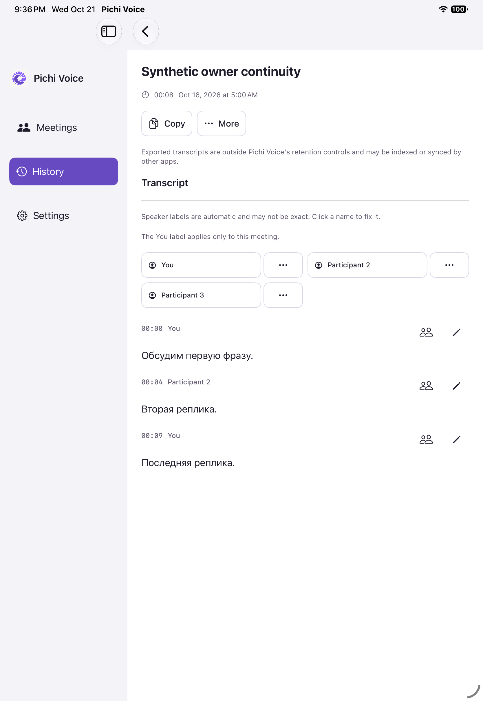
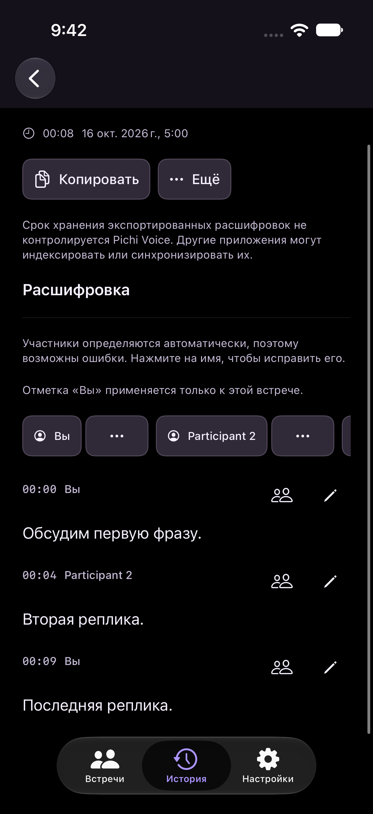

# Streaming owner proof continuity

## Behavior and scope

The current streaming recipe preserves an already confirmed, epoch-scoped owner when a refresh supplies no conclusive contradiction. Initial confirmation still requires two disjoint five-second clips, query self-distance at most 0.45, reference distance at most 0.65 and winner margin at least 0.10.

A missing, malformed, duplicate, unrequested or failed refresh retains the previous complete encoded profile and its duration proof. A mature internally inconsistent refresh may also retain that proof when every query-to-enrollment comparison still passes the unchanged reference threshold. Neither case can establish a new owner. Unresolved refreshes block new promotion, and every cached competitor continues to rank. A measured reference contradiction or sufficiently close rival revokes confirmation. Cancellation remains joined before publication.

This extends the existing prepared runtime and its bounded eight-slot cache. It adds no model inference or PCM retention. Exact earlier recipes remain supported with their original behavior; only the new `owner-refresh=measured-continuity-v1` recipe enables continuity.

Positive participant numbers now remain reserved for their identities through owner promotion, demotion, manual aliases and merge provenance. A previously displayed participant 2 remains 2 after participant 1 becomes You. The existing custom-name flag protects aliases. Legacy zero-owner markers and nil-number names remain decodable; missing historical numbers cannot be recovered exactly.

## Verification

The code and mobile test revision is `c570bb7724f0a7b03514e8066fce7066cfeb38fa`. Desktop products use `f1098a494415341bd47e5bb3e4539ee49ceb23ca`; the only intervening change is mobile test source, outside the desktop target.

| Check | Result |
| --- | --- |
| Prepared runtime actual-source contracts | 38 groups passed, including inconclusive updates, real contradiction, missing/invalid/failure, frozen recipe routing, rivals and joined cancellation |
| Runtime voice verifier contracts | Passed with unchanged thresholds and exact recipe admission |
| Streaming attribution and privacy | 28,990 tail, 139 registry, 211 admission and 3,302 state checks passed |
| Store checkpoints | 785 checks passed, including actual save/reopen |
| Native mobile | Build-for-testing passed; 45 tests passed per iPad/iPhone, zero failures/skips, including coordinator Stop and fresh store reopen |
| Native desktop | Build-for-testing passed; 51 targeted tests passed, zero failures/skips |
| Native simulator UI | Saved transcript contract passed on both forms in English/light and Russian/dark, with exact-frame review acknowledgements |
| Portable repository checks | Passed |
| Independent code review | No material findings at both reviewed code/test revisions |

Fresh local CPU model replay separately reproduced the previous demotion and verified continuity through EOF with the actual changed adapter, collector, verifier, diarizer and encoder. All eight inference batches retained identical input clip hashes and cadence. The second voice and a negative-only control never became owner. ASR and transcript assembly were witnesses in this acoustic probe. Detailed source audio, enrollment, scores and logs remain ignored locally.

The initial broader desktop attempt encountered one unchanged audio-preference UI assertion failure and disk exhaustion during result collection. The failed case passed in the isolated targeted rerun. Initial mobile tests exposed an obsolete numbering expectation, corrected before the final native runs. These earlier attempts remain retained and are not presented as full-suite passes.

## Limits and native images

Original Release owner scores and the matching live trace were unavailable. Fresh replay demonstrates the failure mechanism without reconstructing the exact original execution. Explicit retained-audio reprocessing starts a fresh attempt without historical live proof and can still return an anonymous result; this change covers live, Stop, storage and reopen. No physical app installation or microphone/latency acceptance was performed. Existing saved meetings and enrollment were only read.

Native simulator images below use only the existing synthetic meeting fixture. They show owner and participant 2 presentation, not physical voice recognition.

Continuous native capture retained 308 iPad and 580 iPhone frames, with 179 and 23 missed schedule slots respectively and zero capture errors. This is not complete one-second coverage or touch-latency evidence. Original full frames and decoded-pixel change indexes remain local; reused step reviews require exact full-frame decoded-pixel equality.

