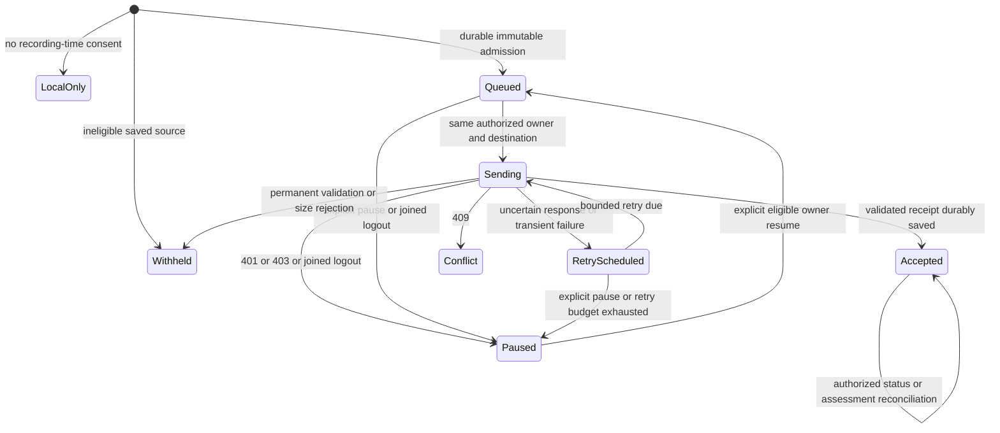

# Native protected publication outbox

Status: N5 source-admission implementation and dependency handoff. Account/profile runtime
wiring and transport remain gated on frozen N1/N2 APIs and the verified W2 wire fixture.
This document does not enable cloud publication or sign-in.

Inputs: native baseline `59e5079066406ff2f2ecdec8c1c2395eaf69e052`, contract and delivery
plan at `f3ea4b15160b92c095d9d83036e6a66e3be81c34`, N2 inventory at
`1c299fb894c65e163adbe2d1915b169c56588518`. N2's inventory is a proposal, not a runtime API.

## Implemented source gate

`PichiProtectedPublicationSource.prepare(for:)` consumes a value snapshot. It returns
immutable exact protected UTF-8 bytes, source session ID and lowercase SHA-256, or throws
a typed `PichiPublicationWithholdingReason`. Cancellation remains `CancellationError`.

The caller must supply a source reloaded through N2's frozen owner boundary after terminal
persistence. This helper does not prove persistence, consent or account ownership. It does
not discover profiles, read settings, choose a destination or perform network requests.

| Check | Stable withholding code |
| --- | --- |
| State is not completed, or persisted end time is missing | `notCompleted` |
| Recording-time redaction is false or unknown | `redactionNotEnabled` |
| Any original-text field remains, including an omitted echo unit | `originalTextRetained` |
| Recognition completeness is unknown | `completenessUnknown` |
| Recognition is incomplete, or a non-echo unit has failed/incomplete coverage | `incompleteTranscript` |
| Any excluded coverage interval remains | `excludedIntervals` |
| Existing exporter rejects timing, identity or final text structure | `invalidTranscript` |
| Existing exporter rejects metadata, UTF-16 text, turn count or byte limits | `exportLimitExceeded` |

The existing coordinator stores nil gaps for a known-complete result without exclusions.
Therefore nil gaps are accepted only alongside `transcriptIsComplete == true`. An empty gap
collection cannot make unknown completeness eligible. Fully measured no-speech recognition
is not classified as incomplete; W2 still needs to specify its empty-source validation.

The exporter remains the only payload encoder. Its 750,000-byte and 100,000-UTF-16-unit
limits and allowlist remain authoritative. Existing explicit protected manual export remains
usable for partial sources. Cloud withholding does not change a local recording or its data.

An absent end time would make duration depend on the current clock. A localized default
title, later edit or rename can also change a new export's bytes. The outbox must keep the
first admitted bytes rather than rerunning the exporter on retry.

## Planned durable state machine

These are internal delivery states, separate from W2's analysis state. They are not a second
account model or profile registry. Concrete owner/context/generation types come from N1;
profile roots, admitted capture ownership and transitions come from N2.

Admission freezes source revision 1, operation UUID, exact bytes/digest, original assessment
binding, N1 owner/destination and N2 profile/capture binding. It must be persisted before
network work starts. A single source admission must never create a second operation after
restart, a consent toggle, later editing or selection changes.

Store each small envelope and its bounded payload in one atomic private record. Use existing
private storage conventions: a profile-owned directory, 0700 directories, 0600 files and iOS
file protection. Reopening validates supported schema, owner/destination, payload length,
exact digest and confined regular-file paths before any request. Corrupt records remain
preserved and visibly unavailable. Do not repair them by rebuilding bytes from current text.

One serialized worker owns delivery for the active profile. Persist attempt admission before
transport so a crash in `sending` recovers as uncertain delivery with the original operation.
Enforce finite queue byte/item limits, automatic retry count and delay bounds. Exhaustion
requires an explicit retry action; it must not silently drop the source. These implementation
bounds will be frozen with the runtime implementation, not inferred from server defaults.

Consent is per verified account/workspace and defaults false. Only a new capture's frozen
admission can qualify for automatic publication. Signing in, enabling consent, scanning
history or reopening the app cannot discover older records and enqueue them. Explicit
historical upload and guest migration remain outside this version.

## Acceptance and analysis are independent

W2 analysis codes are `queued`, `running`, `succeeded`, `failed`, `needsParticipant` and
`needsCriteria`. An accepted upload may still require action or fail analysis. UI must retain
both dimensions and must never present acceptance as completed analysis.

| Recovery point | Required operation |
| --- | --- |
| App restarts with a durable queued item | Resume only under its original verified owner/workspace |
| POST committed remotely but no response/import ID arrived | Repeat POST with identical key, bytes, destination and original assessment binding |
| Receipt arrived but its local save failed | Keep uncertain delivery; identical POST replay recovers the receipt |
| Receipt was saved locally | GET the owner-authorized import ID; keep upload acceptance separate |
| Assessment was explicitly patched | Reconcile current status; retain the original POST fingerprint for delivery retries |
| Logout interrupts POST, GET or PATCH | Cancel and join; clear current projection; retain original-owner durable work paused |
| Login B follows A | B cannot read, retarget or resume A's queue; B's consent starts false |
| HTTP success has malformed, truncated or unsupported receipt JSON | Do not mark accepted; preserve uncertain delivery and original key |

401 pauses for reauthentication. 403 pauses for permission review. 409 is a visible source
conflict. Validation and size errors do not receive automatic retries. Network failures and
appropriate 429/5xx responses receive bounded backoff with bounded Retry-After handling.
Never log bearer credentials, protected text, personal metadata or raw error bodies.

Pending assessment must expose an authorized resolution path. Speaker names, `isLocalUser`
and heuristic diarization cannot select the represented employee. Participant/criteria choices
must come from explicit user action and current W2 authorization.

## Shared operation handoff

The one planned `PichiCloudPublicationService` supplies sanitized current-profile/workspace
consent, pause reason, per-record withholding/delivery status and independent analysis status.
N3/N4 consume that shared operation instead of implementing platform-specific queues.

Operations: set future-capture consent, status, send an already admitted eligible source,
retry identical durable work, pause and join, owner-authorized resume, reconcile receipt and
resolve explicit assessment binding. Stable codes are localized through N3's shared catalog.
Concrete function signatures wait for the approved N1/N2 types. No placeholder account or
profile manager is supplied by N5.

## Required frozen dependencies

| Owner | Exact handoff required before dependent implementation |
| --- | --- |
| N1 | Commit containing verified immutable identity/context/generation; current workspace observation; owner-bound authorized API operation; joined pre-switch/logout hook; trusted API configuration; composition and Xcode membership handoff |
| N2 | Commit containing immutable capture owner/profile binding and recording-time publication admission seam; persisted post-terminal reload; private profile outbox root; joined transition registration; history authorization |
| W2 | Commit and verified synthetic multipart request, 202 acceptance, identical 200 retry, all six analysis codes, GET/PATCH schema and exact sanitized error codes |
| W2 | Response-lost replay fixture; original POST replay after assessment PATCH; PATCH concurrency/conflict semantics; authorized participant/criteria discovery or UI path; empty/no-speech source validation; Retry-After behavior |
| Coordinator | Frozen approved dependency SHAs and explicit composition/Xcode ownership release; heavy-job admission before native builds |

Live transport additionally needs an approved local endpoint and test credential owner. W2's
PR 1614 dependency belongs to W2; it is not a dependency to copy into this Swift repository.

## Verification and resource ownership

The existing `Tests/run_meeting_session_store_checkpoint_tests.sh` compiles the production
store, persisted codecs, exporter and source gate. The new synthetic cases cover completeness,
every exclusion reason, unknown legacy coverage, missing end time, original fields including
echoes, exact bytes/digest, immutable copies, invalid timing/final state, UTF-16/byte limits,
typed-code round trips and cancellation. This is a focused production-code probe, not a
native-target build, account-isolation test, model-quality check or live transport test.

The source-gate candidate passed 969 checks in that probe. The compiler reported the existing
Swift 5-mode isolation warning for `ExportedTranscript: Encodable` at exporter line 1028.

N5 owns `/Users/sabbah/.codex/worktrees/2448/pichi-voice`, branch
`codex/pichi-sso-native-outbox-20261022`. Focused compiler outputs belong only under this
worktree's `.build/meeting-session-store-tests` and are disposable after evidence is saved.
No speech models, UI, simulators, devices, microphone/audio routes or server were started.
Keep this worktree for the named unfinished dependency integration. Native builds require
coordinator admission and private DerivedData/SourcePackages.
