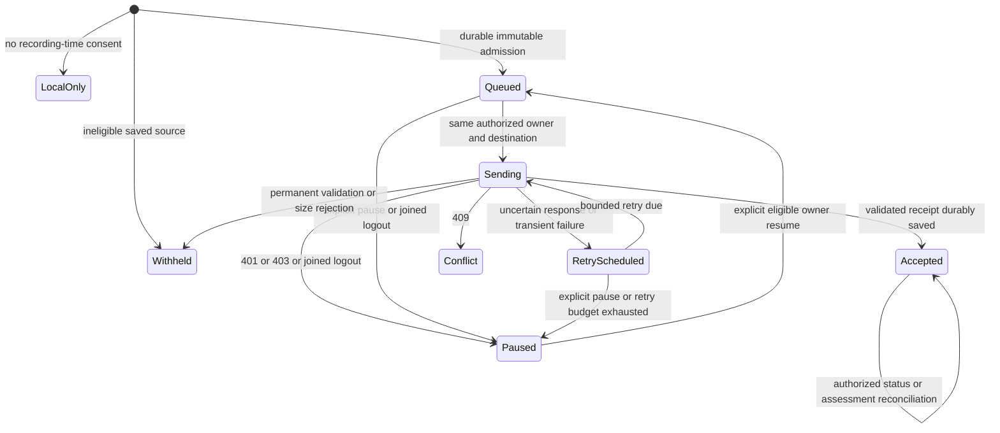

# Native protected publication outbox

Status: N5 source-admission and scoped-consent implementation with dependency handoff.
Account/profile runtime wiring remains gated on the N2 integration and final combined acceptance.
This document does not enable cloud publication or sign-in.

Inputs: native baseline `59e5079066406ff2f2ecdec8c1c2395eaf69e052`, contract and delivery
plan at `f3ea4b15160b92c095d9d83036e6a66e3be81c34`, N2 inventory at
`1c299fb894c65e163adbe2d1915b169c56588518`. N2's inventory is a proposal, not a runtime API.
Corrected N1 API `f989116f2028d1bb1d47cac86ff65f6e57a2391a` is merged as an explicit source
dependency, replacing the earlier `f6b0e48` and `9fc25a13` handoffs. The coordinator's independent
delta review resolved the refresh/workspace and command-cancellation issues without a public interface change.
N1's final native/runtime evidence remains its own gate. No duplicate account or token
manager is introduced, and N5 does not alter N1 account sources. N2 source API `917bd15d`
and published follow-up `66ae984b15d58e0c0d4ff71cd5f5573a4e5d9183` are integrated, with
mandatory source correction `d5febd9421918c192063b61e53d3f208f80d2fb7` is integrated.
Runtime/composition acceptance remains pending; focused publication targets the named N2
branch after that correction is published.

## Implemented source gate

`PichiProtectedPublicationSource.prepare(for:)` consumes a value snapshot. It returns
immutable exact protected UTF-8 bytes, source session ID and lowercase SHA-256, or throws
a typed `PichiPublicationWithholdingReason`. Cancellation remains `CancellationError`.

The caller must supply a source reloaded through N2's frozen owner boundary after terminal
persistence. This helper does not prove persistence, consent or account ownership. It does
not discover profiles, read settings, choose a destination or perform network requests.

| Check | Stable withholding code |
| --- | --- |
| State is not completed, or persisted end time is missing | `notCompleted` |
| Recording-time redaction is false or unknown | `redactionNotEnabled` |
| Any original-text field remains, including an omitted echo unit | `originalTextRetained` |
| Recognition completeness is unknown | `completenessUnknown` |
| Recognition is incomplete, or a non-echo unit has failed/incomplete coverage | `incompleteTranscript` |
| Any excluded coverage interval remains | `excludedIntervals` |
| Existing exporter rejects timing, identity or final text structure | `invalidTranscript` |
| Existing exporter rejects metadata, UTF-16 text, turn count or byte limits | `exportLimitExceeded` |

The existing coordinator stores nil gaps for a known-complete result without exclusions.
Therefore nil gaps are accepted only alongside `transcriptIsComplete == true`. An empty gap
collection cannot make unknown completeness eligible. Fully measured no-speech recognition
is withheld as `emptyTranscript`, separately from incomplete recognition, before any request.

The exporter remains the only payload encoder. Its 750,000-byte and 100,000-UTF-16-unit
limits and allowlist remain authoritative. Existing explicit protected manual export remains
usable for partial sources. Cloud withholding does not change a local recording or its data.

An absent end time would make duration depend on the current clock. A localized default
title, later edit or rename can also change a new export's bytes. The outbox must keep the
first admitted bytes rather than rerunning the exporter on retry.

## Implemented scoped consent store

`PichiPublicationConsentStore` is an actor with `automaticPublicationEnabled(for:)` and
`setAutomaticPublicationEnabled(_:for:)`. Both consume the existing N1 `AccountContext`.
Its constructor requires an injected directory and optional trusted `AccountConfiguration`.
N2 must supply a dedicated existing private directory; this actor never creates or selects a
profile, installs a lifecycle participant, reads a default path or enumerates recordings.

Consent is keyed by N1's issuer/subject/internal user ID, organization/workspace and the
entire trusted account configuration, including API, client, audience and bundle identity.
The filename is a SHA-256 of sorted encoded scope data. The record repeats the exact scope
and supported schema. A process-local generation is deliberately excluded from durable keys.
The same verified owner/workspace can recover its setting after relaunch, while another
account, workspace or distribution starts off.

Missing trusted configuration, no selected workspace, missing root or absent record reads as
off. Invalid existing storage or corrupt consent throws a stable
`PichiPublicationConsentFailure`; callers must show unavailable consent and keep automatic
publication off. A failed read is never permission to publish. Writes preserve corrupt
evidence instead of silently replacing it. There is no in-memory consent cache.

The shared operation must authorize the frozen N1 context before using this storage API.
This value store itself does not establish a current grant or recording-time admission.
It does not mutate any previous capture policy or automatically enqueue historical sources.

Records are capped at 16,384 bytes, scope encodings at 8,192 bytes and individual remote
identifiers at 512 UTF-8 bytes. Directory and record opens use no-follow descriptors, private
permissions and bounded reads. Nonregular, multiply linked and world/group-readable records
fail closed. Writes use an exclusive 0600 temporary file, file sync, same-directory rename,
directory sync and exact typed readback. iOS temporary files receive existing file protection
before text is written. N2 owns the directory's protection and backup policy.

`bash Tests/run_publication_consent_tests.sh` compiles the actual N1 domain/brand types and
consent actor in Swift 6, with no account service, browser, Keychain, models or network.
The first run passed 55 synthetic checks for scoped defaults/persistence, replacement,
cancellation, oversized/truncated/foreign/versioned records, permissions, symlinks, hard
links, FIFO rejection and interrupted temporary files. Recreating an actor and generation
simulates storage recovery; this is not a native application relaunch or logout test.
N1's account probe declares sh; N5 consent and outbox probes declare Bash. All are registered
without UI access. With the N2 probes, registry assertions cover 74 probes: 56 sh, 10 Bash
and 8 Python.

## Implemented W2 wire codec

W2 approved fixture commit `128e1dc17b51f0f0877e00eafb1f73c13cadddf5` supplies the exact
synthetic request, receipts, errors and pending/PATCH rules. The copied approved files and
their hashes are recorded in `Tests/Fixtures/PichiAccountSyncV1/provenance.json`. W2 runtime `ac2b6c352de1c74080c44e0fe206f039b84726eb` preserves this wire contract
and adds purge GET404/replay POST409 behavior. Server implementation is not copied into Swift.

`PichiPublicationRequest` builds immutable POST, GET and PATCH values using N1's existing
configuration/context types. POST body bytes exactly match both W2 multipart fixtures,
including explicit null participant and unmodified protected JSON bytes. The operation key,
original assessment and multipart boundary stay in the original value. PATCH is a separate
value and cannot rewrite that original POST. Non-null participants must be represented by
the protected source; no name, owner label or `isLocalUser` guess is made.

Recovery and source admission share `PichiProtectedPublicationPayload`, a bounded structural
validator for already serialized bytes because the existing exporter is encode-only. It does not re-encode the source and does
not prove native completeness, actual redaction or profile ownership. It rejects fields
outside the exporter allowlist, original/audio/internal exports and invalid typed structure.
The original exporter remains the only admission encoder. Source bytes/text keep its existing
limits. The server contract additionally requires at least one nonblank segment, positive
intervals, at most 86,400 seconds and at most 100 speakers. The serialized validator also enforces nonblank speaker names,
one local-user speaker, ordered starts within duration and a 250,000-unit rendered UTF-16
budget. Empty complete sources are
withheld as `emptyTranscript`, separately from incomplete recognition.
Multipart is capped at 1 MiB, response bodies at 65,536 bytes, and explicit selections
at 100 unique opaque criteria IDs with at most 256 UTF-16 units and 512 UTF-8 bytes per ID. These are conservative
client resource bounds, not a change to server authorization or criteria policy.

Runtime authorization uses the existing N1 `authorizedAccess(for:)`, checks the request's
entire trusted configuration against N1's configuration, and checks `isCurrent` before
returning a transient bearer request. The owner-checked response overload repeats that fence
after network completion. N2 capture/profile authorization must still surround all local
application. Unsigned request values contain no bearer. No network request is activated by
this pure codec. `PichiPublicationHTTPClient` separately implements the status-preserving
executor with refused redirects, disabled cookies/cache/credentials, bounded bodies/time,
at most four requests and joined shutdown.

N1's `AccountHTTPRequesting` is deliberately not reused for publication: it returns only
Data and collapses statuses needed to distinguish validation, billing, conflict and retries.
The publication response type retains only status, bounded body and Retry-After. Typed errors
discard server messages, arbitrary billing details and request IDs instead of projecting them.

All six analysis states remain separate from accepted upload. GET/PATCH responses must retain
both known receipt IDs. Original POST replay after PATCH may return current `queued` analysis
and is not compared to its original pending binding. Approved HTTP/code pairs map exactly to
W2 action codes, including 402 account review without retry/logout. Unexpected statuses,
malformed bodies or unknown codes pause for review rather than becoming acceptance.

`PichiPublicationRetryPolicy` permits five total automatic attempts with 5/10/20/40-second
backoff. Valid delta-seconds or IMF-fixdate Retry-After is honored within a one-hour automatic
window. Longer valid windows pause rather than retrying early; exhaustion also pauses.
The durable worker persists the attempt budget and server deadline independently. Explicit
retry cannot bypass a future server deadline after exhaustion, logout or restart. A delay
that cannot be represented safely remains a review pause. The codec starts no timer/retry.

The existing consent probe also compiles the actual N1 account sources and wire code in
Swift 6. It passed 55 consent checks and 124 wire checks, including exact fixture hashes/body
bytes, all approved method/error pairs, pending resolution/replay, safe opaque paths,
malformed/oversized/unsafe inputs, bounded retry and N1 destination/generation fences.
Browser, credentials, transport and lifecycle are synthetic injected test services. That
lifecycle proves no N2 isolation, and no server, Keychain, browser or real grant is accessed.

## Implemented durable store and facade

`PichiPublicationOutboxStore` consumes N2's profile snapshot and N1 configuration. Its
generation-independent records persist existing `MeetingProfileOwnership`, operation ID,
recording-time consent, original null assessment, revision 1, exact bytes/digest and typed
delivery state. Known-ID lookup never scans accepted history. Pending storage is bounded
to 32 records and 24 MiB of payload; each encoded record is at most 1 MiB. Accepted,
withheld and false-consent records are retained separately without consuming pending slots.
There is no automatic accepted-record deletion or new cloud-retention policy.

The shared facade binds the N2 recording observer, persisted-source reload and transition
participant. It freezes consent before capture, deduplicates repeated notifications and
keeps callbacks local. An explicitly activated worker handles HTTP independently. Transition
cleanup joins complete manual commands, the worker and HTTP before clearing projections.
Individual command cancellation joins its concrete request and durably pauses uncertain
delivery without recreating the retained store. Accepted GET/PATCH failures persist a review
overlay while retaining receipt, source and key. The same worker polls observed active
analysis receipts with a bounded budget; it never discovers accepted history.
Billing, permission/validation review and Retry-After deadlines survive logout/resume.

The UI toggle is `setCloudSyncEnabled(_:)`. OFF closes network admission, joins POST/GET/PATCH,
atomically persists future consent off plus pause, and retains work. ON never claims guest
or OFF history. See [the concrete API/catalog handoff](pichi-cloud-publication-api.md).

## Durable state machine

These are internal delivery states, separate from W2's analysis state. They are not a second
account model or profile registry. Concrete owner/context/generation types come from N1;
profile roots, admitted capture ownership and transitions come from N2.

Admission freezes source revision 1, operation UUID, exact bytes/digest, original assessment
binding, N1 owner/destination and N2 profile/capture binding. It must be persisted before
network work starts. A single source admission must never create a second operation after
restart, a consent toggle, later editing or selection changes.

Store each small envelope and its bounded payload in one atomic private record. Use existing
private storage conventions: a profile-owned directory, 0700 directories, 0600 files and iOS
file protection. Reopening validates supported schema, owner/destination, payload length,
exact digest and confined regular-file paths before any request. Corrupt records remain
preserved and visibly unavailable. Do not repair them by rebuilding bytes from current text.

One serialized worker owns delivery for the active profile. Persist attempt admission before
transport so a crash in `sending` recovers as uncertain delivery with the original operation.
Enforce finite queue byte/item limits, automatic retry count and delay bounds. Exhaustion
requires an explicit retry action; it must not silently drop the source. These implementation
bounds will be frozen with the runtime implementation, not inferred from server defaults.

Consent is per verified account/workspace and defaults false. Only a new capture's frozen
admission can qualify for automatic publication. Signing in, enabling consent, scanning
history or reopening the app cannot discover older records and enqueue them. Explicit
historical upload and guest migration remain outside this version.

## Acceptance and analysis are independent

W2 analysis codes are `queued`, `running`, `succeeded`, `failed`, `needsParticipant` and
`needsCriteria`. An accepted upload may still require action or fail analysis. UI must retain
both dimensions and must never present acceptance as completed analysis.

| Recovery point | Required operation |
| --- | --- |
| App restarts with a durable queued item | Resume only under its original verified owner/workspace |
| POST committed remotely but no response/import ID arrived | Repeat POST with identical key, bytes, destination and original assessment binding |
| Receipt arrived but its local save failed | Keep uncertain delivery; identical POST replay recovers the receipt |
| Receipt was saved locally | GET the owner-authorized import ID; keep upload acceptance separate |
| Assessment was explicitly patched | Reconcile current status; retain the original POST fingerprint for delivery retries |
| Logout interrupts POST, GET or PATCH | Cancel and join; clear current projection; retain original-owner durable work paused |
| Login B follows A | B cannot read, retarget or resume A's queue; B's consent starts false |
| HTTP success has malformed, truncated or unsupported receipt JSON | Do not mark accepted; preserve uncertain delivery and original key |

401 pauses for reauthentication. 403 pauses for permission review. 409 is a visible source
conflict. Validation and size errors do not receive automatic retries. Network failures and
appropriate 429/5xx responses receive bounded backoff with bounded Retry-After handling.
Never log bearer credentials, protected text, personal metadata or raw error bodies.

Pending assessment must expose an authorized resolution path. Speaker names, `isLocalUser`
and heuristic diarization cannot select the represented employee. Participant/criteria choices
must come from explicit user action and current W2 authorization.

## Shared operation handoff

The implemented `PichiCloudPublicationService` supplies sanitized current-profile/workspace
consent, pause reason, per-record withholding/delivery status and independent analysis status.
N3/N4 consume that shared operation instead of implementing platform-specific queues.

Operations: coherent Cloud sync enable/disable, status, send an already admitted eligible source,
retry identical durable work, pause and join, owner-authorized resume, reconcile receipt and
resolve explicit assessment binding. Stable codes are localized through N3's shared catalog.
Concrete signatures are in the linked API handoff. No placeholder account/profile manager
is supplied by N5.

## Required frozen dependencies

| Owner | Exact handoff required before dependent implementation |
| --- | --- |
| N1 | Corrected source types are available at `f989116f`; native builds, combined joined-operation gates and composition/Xcode ownership handoff remain required |
| N2 | Integrated `d5febd94` supplies private roots, immutable admissions, persisted sources, observer and joined transitions; composition/source membership and runtime acceptance remain N2-owned |
| W2 | Frozen runtime `ac2b6c35` and original fixtures `128e1dc1` are available; native HTTPS integration and combined live identity/authorization/billing acceptance remain required |
| W2 | Authorized participant/criteria discovery or UI path and approved HTTPS fixture ownership remain separate gates; empty sources are locally withheld |
| Coordinator | Frozen approved dependency SHAs and explicit composition/Xcode ownership release; heavy-job admission before native builds |

Live transport additionally needs an approved local endpoint and test credential owner. W2's
PR 1614 dependency belongs to W2; it is not a dependency to copy into this Swift repository.

## Verification and resource ownership

The existing `Tests/run_meeting_session_store_checkpoint_tests.sh` compiles the production
store, persisted codecs, exporter and source gate. The new synthetic cases cover completeness,
every exclusion reason, unknown legacy coverage, missing end time, original fields including
echoes, exact bytes/digest, immutable copies, invalid timing/final state, UTF-16/byte limits,
typed-code round trips and cancellation. This is a focused production-code probe, not a
native-target build, account-isolation test, model-quality check or live transport test.

The original source gate passed 969 checks; the first combined N2/source run passed 995,
including actual exporter provisional metadata. The compiler reported the existing
Swift 5-mode isolation warning for `ExportedTranscript: Encodable` at exporter line 1028.
The 969 result belongs to `3c2fd6e4` and is historical evidence. N2 and the shared validator
changed inputs, so final combined checks must run on the integrated candidate.

N5 owns `/Users/sabbah/.codex/worktrees/2448/pichi-voice`, branch
`codex/pichi-sso-native-outbox-20261022`. Focused compiler outputs belong only under this
worktree's `.build/meeting-session-store-tests` and are disposable after evidence is saved.
The separate consent probe owns only `.build/publication-consent-tests`.
Store/facade probes own only `.build/publication-outbox-tests`. Delegated storage source
was integrated after verifying all source/test hashes and independent log copies; its
app-managed worktree archival was requested and must be verified separately.
No speech models, UI, simulators, devices, microphone/audio routes or server were started.
Keep this worktree for the named unfinished dependency integration. Native builds require
coordinator admission and private DerivedData/SourcePackages.
