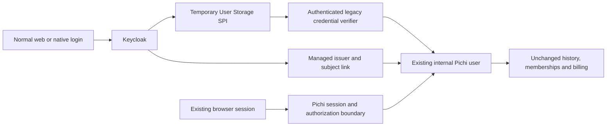

# Existing production accounts: gradual authentication migration

> Historical design snapshot from PR #48 at `31d7a077a9ebd0855ed900e2cfbcea698e0971ae`, dated 2026-10-22. Session assignments, implementation statuses and source references below describe that snapshot. Current implementation and release acceptance evidence take precedence. Preserving this design does not establish deployed server support or authorize production account migration.

Status: proposed future mechanism, disabled by default. This document adds design and acceptance gates to [the SSO delivery plan](pichi-sso-delivery-plan.md). It does not implement migration or authorize production access, deployment, data changes or changes to Neiroplan/Casdoor. Contract v1 remains unchanged.

## Intended user experience

An existing user keeps the same Pichi account, password, history, teams, permissions and balance. An already signed-in browser continues working. There is no mass logout, registration campaign or mandatory password reset. At a normal subsequent login, Keycloak can validate the existing credential through the legacy system and issue SSO for the same internal Pichi user. Moving the password database itself is a later, optional operation.

For a browser with a sufficiently verified existing session, a later bridge can establish SSO without asking for the password again. This is conditional: account mismatch, mandatory MFA, expired or insufficient session proof and browser restrictions can require ordinary visible authentication. Leave the existing approved session usable when an optional upgrade cannot proceed. Never interrupt an active recording or unsaved work to redirect for migration.

Signing in on a tablet or desktop selects that same server account. It does not claim guest recordings, enable cloud consent or upload existing local history. Cloud publication stays separate and off until the user enables it.

## Verified source facts and unknown deployment facts

The following inventory uses frozen web revision `cdd257da288d7ba906272bc6979911deca588c2b` and baseline `e6ebf04a3ca76730cccc1644ab0537002c39d9ca`. These are code facts, not an inventory of production. The deployed revision, actual password formats/costs, provider configuration, MFA policy and account populations still require a separately authorized read-only production inventory.

| Boundary | Source evidence | Design consequence |
| --- | --- | --- |
| Canonical application identity | [schema.ts:126](https://github.com/Pichi-AI/web/blob/cdd257da288d7ba906272bc6979911deca588c2b/apps/server/db/schema.ts#L126) | Preserve `users.id` and existing ownership, membership, billing and workspace rows. Add external links rather than recreating accounts or copying history. |
| Passwords | [storage.ts:571](https://github.com/Pichi-AI/web/blob/cdd257da288d7ba906272bc6979911deca588c2b/apps/server/db/storage.ts#L571), [validation:695](https://github.com/Pichi-AI/web/blob/cdd257da288d7ba906272bc6979911deca588c2b/apps/server/db/storage.ts#L695) | Local writers use per-user bcryptjs hashes at cost 10; verification uses `bcrypt.compare`. CIAM credentials may be null. Preserve legacy-valid passwords initially. |
| Browser sessions | [tokenService.ts:12](https://github.com/Pichi-AI/web/blob/cdd257da288d7ba906272bc6979911deca588c2b/apps/server/services/auth/tokenService.ts#L12) | Main `auth_token` is a seven-day PASETO v3.local cookie with `tokenVersion`; historical versionless cookies are supported. Keep current keys/cookies valid during shadow rollout. |
| Passwordless links | [storage.ts:546](https://github.com/Pichi-AI/web/blob/cdd257da288d7ba906272bc6979911deca588c2b/apps/server/db/storage.ts#L546), [auth.ts:508](https://github.com/Pichi-AI/web/blob/cdd257da288d7ba906272bc6979911deca588c2b/apps/server/routes/auth.ts#L508) | The inspected login path neither consumes nor expires the persistent bearer `loginToken`. Do not treat it as fresh one-time mailbox proof. |
| Email confirmation | [storage.ts:5187](https://github.com/Pichi-AI/web/blob/cdd257da288d7ba906272bc6979911deca588c2b/apps/server/db/storage.ts#L5187) | Missing confirmation records can count as confirmed. Email equality or this flag cannot authorize migration linking. |
| Existing OIDC web surface | [auth.ts:604](https://github.com/Pichi-AI/web/blob/cdd257da288d7ba906272bc6979911deca588c2b/apps/server/routes/auth.ts#L604), [oidcBoundary.ts](https://github.com/Pichi-AI/web/blob/cdd257da288d7ba906272bc6979911deca588c2b/apps/server/services/auth/oidcBoundary.ts) | Current identity-bearing sessions select the restricted own-import experience. Converting legacy cookies now could remove full history, team/admin features and WebSocket access. Full web parity is a cutover gate. |
| Existing identity links | [oidcIdentity.ts:118](https://github.com/Pichi-AI/web/blob/cdd257da288d7ba906272bc6979911deca588c2b/apps/server/services/auth/oidcIdentity.ts#L118) | Unique issuer/subject and revoked-link reservations are useful, but automatic migration additionally needs managed per-user reservations and transactional expected-version checks. |
| Separate populations | [schema.ts:110](https://github.com/Pichi-AI/web/blob/cdd257da288d7ba906272bc6979911deca588c2b/apps/server/db/schema.ts#L110), [ciamBridge.ts:40](https://github.com/Pichi-AI/web/blob/cdd257da288d7ba906272bc6979911deca588c2b/apps/server/services/auth/ciamBridge.ts#L40) | Panel `admin_users`, machine/shared secrets and CIAM are separate boundaries. Do not merge similarly numbered IDs or use local-password migration to bypass corporate login. |

No application MFA implementation was found in this source inventory. That does not establish the absence of external production MFA. Classify local-password, persistent-link, corporate/CIAM and panel-admin populations separately before enabling any cohort.

## Architecture and ownership

Use Keycloak as the SSO issuer and retain Pichi's database as the application identity and authorization authority. For partner deployments, issuer/realm/domain/client trust comes from approved distribution configuration, never an imported visual brand. A bank's corporate policy must not gain a local-password fallback through this migration.

W1 owns application admission, migration reservations, identity activation, session policy, reconciliation and current ACL enforcement. I1 owns the Pichi-only provider adapter, least-privilege verifier client and disabled cohort configuration. N1/N2/N5 consume the same canonical account boundary; they do not implement migration or another profile manager. N3/N4 preserve optional sign-in and explicit cloud consent. The coordinator keeps this design in planning PR48. No extra implementation chat or PR is created by this design; future code must remain focused and reviewed in its owning delivery scope.

### Managed identity reservation

Introduce an additive migration ledger with immutable legacy source/kind/ID, canonical `users.id`, trusted target issuer, target subject when known, operation ID, state, expected security epoch, credential authority/generation and audit timestamps. Enforce uniqueness of issuer/subject and one active managed mapping per canonical user/issuer. Never derive ownership from email, username, JWT roles or a user-editable attribute. A service-managed immutable mapping is required. Preserve revoked/deleted identity tombstones.

Proposed identity states are `reserved -> provisioned -> active`, with explicit conflict and revoked states. A shadow reservation is not an active external identity and cannot change authorization. Credential authority has a separate monotonic state; a routing flag cannot reverse credential retirement.

Reserve under the authenticated account and expected `tokenVersion`. Provision the target idempotently, then activate the exact tuple only after rechecking the account's eligibility, expected epoch and reservation in the application transaction. PostgreSQL and Keycloak are different systems: use operation IDs and reconciliation, not a claimed cross-database transaction. Provisioning success followed by callback or database failure remains reserved and recoverable; retries must never create or link a second user. Persist reconciliation IDs/status, never passwords, access tokens or browser cookies.

## Staged implementation and rollout

### 1. Inventory and OFF/shadow

Start with flags off. Record code/deployment/configuration fingerprints and population counts without exporting credentials. Verify actual credential formats, origins, callback domains, signing/cookie keys, corporate IdPs, MFA/recovery requirements, issuer-to-organization coverage and account lifecycle operations. The current issuer registry's scale limits must fit the approved population; do not infer tenant access from token claims.

Use synthetic accounts first. A later authorized shadow run may reserve identities and report conflicts, but it must not activate links, replace cookies, increment token versions, redirect users or change ACL/UI selection. Historical cookies keep their current validity without being represented as fresh password/MFA proof. No account is silently created because an email happens to match.

### 2. Federate existing credentials at normal login

Implement a disabled, version-pinned Keycloak User Storage SPI for Pichi local-password accounts. It calls a narrowly authenticated internal Pichi verifier with current account/credential eligibility and rate limits. Passwords exist only for the request, with request-body, tracing and error redaction; no queue, persistence or logging of raw credentials. Provider or verifier failure fails closed.

Initially, the legacy system remains the sole password-change/reset authority. The provider is read-only for passwords. Imported users must not acquire a Keycloak local password, recovery/account-console bypass or fallback that survives legacy revocation. Lookup and validation must recheck current account status and credential generation, including when Keycloak caches user metadata. Corporate-only users stay on their existing approved provider.

This keeps the existing password usable without a mass reset. Keycloak 26.8.1 provides the [User Storage SPI](https://www.keycloak.org/docs/26.8.1/server_development/#_user-storage-spi), but this adapter is future custom implementation. Its stock [PBKDF2 registrations](https://github.com/keycloak/keycloak/blob/26.8.1/services/src/main/resources/META-INF/services/org.keycloak.credential.hash.PasswordHashProviderFactory) and [Argon2 registration](https://github.com/keycloak/keycloak/blob/26.8.1/crypto/default/src/main/resources/META-INF/services/org.keycloak.credential.hash.PasswordHashProviderFactory) do not provide built-in bcrypt compatibility. Do not place an existing hash in a plaintext credential field or assume an automatic migration flag.

Test actual supported bcrypt prefixes/costs, wrong/null/malformed credentials, Unicode and long UTF-8 input. [bcryptjs documents a 72-byte input limit](https://github.com/dcodeIO/bcrypt.js#security-considerations); changing to a different hash after one truncated input can change which passwords work. Preserve compatibility until a separately verified credential transfer or explicit password change. New enrollment policy must not retroactively reject a legacy-valid password during initial federation.

### 3. Preserve full web experience before browser conversion

Keep authentication provenance, credential transport and application permissions distinct. Add a server-controlled browser-session policy for an approved migrated legacy population, while retaining verified issuer/subject/assurance metadata. Derive history/team/admin/workspace rights from current Pichi rows within trusted issuer-to-organization coverage. Preserve the selected organization/workspace only when still authorized. A user with memberships in A and B must not gain B through an issuer trusted only for A.

Do not strip identity fields, spoof `authMode` or broaden the native bearer allowlist to recover legacy UI. A migrated administrator's native token must still be limited to its approved own-recording APIs. Before converting browser sessions, prove the same permitted legacy history, recordings, training, team/admin and WebSocket behavior for that browser cohort. The current W1 callback is not this migration mechanism.

### 4. Optional upgrade from an existing browser session

Keep this stage separate from normal-login federation. PASETO is not a Keycloak browser cookie. If production already has an appropriate upstream OIDC/SAML provider, prefer standard brokering and its existing session. Otherwise a Pichi legacy-session-to-OIDC bridge is new code that needs independent review.

The proposed bridge uses a registered confidential broker client, exact HTTPS redirects, one-use short-lived authorization codes, state/nonce, PKCE S256 and narrowly scoped claims. It validates the current legacy account, membership, original authenticated epoch, original expiry and authentication assurance before issuing proof. Its keys are separate from the PASETO encryption key. No password grant or token in a URL is permitted.

The existing session projection does not expose original expiry/authentication assurance. Add a verified proof projection first. Never extend the source session's lifetime or claim recent password/MFA authentication from an old cookie. An insufficient or unknown-assurance session remains on its current approved path until ordinary login or required step-up. Persistent login links are not fresh proof for password/MFA enrollment or privilege elevation.

Cookie-only bootstrap must also bound every resulting Keycloak SSO session, refresh/offline grant and derived client grant to the original immutable proof expiry. Refresh must preserve the original authentication time and assurance; it cannot turn this proof into a fresh login. Extending that authority requires a new qualifying authentication. If the provider adapter cannot enforce these limits across all derived grants, leave optional bootstrap disabled and use normal-login federation.

**MUST:** If legacy account A is active while Keycloak's browser session belongs to B, abort the optional upgrade before activating links or replacing A's cookie. Require the exact pre-managed issuer/subject for A, current eligibility and expected epoch. Do not link an arbitrary valid B token to A, even if names/emails match. Do not log out B or change accounts automatically. Preserve A and offer an explicit normal sign-in at an appropriate moment.

`prompt=none` can avoid credential prompts only when the required session and policy already permit it. It can still redirect or return interaction-required errors. Modern browsers can block [silent iframe checks through third-party cookie restrictions](https://www.keycloak.org/securing-apps/javascript-adapter#_modern_browsers). Bound attempts, prevent redirect loops and defer optional upgrades while work is active. Do not promise an invisible migration in every case.

### 5. Canary cohorts and reversible routing

Enable a synthetic cohort, then a small explicit employee/test cohort, then approved organizations gradually. Each promotion requires observed login success, migration conflict/error counts, active-session continuity and ACL parity, with identifiers redacted and no credential/token payloads. Define numeric thresholds and observation windows from the actual deployment baseline before rollout; they are a promotion prerequisite, not an unspecified automatic rollout.

Maintain independent flags for shadow reservation, managed activation, normal-login federation and browser conversion. A routing rollback stops new upgrades and preserves existing valid sessions and data. It does not undo security revocation, remove identity reservations, weaken MFA or switch a retired password back on. An unavailable IdP never triggers an unverified alternate-login bypass.

### 6. Optional later transfer of password storage

This is not required for the initial SSO migration. Keep credential authority `legacy-federated` until a separately accepted transfer can enforce `legacy-federated -> transfer-pending -> keycloak-authoritative` per account.

All credential consumers and writers must fence the same generation: legacy login, SPI validation, password change/reset, delayed reset tokens, admin/bulk writers and recovery. Use expected-epoch/hash checks and atomic single-use reset consumption. Prohibit independent old/new password writers. A provider credential write needs an authenticated, idempotent completion acknowledgement bound to the operation ID, exact issuer/subject, canonical Pichi ID, expected epoch and credential generation. This is a required future interface, not an existing Keycloak feature assumed by this plan.

On an ambiguous write, keep stale-verifier admission closed while reconciling through non-secret operation metadata or independently verified recovery. Never restore the old hash merely because a response was lost. After confirmed transfer, the legacy verifier becomes permanently ineligible, including during routing rollback. No raw password may be persisted for reconciliation.

Before retiring any legacy credential, enforce a minimum rollback-compatible binary version plus a data-level barrier that prevents old reset/admin/bulk code from restoring the old verifier. Remove or irreversibly quarantine the online legacy verifier through a separately reviewed migration. A backup restore must reconcile monotonic retirement state before reopening authentication. A feature flag alone cannot protect against an old binary that ignores it.

Imported/federated-user cleanup needs a verified unlink/ownership plan and complete user/credential counts. Keycloak documents [federation import and removal hazards](https://github.com/keycloak/keycloak/blob/26.8.1/docs/documentation/server_development/topics/user-storage/import.adoc). Deleting the provider is not a rollback procedure. Preserve the legacy authority until sunset acceptance and recovery are proven.

## Security prerequisites before activation

- Refresh/session issuance and identity activation must retain and compare the originally authenticated security epoch. The [current refresh sequence](https://github.com/Pichi-AI/web/blob/cdd257da288d7ba906272bc6979911deca588c2b/apps/server/routes/auth.ts#L962) can read a newer `tokenVersion` after authentication; source review identifies a concurrent logout/password-change risk. Do not mint a new session from stale proof.
- Canonical admission must check live account status, token/security generation, active membership and issuer/client/tenant bounds. Audit [direct cookie readers](https://github.com/Pichi-AI/web/blob/cdd257da288d7ba906272bc6979911deca588c2b/apps/server/services/auth/requestUser.ts#L51), refresh, password/reset and [WebSocket admission](https://github.com/Pichi-AI/web/blob/cdd257da288d7ba906272bc6979911deca588c2b/apps/server/routes/ws/upgrade-auth.ts#L72). Setting `users.isActive=false` alone is not proof of complete legacy offboarding.
- Define local logout, intentional global logout and administrative offboarding separately. Enforce revocation across app cookies, provider SSO/refresh families, native grants and already-open sockets. For locally validated JWTs, implement app-side epoch/link rejection and a defined bounded revocation delay; provider logout alone does not invalidate every issued access token. Reactivation must not resurrect old grants.
- Preserve corporate MFA/recovery and panel-admin separation. Session bootstrap may not grant enrollment, recovery, local-password fallback or higher assurance than its original proof.
- No main merge, production deployment, identity mutation or paid resource is authorized here. Initial tests use synthetic accounts/transcripts and isolated local environments.

## Required acceptance and handoff

| Check group | Required evidence |
| --- | --- |
| Continuity | Old version-zero/current cookies survive OFF/shadow and routing rollback without new cookie/key/version, forced navigation or loss of unsaved work. Same internal ID, history, billing, memberships and selected authorized context. |
| Credentials | Existing valid/wrong/Unicode/long-byte passwords, supported hashes and legacy policy variations; no local override/fallback or secret logs; CIAM/passwordless/admin cohorts stay separate. |
| Linking and recovery | Parallel first logins, replay, provision-success/DB-failure, identical-email users, legacy A/SSO B and changed initiating account; exactly one managed tuple or a safe conflict, never account reassignment. |
| Concurrency/revocation | Logout/password/reset/offboarding against refresh and delayed callbacks, reset replay, stale epochs, direct readers, open sockets and native grants. No stale session resurrection. |
| Authorization | Full approved browser experience within issuer tenant bounds; native token for the same administrator still denied legacy/admin/WS and foreign-account routes. |
| Browser behavior | Existing/no SSO, blocked cookies, expired proof, required MFA, cancel and provider outage; bounded attempts, no redirect loop and explicit recovery when silent upgrade is impossible. |
| Deferred credential transfer | Lost acknowledgement, transfer-pending, delayed writers, provider outage, rollback to an old binary and pre-retirement backup restore cannot revive the old password. Test before enabling this separate stage. |
| Native invariants | Guest/A/B isolation, optional sign-in, no implicit guest association/backfill and cloud consent still separate/off by default. |

W1/I1 must publish immutable implementation revisions, schema/API and provider/configuration fingerprints, independent review results, synthetic test evidence, rollback-compatible version floor and cleanup ownership. The coordinator verifies the combined server/native candidate. Production rollout requires a later explicit approval of a concrete deployment, cohort, thresholds, rollback and recovery plan. This document records a future mechanism; none of the new migration paths above has been implemented or runtime-tested by publishing it.
