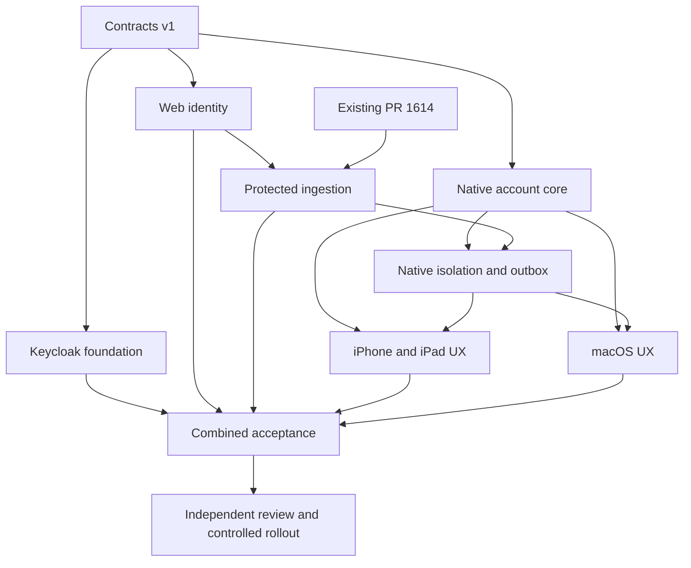

# Pichi account, enterprise SSO and cloud publication delivery

Status: coordinated implementation, contract version 1. Initial baselines were verified on 2026-10-22.

## Product decisions

- Community Keycloak is the identity platform. Preserve Apache-2.0 notices; no paid identity-platform dependency is required.
- Sign-in is optional on iOS, iPadOS and macOS. Guest recording and manual export/import remain usable.
- Cloud publication is a separate opt-in. The initial payload is the existing protected transcript and metadata, without audio, original text, embeddings, identity evidence or file paths.
- First opt-in affects new eligible recordings only. Existing guest history is never silently assigned or uploaded.
- Corporate IdPs connect through OIDC or SAML. Native clients use Authorization Code with PKCE S256 through the system authentication browser.
- White-label appearance is separate from trusted issuer/API/client configuration, signing, Keychain and local storage namespaces.
- Ordinary B2B customers may share a realm with Organizations. Full white label may use a dedicated realm and verified domain; infrastructure isolation requires a dedicated deployment.
- Existing Neiroplan/Casdoor installations are outside this delivery. Do not migrate their production accounts or configuration.
- Pichi Voice retains GPL-3.0. This plan does not authorize a closed-source OEM licence or remove notices.

## Baselines and existing dependency

| Repository | Starting revision | Destination |
| --- | --- | --- |
| Pichi-AI/pichi-voice | `59e5079066406ff2f2ecdec8c1c2395eaf69e052` | Task branches to this repository only |
| Pichi-AI/web | `e6ebf04a3ca76730cccc1644ab0537002c39d9ca` | Task branches to this repository only |
| Pichi-AI/infra | `a262421bbbb294554e91776a35fee57ad663c927` | Task branches to this repository only |

[Web PR 1614](https://github.com/Pichi-AI/web/pull/1614) is OPEN and unmerged, at `10b3c1efc2530fcf699bda9974b63ddb6bcab52d`. It supplies structured protected import and assessment. Reuse its implementation after review; do not implement a competing importer. Its schema/migrations and latest changes must be reconciled with the web identity work before integration.

The existing local `pichi` checkout has unrelated changes and an `origin` pointing to Aspirity/AICallStudio. Web workers must use a fresh isolated clone whose `origin` is Pichi-AI/web. Do not change shared remotes or touch that checkout's changes.

## Seven delivery sessions and one planning PR

| ID | Session / PR | Repository | Owned implementation | Integration prerequisites |
| --- | --- | --- | --- | --- |
| P0 | Contracts and orchestration | pichi-voice | This plan and the versioned cross-repository contract | None |
| I1 | Keycloak foundation | infra | Reproducible dev/test deployment, pinned image, realms/clients, synthetic partner theme, secret references and runbook | P0 |
| W1 | Web identity bridge | web | OIDC web flow, verified native bearer principal, external identity links, account/capability endpoint, tenant membership checks | P0; live check with I1 |
| W2 | Protected cloud ingestion | web | PR 1614 integration, own-upload/assessment authorization, pending assessment resolution, durable dispatch, persistent deduplication, receipts/status | P0, W1, reviewed PR 1614 |
| N1 | Shared native account core | pichi-voice | Browser login, Keychain, refresh/logout, generation cancellation, trusted config and both composition roots | P0; live check with I1/W1 |
| N2 | Native isolation and outbox | pichi-voice | Account/guest storage boundaries, all read paths, owner profiles, durable immutable outbox, transport/status | P0, N1; server integration with W2 |
| N3 | iPhone/iPad account UX | pichi-voice | Skippable onboarding migration, settings/account/workspace screens, consent and per-record statuses | N1; usable account switching and sync require N2 |
| N4 | macOS account UX | pichi-voice | Desktop onboarding/settings/history presentation using the same services | N1; usable account switching and sync require N2 |

Each session produces one focused draft PR. P0 is a documentation PR. The first planned delivery therefore has eight new PRs plus the existing import dependency, not eight parallel feature implementations in one branch.

Independent implementation can proceed against [contract v1](pichi-account-sync-contract-v1.md). A dependent session may inspect sources, design UI and prepare its verification cases before prerequisites arrive. It must not duplicate another owner's runtime models, invent production stubs or mark dependency-bound behaviour as tested. Missing prerequisites are reported to the coordinator with the exact required interface.

## Shared-file ownership

- N1 owns both composition roots (`Sources/Mobile/MobileApp.swift` and `Sources/Fluid/Services/AppServices.swift`), account settings, trusted distribution auth configuration, callback declarations and initial Xcode target membership.
- N2 owns account isolation in `MeetingSessionStore`, meeting ownership metadata, owner voice/profile access, and every user-data read path including history, playback, summaries and Local API. A tagged outbox alone is insufficient.
- N2 may modify composition wiring after N1 publishes its stable commit. N3/N4 request lifecycle hooks rather than adding independent account managers.
- N3 owns new shared account/sync String Catalog entries for both platforms. N4 sends its key delta through the coordinator. Avoid wholesale catalog reformatting.
- Xcode project, shared settings and entitlements changes are sequenced by the coordinator. Independent UI source files can proceed concurrently.
- W1 owns authentication middleware/principal and identity schema migrations. W2 consumes that boundary and owns recording/job schema migrations. Coordinate migration filenames and reconcile PR 1614 before assigning a new number.
- I1 owns identity deployment artifacts; W1 owns application environment consumption. Do not copy secrets or server configuration into the native brand package.

## Merge and rollout gates

1. Review and publish P0. Freeze its commit and the three input revisions.
2. Run I1, W1 and N1 independently. W2 inventories and reconciles PR 1614; N2 inventories all local profile/read paths. N3/N4 prepare platform UX against the agreed domain contract.
3. Integrate W1 before W2, N1 before N2, and N1/N2 before enabling production UI in N3/N4. Use stacked draft PRs only when their base dependency is explicit.
4. Every PR preserves current behaviour when the trusted account configuration is absent or disabled. Test-only fakes must not activate production cloud paths.
5. Keep upload opt-in separate and off by default. Authentication errors never disable local recording. Account switching must not expose another profile's data.
6. Pin all candidate SHAs and run combined server/native acceptance. Isolated passing checks do not prove the combined flow.
7. Perform independent security and architecture review of the integrated commits, fix material findings and repeat affected checks.
8. Native iPhone/iPad simulator screenshots must be reviewed by the user before the final physical-device stage. Desktop native screenshots follow the same exact-build evidence policy.
9. Publish draft PRs freely within scope. Do not merge to main, deploy production infrastructure, mutate production identity/data, provision paid services or install on a physical device as part of session startup.

Each feature PR is independently reviewable and testable in its declared dependency context. It is not necessarily mergeable before its prerequisites. Do not squash unrelated session scopes into an integration feature PR.

## Required verification by owner

| Owner | Required focused checks |
| --- | --- |
| I1 | Fresh realm import, discovery/JWKS, PKCE/redirect validation, synthetic partner isolation, logout and documented key rotation; static Helm/compose validation as applicable |
| W1 | Wrong issuer/audience/signature/expiry, unavailable JWKS, no email-only account linking, cross-organization denial, existing local-session regression, web callback state/nonce |
| W2 | Same request retry, same key/different bytes conflict, scoped receipt access, representative upload and pending-assessment resolution without editor access, transaction/worker restart, no duplicate charge, source text/timing preservation |
| N1 | Callback/state/nonce failure and cancellation, single concurrent refresh, stale completion after logout, device-specific revoke, isolated branded credentials, actual affected macOS/iOS target builds |
| N2 | A/logout/B history and profile isolation, guest migration preservation, offline restart, accepted-but-response-lost replay, logout during transfer, no retroactive upload, redaction/incomplete/size-limit failures |
| N3 | iPhone and iPad native simulator smoke, skip/cancel/offline/account switch, RU/EN and light/dark screenshots, onboarding resume migration |
| N4 | macOS build and focused integration checks, native skip/login/logout/relaunch/history smoke, RU/EN and light/dark screenshots |

Do not download speech models or use real recordings for auth/sync tests. Use approved synthetic transcript fixtures. No new generic testing framework is needed.

## Resources and coordination

The coordinator is the current chat `01a16612-f106-7292-9300-8e0e83997b0d`. It owns dependency releases, contract changes, combined review and the delivery register.

- Each coding session uses its own worktree and unique `codex/` branch. Repositories and push URLs are verified before publication.
- Every native worktree has private DerivedData and mutable SourcePackages. No alternates or cache donors may be assumed safe for deletion.
- Initial host preflight found 16 logical CPUs, 128 GiB RAM and low memory pressure. Admit at most two heavy native/container jobs initially, one per owner, and reduce concurrency under contention. Lightweight analysis/tests can run in parallel.
- I1 owns only its explicitly named local containers/loopback ports. W1/W2 own separate local test namespaces and databases.
- N3 may reserve owned iPhone/iPad simulators after dependencies compile. N4 owns its frozen test app. Foreground desktop, microphone, audio routing and physical mobile devices remain coordinator-owned until an explicit handoff.
- A session reports worktree/branch, frozen SHA, PR URL, tests, evidence paths, dependency gaps and cleanup. It stops owned processes and removes disposable outputs.
- Preserve useful evidence and ignored user data outside any worktree being removed, verify copies/hashes, and retain recoverable refs. App-managed worktrees use the app lifecycle tools.
- Keep a worktree only for a concrete active dependency or unfinished verification, recording its owner/path/reason. Never clean unrelated or shared resources.

## Completion definition

The planning task is complete after contracts are published, the seven sessions exist with bounded scopes, and their initial progress/dependency states are checked. Feature delivery remains in progress until all required PRs have passed their declared and combined acceptance gates. No session may describe planning, mocks or an unsigned build as production SSO, cloud sync, or physical-device validation.
