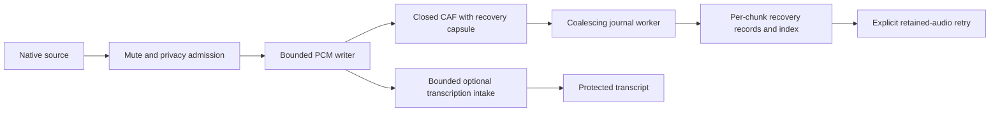

# Recording reliability

File-backed capture owns the original audio. Recognition, attribution, metadata,
indexing and publication are optional consumers. Their failure must not end the
physical recording, delete PCM, or make the next valid buffer inadmissible.
This product requirement was explicitly confirmed on November 11, 2026.

## Ownership and failure boundaries

The existing writer orders producers and measured clocks. It owns each live CAF
handle. Only closing that handle and writing the bounded recovery capsule happen
at a chunk boundary. Growing track JSON, hashing, full sync, journal writes and
indexing run outside the PCM queue. The journal retains one active snapshot and
one coalesced successor. A complete compatibility manifest is written at Stop.

Each CAF capsule contains the track identity, frame extent, measured clock and
relevant capture eras. It contains no transcript, model weights or credentials.
The per-chunk journal and the capsule provide independent recovery paths. Recovery
confines paths, rejects symlinks, verifies format/frame count and hashes the actual
file before publishing it as a ready asset. A metadata or verification failure
preserves the partial for a later attempt.

Metadata receipts control live transcription admission. They do not hold PCM
queue reservations. Pending live offers retain their original order behind an
era receipt and have explicit count/byte limits. If that optional budget is
exhausted, release it, defer transcription and keep writing audio.

## Observable outcomes

| Failure | Capture | Transcript and recovery |
| --- | --- | --- |
| Recognizer preparation or inference fails | Continue | Mark deferred; release attempt resources; retry retained audio explicitly |
| Metadata/index unavailable or slow | Continue | Keep audio and conservative in-memory provenance; retry metadata |
| PCM queue temporarily saturated | Accept later valid audio | Record dropped-input health and measured gaps; never claim complete coverage |
| Optional live queue saturated | Continue | Discard only optional copies; defer recognition |
| Index and sidecar lost | Preserve CAF | Recover clock/frame facts from its bounded capsule |
| User stops | Join capture, close files, join optional workers | Healthy live mode finalizes without replay; failed live mode offers retained retry |

The writer bounds both PCM bytes and duration. It never substitutes an unlimited
queue for reliability. If the OS supplies no samples, storage cannot accept bytes,
power is lost or a process is killed, software cannot manufacture missing audio.
Keep explicit evidence of such gaps and preserve all available files. Continuing
the recording must not be confused with claiming every source frame was saved.

Mute/privacy admission remains before persistence. A strict no-file policy never
silently falls back to unencrypted files. Deferred publication remains closed if
its required privacy processing fails.

## Verification

Use the actual integration target with deterministic substitutes at model and I/O
boundaries. Tests must cover delayed/failing metadata, consumer rejection, bounded
queue overflow and later recovery, preservation of earlier PCM after a bad buffer,
later transcription retry, cancellation, and reconstruction without an index.
Long synthetic capture must decode and compare saved PCM, keep the actual native
clock cadence, and avoid a mandatory per-minute finalization barrier.

Source review, synthetic long-call tests, actual inference, native capture and a
physical conference are separate evidence. Installation uses the frozen signed
candidate and the existing [native acceptance](agent-workflow.md#native-acceptance)
and [Mac distribution](macos-distribution.md) procedures.
