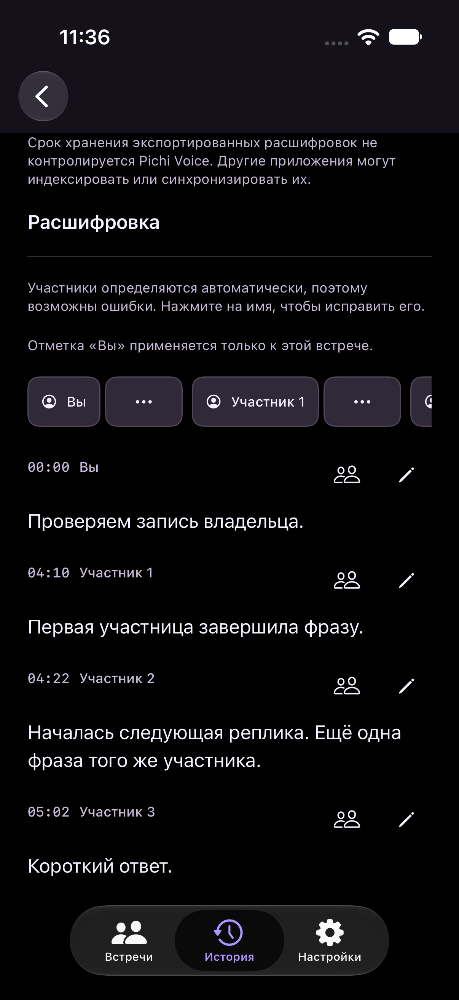
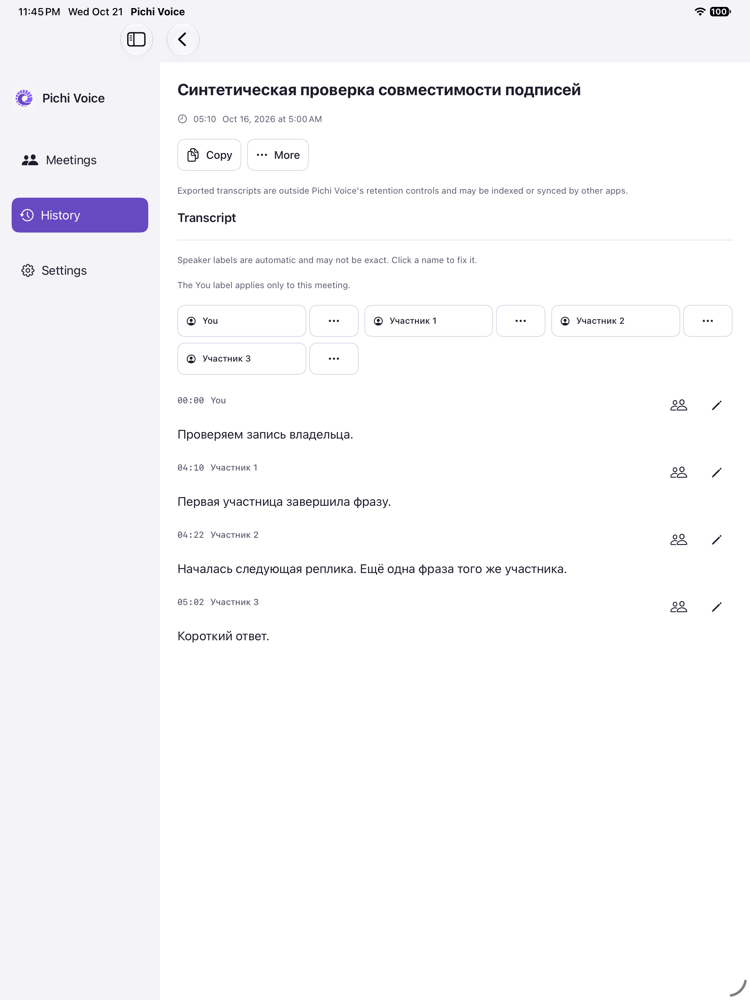

# Stable meeting participant opening

Mobile code and native test revision: `5f365976e0cf4daaf138045c28507aba978f2418`.
Desktop empty-state completion and independent final code review: `d5173f5fca82bda8e55c2dc474984ecb57a3c019`. The later desktop-only delta does not enter the mobile target.
Base: `6691dcffd6eff893179fc6ffc41fe9588426ce7d`.

## Cause and behavior

A final punctuation-only ASR word could pass the privacy gate unchanged because it was nonempty. With no acoustic assignment, the protected tail allocated a provisional product identity. Roster and caption rendering then displayed another numbered participant. This establishes a publication/identity-policy defect; it does not establish why recognition emitted punctuation or demonstrate another acoustic person.

New recordings freeze an additive stable-opening policy. The first actual lexical native speaker may be visible immediately. Additional identities use existing native voiced qualification, including accumulated brief replies. New uncertain bouts no longer allocate standalone provisional identities. A short unresolved run of at most 3.5 seconds may use an independently supported existing neighbor within 0.8 seconds, preferring compatible native cues. These contextual choices retain native timing/assignment and an explicitly non-acoustic rule. They cannot sponsor voice enrollment or owner proof. The existing owner thresholds and continuity implementation remain unchanged.

Letters/numbers count as lexical content. Combining-only and default-ignorable scalar strings do not. True privacy replacements retain separate optional provenance, so even symbolic masks remain readable. Standalone noise is excluded from shared reading paragraphs, protected live history, readable export and generated participant rosters. Adjacent typography retains original source members and times. Canonical diagnostic evidence is preserved. Domain identities remain available for corrections and undo; rendering never renumbers or rewrites saved personal meetings.

The shared caption formatter no longer adds provisional qualifiers. Saved legacy uncertainty metadata, manual aliases and decoding remain compatible. Older frozen policy fingerprints retain their previous identity. Final contextual attribution reads immutable indexed inputs across former word/text chunk boundaries with scalar working state and cancellation checks; an artificial storage boundary cannot change ownership.

## Verification

Independent automated review of the integrated code at `5f365976` and the desktop-only completion at `d5173f5f` found no remaining P1/P2 issues after fixing invisible scalar admission, final chunk context, desktop fallback rows and punctuation ownership anchors. Later standalone-test and documentation changes do not alter the tested native application.

| Check | Result |
| --- | --- |
| Protected word tail | 28,990 passed |
| Known-speaker registry | 139 passed |
| Native voiced admission | 211 passed |
| Privacy/transcript state | 3,302 passed |
| Stable and legacy identities, chunk edges and cancellation | 542 passed |
| Store, reading and protected export, including 20,000-row codecs | 846 passed |
| Structured privacy policy and symbolic masks | Passed, model-free |
| Portable repository checks | Passed |
| Native iPhone/iPad integration | 41 passed per form, zero failures/skips |
| Native iPhone/iPad UI | One targeted reopen case per form passed; 28 exact checkpoint frames reviewed |
| Unsigned native macOS Debug build | Passed on final desktop code |

Host: Apple Silicon, macOS 26.6.2, Xcode 27.0 (27A266a). Native mobile version remains 0.1.0 (5).

The native owner Stop regression was updated from the retired expectation of a mandatory preliminary third person. It still verifies owner identity, issued numbers, exact useful text/native metadata, Stop and fresh-store reopen. Existing source-only composer expectations were updated to consume explicit protected context rather than manufacture ownership from capture routing.

A portable process-cleanup race failed on the first run, then passed in isolation and in the complete portable rerun. An initial integrated probe was invalidated when review fixes changed a source during compilation; its incomplete stages are not counted. The expensive optimized macOS Release build was intentionally cancelled; it is not reported as a pass.

## Scope and evidence

Only synthetic fixtures and native simulator screenshots are published. The actual latest iPad meeting, audio, profiles and logs remain in ignored local storage with copied-file hashes. The physical device was read only and released, without launch, installation, preference or enrollment changes. Retained logs show aggregate progress, not every raw ASR callback or intermediate revision; exact callback chronology cannot be recovered from them.

No new model inference, microphone/audio-route test, physical-device acceptance or full macOS integration suite was run for this increment. Simulator results verify the tested synthetic UI and native service paths. The iPhone periodic capture began after its initial native checkpoints; complete one-second coverage is not claimed. Exact requested native checkpoint images were individually reviewed. An additional 27 iPhone and 39 iPad unique application-area periodic states were visually inspected from the full originals, with launch/navigation transitions distinguished from stable screens. Duplicate application pixels were indexed using only a documented system-status-bar exclusion (top160 native pixels on iPhone, top60 on iPad); full originals and hash provenance remain local. iPad periodic capture began before its UI actions. iPhone periodic capture retained 421 frames with 5 missed schedule slots; iPad retained 360 frames with 160 missed slots. Both report zero capture errors. These are periodic samples, not continuous one-second proof. All full originals, changed-frame indexes and exact-step acknowledgements remain local.

## Cleanup

Both newly created task simulators were shut down and deleted. The iPad app container was copied and all 28 retained files hash-verified before deletion. The iPhone full-container backup command failed after shutdown because that state prevents container lookup; the synthetic-only device was subsequently deleted. No personal input or real enrollment had been staged there, and its source fixture, frozen products, test reports and every external screenshot remain independent. No full iPhone-container backup is claimed. Task child worktrees were removed after verified evidence copy. Reproducible task build/package caches were removed after final evidence preservation; private originals, frozen mobile products and verification records remain in ignored local storage.

## Native screenshots

Only synthetic content is shown.

