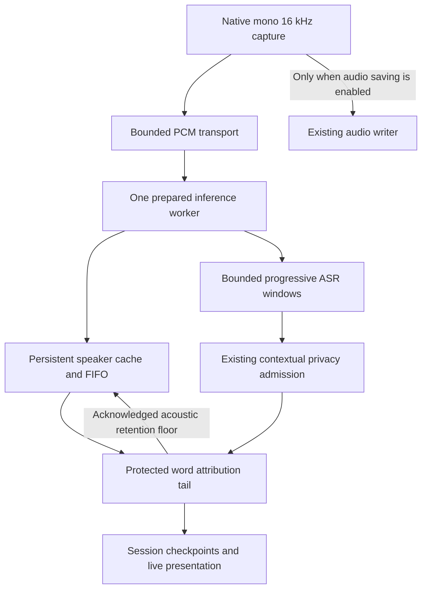

# Streaming meeting processing

The experimental speaker-processing mode is registered for GigaAM in-room meetings. It is
off by default. Recognition, text privacy and speaker attribution share the existing meeting
pipeline, resource owners, session store and native capture engines.

## Why continuous speaker state

Nemotron uses an arrival-order speaker cache and a recent-frame FIFO. Resetting its state for
each ASR phrase loses the meaning of speaker slots. One attempt therefore owns one diarizer
state from the first sample through the final right-context flush. Speaker slots identify
anonymous voices within this attempt; they do not establish people's names or the owner's
identity.

The registered streaming profile is the pinned FP16 fast128 Core ML artifact with CPU-only
execution. On the physical A10X iPad, isolated diarization of 180 seconds took 46.6 seconds
with a sampled application footprint peak of 243 MiB. These are model-only measurements;
they do not establish joint ASR/privacy throughput, attribution quality or battery cost.
The fast128 input-buffer latency is 10.56 seconds before inference time. Its throughput is
more suitable for the old iPad than the measured fast32 variants, at the cost of later labels.

Sources: [NVIDIA model card](https://huggingface.co/nvidia/Nemotron-3-Diarization),
[Core ML conversion](https://huggingface.co/FluidInference/nemotron-3-diarization-coreml),
[diart incremental, overlap-aware alternative](https://github.com/juanmc2005/diart).

## Processing and publication

* Capture uses one monotonic sample clock. Native word timestamps retain their original
  values and identities. An ASR window identity differs from the continuous speaker epoch.
* The logical stages run concurrently with capture, while expensive inference operations
  run cooperatively in sequence. Two independent tasks must not compete for model residency.
* A prepared ASR session and one diarizer remain inside their original resource scopes.
  The command controller joins both scopes on success, failure and cancellation.
* PCM windows are at most 20 seconds; the transport charges queued and in-flight audio
  against one 60-second budget. There is no complete AAC archive in streaming mode.
* Acoustic processing progress does not prove that ASR recognized the same prefix. The
  adapter reports an explicit ASR stability cursor, including sealed silence windows.
* Privacy admission precedes display and persistence. The existing lexical tail can span
  ASR windows. Previously admitted text is never sent through redaction a second time.
* Only protected words covered by both the ASR and acoustic cursors enter attribution.
  Neighbor and short-interruption rules reuse the canonical policy. A finite future context
  permits revisions; ambiguous evidence eventually remains explicitly uncertain.
* Speaker-only patches apply to the latest stored segment. They preserve current text,
  native timing, privacy status and completeness. Session speaker aliases remain session data.
* Native callbacks can publish safe metadata and checkpoints but cannot recursively submit
  commands to their own worker. Eviction is acknowledged after publication, outside callbacks.

The protected pending queue and attribution tail have independent word, text-byte and
activity limits. A long pause alone is not a failure. Input gaps, exhausted budgets,
unsupported native timings or failed inference stop the attempt explicitly and preserve
completed protected text. There is no silent frame dropping or hidden full-audio fallback.

## Stop, retained audio and compatibility

Normal Stop joins native capture, queued inference, the diarizer's final context and the
privacy/attribution tail. It does not repeat diarization over the whole recording. The session
coordinator merges the final checkpoint before creating the processing result.

Audio saving remains an independent capture setting. When enabled, the existing writer
receives the same capture alongside the bounded consumer. A later retained-file retry uses
the pinned recording mode and profile. When disabled, audio remains in bounded memory and
cannot be recovered after process termination.

The optional mode decodes old sessions as `afterRecording`. Legacy configuration identities
remain unchanged; streaming identities include the mode and exact model profile. An
unsupported backend or two-source capture is rejected before permissions and preparation.

## Continuing participant reading convention

The displayed transcript assigns a short mixed insertion to the continuing main participant.
For `A / mixed / B / mixed / A`, the complete bounded insertion reads as A. The closest clean
participant before the interruption owns the pending bout; an older participant cannot claim
it merely by appearing inside the insertion. A clean `A / B / A` exchange remains three turns.
At a genuine change of participant, an unresolved short prefix can still follow the incoming
participant under the existing neighbor rule. Missing audio, manual corrections, incompatible
tracks or speaker epochs, temporal conflicts and long insertions block inference.

This is a reading convention, not source separation or proof of who spoke each recognized word.
Labels show plain participant names. They do not show multiple-speaker, interrupting or
estimated annotations. An unresolved passage without defensible context retains the ordinary
unknown-participant label. Word times, raw candidate voices and overlap evidence remain intact
in the canonical JSON. A shared batch projection supplies history, live captions, desktop,
text export, CLI labels and summary citations. Reading an archive never rewrites its manifest.

New attempts freeze `enableMainSpeakerContinuation` in their attribution policy. Missing keys
decode to false, preserving old checkpoint identities and processing on resume. The current
reading projection can apply the convention to old archives independently of their raw evidence.
Legacy inferred identities cannot act as independent anchors for another contextual guess.

## Verification boundaries

Model-free contract tests cover PCM continuity, explicit stability cursors, privacy boundary
holds, bounded protected history, long silence, late speaker revisions and joined native
cleanup. The opt-in mobile E2E test separately measures paced joint inference, pre-Stop safe
publication, native word preservation, no-audio-file behavior, resource samples and Stop tail.
Detailed profiling is explicitly gated and records scalar timing/resource metadata.

Automatic Fathom annotations are a weak comparison reference, not manually verified DER
ground truth. One ASR stream also cannot reliably recover both word sequences in overlapping
speech. Contextual reading ownership remains an evidence-gated heuristic rather than source
separation or proof of the words spoken by each voice.
