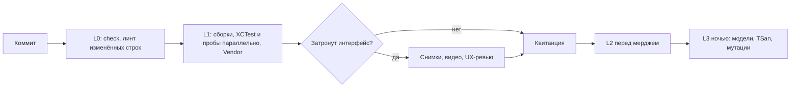

# Аудит тестовой инфраструктуры

Этап 1 плана улучшения проверок. Код продукта и проверки в этом PR не менялись, ничего не удалено и не перенесено.

Машиночитаемые данные: [таблица проб](test-infrastructure-probes.json), [хронометраж](test-infrastructure-timing.json), [мутации](test-infrastructure-mutations.json), [пропуски XCTest](test-infrastructure-skips.json).

| Что | Значение |
| --- | --- |
| Ревизия замеров, точка «до» | `788f26c6` |
| Сверка после влития #91 и #92 | `68b935b4`: падают те же 14 проб |
| Машина | Apple M4 Max, 16 ядер, 128 ГБ, macOS 26.6.2, Xcode 27.0 |
| Условия | Рабочая машина: часть замеров шла рядом с другими сессиями, Zoom и индексатором Spotlight. Значения под известной нагрузкой помечены. Время коммитов указано по UTC-7 |

## Итог

1. **Автоматического шлюза почти нет.** На каждый PR CI запускает только Linux-набор `check.sh`. Все 100 последних прогонов `Build and Test` (29 октября - 5 ноября) пропущены: первый джоб `changes` защищён условием на репозиторий upstream, а от него зависят линт и сборка, поэтому SwiftLint в этих прогонах не запускался. macOS и iOS в CI работают только по ручному запуску, а пробы не запускаются в CI совсем.
2. **Вне шлюза проверки гниют за дни.** 14 из 105 исполняемых проб стабильно падают на чистом `main`. На ревизии 30 октября 11:35 все 14 были зелёными, а 3 ноября 13 из них сломали два слияния подряд. Ещё 10 из 29 проверок, которые никто не запускает, тоже падают. Для всех 14 проб починка подтвердила, что причина в тестах, а не в продукте, см. [раздел о сломанных проверках](#сломанные-проверки).
3. **Пробы и XCTest дополняют друг друга.** Из 48 мутантов, отобранных по вреду, а не случайно, поймано 28 (58%): пробами 18, XCTest 12, мобильными тестами 1. Только пробы поймали 15, только XCTest 10. Поэтому удалить пробы как дубли нельзя: прямых кандидатов нет, кроме вывода из реестра `local_api_live_harness` и `diarization_repeatability`, которые запускают те же файлы, что и `check.sh`.
4. **XCTest почти не исполняет публикацию и приватность.** Он исполняет 43,5% функций `Sources`, но только 4% в `CloudPublication` и 2% в `Privacy`. Для всех 9 мутантов публикации ни один класс XCTest не заходит в изменённую функцию, там всё держится на пробах.
5. **Пробы ускоряются почти бесплатно, XCTest нет.** Параллельный запуск сокращает все 105 проб с 22 минут до 4-5 минут: 1343 с по одной, 289 с на 8 потоках, 235-259 с на 12. Первая оценка здесь, 69-100 секунд, относилась только к 91 исправной пробе, а самые медленные были среди сломанных. Параллельный XCTest оказался ненадёжным: в 9 прогонах упали 33 разных теста из 14 классов. Все 14 пишут в общие настройки, а параллельные процессы делят один домен настроек. Таких классов 103 из 217, поэтому XCTest остаётся последовательным, а пробы идут рядом с ним.
6. **Выбор проверок по влиянию помогает, но уступает параллельности.** На 40 последних слияниях в `main` он сократил бы XCTest примерно вдвое (медиана 165 с, среднее 144 с вместо 285 с), а пробы примерно на 68%. Это расчёт, сами выборки не запускались. Параллельный запуск даёт ускорение в 3-4 раза и не несёт риска пропустить нужный тест, поэтому граф зависимостей лучше отложить.
7. **Новый тестовый таргет не нужен.** В пилоте (ветка `claude/xctest-pilot`, в этот PR не входит) две пробы перенесены в существующий таргет без вырезок и заглушек, 5 новых тестов ловят все 8 мутантов, которых ловили пробы `publication_consent` и `history_persistence` (`STOR-02` и `STOR-03` ловила ещё `admitted_history_writes`). Одна синхронизированная папка требует разовой правки `project.pbxproj` на 9 строк, дальше новые файлы подключаются сами.
8. **macOS визуально почти не проверяется.** По чтению кода автоматических снимков настоящего приложения на macOS нет, 22 из 50 поверхностей не имеют снимков вообще, а 33 из 40 последних слияний затрагивают интерфейс.

## Поправки к исходным фактам

| Считалось | Измерено |
| --- | --- |
| XCTest macOS: 3551, 3464 прошли, 1 упал, 86 пропущены | На `788f26c6` 3552, 3465 прошли, 1 упал, 86 пропущены. На `68b935b4` вне `~/Documents`: всего 3558 с 5 тестами пилота, 3472 прошли, 0 упали, 86 пропущены |
| 106 проб, около 53 тыс. строк | 106 проб, 56,7 тыс. строк (скрипты 9,2 тыс., 170 файлов обвязки 47,5 тыс.) |
| 106 проб это все проверки | 105 исполняемых, `update_prompt` только по opt-in. Есть ещё 29 незарегистрированных проверок и 184 теста в `Vendor/*`, которые никто не запускает |
| 422 текстовых якоря в upstream-файлах | Способ подсчёта в #91 не записан. Здесь: 1140 строковых литералов скриптов дословно совпадают с текстом upstream-файлов, которые проба использует. Это верхняя граница, а не точное число якорей |
| CI запускает SwiftLint вне черновика | В 100 последних прогонах не запускал: джоб `changes` защищён условием `github.repository == 'altic-dev/FluidVoice'`, а линт зависит от него |
| Release macOS 333 с | 391 с (холодная сборка, рядом шли другие задачи) |
| iOS build-for-testing 86 с | 109-218 с холодная сборка в зависимости от нагрузки, 5 с без изменений |
| Падение shimmer связано с видимостью окна | Подтверждено и уточнено, см. [раздел о старых падениях](#старые-падения) |
| Диск: 38 ГБ свободно | Наблюдались значения от 4,7 до 63 ГБ за сутки. Часть объяснена: каждый запуск `xcodebuild -xctestrun` без `-derivedDataPath` создаёт каталог в глобальном `DerivedData` |
| Файлы под `~/Documents` блокируют процессы симулятора | Блокируют и macOS, но не постоянно: последовательные прогоны под `~/Documents` работали, а с 2 часов ночи хост стоял в `open()` при запуске и при символизации упавшего теста, см. [что не проверено](#что-не-проверено) |

## Хронометраж

| Проверка | Время | Заметка |
| --- | --- | --- |
| `check.sh` | 48-51 с | 26 с из них `run_upstream_sync_tests.sh` |
| SwiftLint, весь репозиторий | 3 с | 12 514 нарушений в `--strict` |
| SwiftFormat `--lint Sources` | 6 с | 458 из 578 файлов, без указания версии Swift, часть правил не применялась |
| macOS Debug, холодная сборка для тестов | 105 с | |
| macOS Debug, правка одного файла | 20 с (18-30) | по 48 мутантам |
| macOS Debug, без изменений | 6 с | |
| macOS Release, холодная | 391 с | |
| XCTest macOS | 293-295 с | первый прогон 340 с: скачивание моделей |
| XCTest macOS, 4, 6, 8 работников | 96, 73, 67 с | по одному прогону на `68b935b4`. Падают разные 5-6 тестов, в последовательном ни одного. В более раннем прогоне с 6 работниками и изолированным `HOME` упало 9 |
| XCTest macOS под Thread Sanitizer | 610 с | |
| XCTest iOS, интеграционные | 116-127 с | 293 прошли, 45 пропущены. Под нагрузкой, load average 300-600 |
| XCTest iOS, UI, iPhone 17e | 1673-1680 с | на чистом симуляторе 8 прошли, 20 упали, 36 пропущены, см. ниже. Первый прогон под нагрузкой |
| Пробы последовательно | 766-771 с | 888 с с холодным кэшем модулей и load average около 30. Компиляция 509 с из 775. На `68b935b4` 920 с под load average до 84 |
| Пробы, 8 работников | 99-103 с | только 91 здоровая проба, без ложных падений |
| Пробы, 8 работников, общий кэш модулей | 89-94 с | 72 пробы сейчас держат кэш во временном каталоге |
| Пробы, 12 работников, общий кэш модулей | 69 с | один прогон |
| Тесты `Vendor/*` | 74 с | 4 пакета, все зелёные |

XCTest сильно неравномерен: 3047 тестов быстрее 0,1 с, а 48 тестов дольше секунды занимают 165 из 285 с. Четыре класса дают половину времени, в основном реальные ожидания: `MeetingRecoveryTests` 53 с, `MeetingParakeetNemotronBackendTests` 40 с, `NormalAudioCaptureCompatibilityTests` 26 с, `AudioRouteRecoveryIntegrationTests` 25 с.

Повторяемость хорошая для больших проб. У коротких, до 4 с, разброс доходит до 5 раз и в тёплых прогонах, например `command_workspace_presentation` 0,7 с против 3,5 с.

## Что реально проверяется

| Проверка | Где запускается |
| --- | --- |
| `check.sh` | CI на Linux, вручную |
| SwiftLint | Нигде |
| Сборка и XCTest macOS | Вручную и через `workflow_dispatch`, всего 43 ручных запуска, в основном на ветках синхронизации. Автоматически только при `PICHI_VOICE_MACOS_CI=true`, сейчас не задана |
| Сборка iOS | Вручную и через `workflow_dispatch` |
| 105 исполняемых проб | Вручную через `standalone-regression` |
| 29 незарегистрированных проверок | Нигде |
| 184 теста `Vendor/*` | Нигде |
| Мобильные UI-тесты | Вручную, требуют заготовок на симуляторе |

Организация на GitHub Free: репозиторий приватный, защищённых веток нет, поэтому шлюз может быть только процессным. Своих runner нет. Полный XCTest на размещённом runner прошёл за 10 минут (прогон `41741192794`), но для этого на ветке был временно выбран образ с Xcode 27. Минута macOS в октябре стоила около $0,062, то есть такой прогон обходится примерно в $0,6. Сами пробы на Linux не запускаются: им нужен Xcode.

## Классификация проб

Каждая проба прочитана целиком. Подробности по каждой: что защищает, файлы, время, дубли, решение, препятствия для переноса.

| Тип | Проб | Время | Сломано |
| --- | --- | --- | --- |
| A: логика на скомпилированном или вырезанном коде | 96 | 673 с | 12 |
| B: текстовая проверка исходников как основная | 1 | 2 с | 0 |
| C: рендеринг и контраст | 5 | 63 с | 2 |
| D: внешний процесс | 4 | 36 с | 0 |

Типы смешаны: 30 проб содержат текстовые проверки как часть, 72 вырезают код по маркерам, 31 компилирует только целые файлы.

| Решение | Проб |
| --- | --- |
| Перенести в XCTest | 66 |
| Разделить на части | 33 |
| Оставить чёрным ящиком | 5 |
| В общий визуальный набор | 2 |
| Удалить | 0 |

Размер переноса: 33 малых, 41 средний, 32 больших. Числа 66 и 33 в таблице выше включают 24 и 8 проб с upstream-скриптами: 32 скрипта и 37 файлов обвязки принадлежат upstream, их нельзя удалять без роста расхождения, поэтому такие пробы выводятся из наших проверок, а файлы остаются на месте.

Выявлены хрупкие связи: `declaration()` из `run_meeting_backup_refresh_tests.py` импортируют другие пробы и `Tests/Support/write_private_profile_standalone_types.py`. `ui_contrast` это один скрипт на 828 строк с примерно 86 текстовыми проверками внутри.

## Сломанные проверки

**Зарегистрированные пробы, 14 из 105.** На `68b935b4` список тот же.

| Проба | Причина | Сломало |
| --- | --- | --- |
| `publication_outbox` | Проба не поставляет переводы заголовков, позже новые зависимости | 30 октября, между #82 и #86 |
| `meeting_session_store_checkpoint`, `publication_composition`, `meeting_asr_prepared_provider` | Новые зависимости `MeetingProcessingConfiguration.swift` (`99be891b`) | 3 ноября, #89 |
| `ui_contrast`, `participant_input_contrast` | Вырезанный фрагмент получил лист выбора языка | 3 ноября, #89 |
| `meeting_backup_refresh` | Новый `MeetingRecordingSourcePromptController` (`80ac6e4a`) | 3 ноября, #89 |
| `paste_key_cache` | `import AppKit` в файле, который проба собирает без него (`ea94c8a6`) | 3 ноября, #89 |
| `voice_edit_cancellation` | Новый вызов `showEditModeFailure` (`51465d76`) | 3 ноября, #89 |
| `file_operation_isolation` | Новый тип `DictionaryLearningFeatureFrames` | 3 ноября, #85 |
| `command_archive_search` | Новое поле в заглушке | 3 ноября, #85 |
| `dictionary_training_save` | Новое поле в заглушке | 3 ноября, #85 |
| `local_api_lease` | Вторая перегрузка функции, маркер перестал быть уникальным | 3 ноября, #85 |
| `dictation_capture_admission` | Текстовая проверка порядка устарела: захват аренды стал асинхронным (`7a37d314`) | 3 ноября, #85 |

Состояние определено прогоном этих проб на шести ревизиях `main`: 29 октября красные 6, 30 октября в 11:35 ни одной, 30 октября в 15:43 одна, такой же она оставалась 1 и 3 ноября, после #89 девять, после #85 все 14. #83 и #84 отдельно не проверялись, поэтому граница для `publication_outbox` приблизительная. Это цикл: поломка, разовая чистка, снова поломка. Проверка на уровне PR показала бы каждую поломку в момент слияния. У четырёх проб одна причина, поэтому починка обходится дешевле числа проб.

**Незарегистрированные проверки, 10 из 29.** Девять не компилируются, десятая это `test_physical_ui_smoke_observation.py`. 7 из 10 принадлежат upstream. Починка этих девяти не проверялась.

**Проверка починки.** В локальной ветке починены все 14 проб: 176 строк добавлено, 19 удалено, только в `Tests/`, 5 файлов upstream. Проверки не ослаблялись, единственная изменённая по смыслу (`dictation_capture_admission`) стала строже. Все 14 и 6 незарегистрированных скриптов проходят вместе на объединённой ветке. Это в данный PR не входит.

## Мутации

48 ручных семантических мутаций в критичном коде: приватность, хранение, отмена, выбор модели, публикация. Все собрались, контрольный прогон без мутаций чистый. Для каждой запускалась 91 здоровая проба, для общих файлов ещё мобильные интеграционные тесты. Упавшая проба считалась только после подтверждения отдельным запуском. XCTest целиком запускался для 6 мутантов, для 26 только классы, исполняющие изменённую функцию, а для 16 мутантов таких классов нет, и XCTest поймать их не мог. 14 проб, сломанных на момент замера, участвовали только во втором проходе: для 20 выживших мутантов.

| Домен | Мутантов | Поймано | XCTest | Пробы | iOS | Поймано с починенными пробами и скриптами |
| --- | --- | --- | --- | --- | --- | --- |
| Приватность | 10 | 5 | 1 | 5 | 1 | 5 |
| Хранение | 10 | 8 | 3 | 5 | 0 | 8 |
| Отмена | 10 | 5 | 3 | 3 | 0 | 7 |
| Выбор модели | 9 | 5 | 5 | 0 | 0 | 6 |
| Публикация | 9 | 5 | 0 | 5 | 0 | 7 |
| **Всего** | **48** | **28 (58%)** | **12** | **18** | **1** | **33 (69%)** |

Починка 14 проб и регистрация незадействованных скриптов добавляют 5 поимок. Оставшиеся пробелы закрываются только новыми тестами. Первый такой тест уже проверен: 5 строк для `PRIV-10` проходят на чистом коде и ловят мутанта.

Разбор 20 выживших чтением кода дал 10 настоящих пробелов и 10 защит, продублированных другой проверкой. Эквивалентных мутантов нет. Разбор ошибался в обе стороны: `CANC-04` и `PUB-08` он считал дублями, но починенные пробы их поймали, поэтому оценку важности стоит считать предварительной. Запуском подтверждён только `PRIV-10`.

| Мутант | Важность | Что может случиться |
| --- | --- | --- |
| `PRIV-10` | высокая | Классификатор пропускает незавершённое последнее предложение, если до него были другие. Чувствительная фраза в конце фрагмента не распознаётся |
| `PRIV-09` | средняя | Хвост текста пишется в контрольную точку до классификации |
| `PUB-09` | средняя | Стенограмма с исключёнными интервалами уходит на анализ в облако |
| `STOR-09` | средняя | Запись манифеста и индекса встречи перестаёт быть атомарной |
| `MODEL-09` | средняя | Отмена повторной подготовки удаляет уже скачанную модель |
| `PRIV-06` | средняя | Утечка хранилища и второй писатель в тот же каталог после повторного входа |
| `CANC-02` | средняя | Отмена внешней задачи не доходит до операции. После починки проб ловится |
| `CANC-07` | средняя | Сбой загрузки не закрывает токен, только мобильный путь |
| `MODEL-04`, `MODEL-07` | низкая | Выбор чужого манифеста. `MODEL-04` ловится незарегистрированным скриптом |

Ограничения выборки: мутации отбирались по вреду, а не случайно, поэтому 58% не оценка всего кода; 48 штук затрагивают малую часть проб; выбор классов по покрытию проверен полными прогонами лишь шести мутантов, ни один из которых XCTest не поймал.

## Покрытие

| Область | Функций исполнено XCTest | Всего | Доля |
| --- | --- | --- | --- |
| `Services/Meeting` | 5151 | 8566 | 60% |
| `Persistence` | 1140 | 1929 | 59% |
| `Account` | 140 | 517 | 27% |
| `UI` | 1691 | 8355 | 20% |
| `Services/CloudPublication` | 21 | 529 | 4% |
| `Services/Privacy` | 4 | 186 | 2% |
| Весь `Sources` | 13854 | 31854 | 43,5% |

У 44 из 212 классов нет ни одной функции, которую не исполнял бы другой класс. 14 из них полностью пропускаются. Остальные 30 содержат 155 живых тестов и 32 с времени, но совпадение функций не означает совпадения проверок, поэтому удалять их на этом основании нельзя. Для 91 здоровой пробы покрытие строк не снималось: вырезанный код не сопоставляется с исходниками.

## История

Разобрано 3236 коммитов, 619 трогают файлы проб. Классы определялись правилами, а не чтением каждого diff, поэтому точность не измерена.

| Вердикт по пробе | Проб |
| --- | --- |
| Доказанная поимка | 1 (`participant_input_contrast`) |
| Только стоимость маркеров | 15 |
| Неизвестно | 52 |
| Сигнала нет | 38 |

Тела коммитов почти не называют упавшую пробу, поэтому «неизвестно» означает отсутствие доказательств, а не отсутствие поимок. Самые дорогие по правкам маркеров: `participant_input_contrast`, `meeting_backup_refresh`, `ui_contrast`, `meeting_capture_pcm`.

Найдено только человеком или на устройстве: обрезанные подписи на iPad, контраст кнопки AI Enable в неактивном окне, оттенок в углах панели субтитров, двойная вставка после физической отмены, английские шаги на русской странице разрешений.

## Пропуски

Разобраны все 86 пропусков macOS: у каждого есть причина-сообщение. У 67 нет ни запускателя, ни упоминания в документации.

| Слой | Тестов |
| --- | --- |
| L3, настоящая модель или публичная заготовка | 35 |
| Диагностический инструмент, а не тест | 16 |
| L4, оборудование или ручной запуск | 12 |
| L4, подписанный релиз | 10 |
| Вручную, личные данные | 6 |
| L1, визуальная проверка | 5 |
| L2, нужен отдельный запускатель | 2 |

Слои назначены по ключевым словам сообщений и требуют сверки при оформлении. Ещё 45 пропусков в мобильных интеграционных тестах, в основном нужны активы моделей, opt-in HTTP или физическое устройство.

## Старые падения

**`OverlayCaptionPresentationTests.testWaitingShimmerStopsWhenItsViewOrWindowIsHidden`.** Тест требует, чтобы окно реально оказалось на экране. В запуске через `xcodebuild` это не гарантировано: в прогонах с падением `CGWindowList` не показывал окно как видимое, `isOnActiveSpace` было ложно, `occlusionState` не становился `.visible` и за 3 с, не помогали уровень `.statusBar`, `canJoinAllSpaces` и цикл событий. Это не гонка. В последовательном прогоне 5 ноября в 03:45 тест прошёл, а в прогоне в 02:43 на той же машине упал, значит, результат зависит от состояния экрана. Исправление в 7 строк: тестовый подкласс `NSWindow` переопределяет `occlusionState`, остальные условия остаются настоящими. Проверено: тест проходит, а если убрать проверку `alphaValue` из продукта, падает.

**`Tests/test_physical_ui_smoke_observation.py`.** Ищет в тексте `presentationDone.exists`, а код с PDF удалён в `f695c5b4`. Лечится удалением одной строки, проверено. Тест не входит в `check.sh`, поэтому этого никто не заметил.

## Зависимость от окружения

| Находка | Доказательство | Следствие |
| --- | --- | --- |
| `~/Documents` блокирует хост | `sample`: главный поток в `open()` внутри `dyld`, и в символизации после падения теста. Из `~/.pichi-test-infra` всё работает | Worktree сессий Claude Code лежат под `~/Documents`, Codex нет |
| Глобальный `DerivedData` засоряется | В пике 1415 каталогов `Fluid-*`, с покрытием по 42 МБ, из них 214 создал этот аудит | В `macos.sh` нужен `-derivedDataPath` для шага `-xctestrun` |
| Тесты ходят в сеть | Прогон в новом пространстве имён скачал 871 МБ (две модели), в том числе из `testProfileFreeLongDictation...` и `testTrainingTranscribesSpellings...` | На чистой машине поведение другое. Вынести в L3 |
| Мусор в реальном `~/Library/Preferences` | 133-143 файла за прогон XCTest, всего почти 13 тыс., из них около 5 тыс. добавили прогоны этого аудита | Нужна уборка после прогона |
| Подмена `HOME` не лечит настройки | `CFPreferences` пишет в реальный каталог, `FluidServeTests` падают, 10 тестов подписи пропускаются | Общий `HOME` для тестов не годится |
| Тесты используют настоящую подпись разработчика | Без реального Keychain 10 тестов `UpdateBundleValidatorTests` пропускаются | Результат зависит от машины |
| Тесты хоста используют `ai.pichi.voice.debug` | Значение из `Configuration/PichiBrand.xcconfig` | Совпадает с ручными Debug-сборками и между сессиями. Нужен отдельный идентификатор |

Thread Sanitizer на всём наборе: 3464 теста прошли, 2 упали (shimmer и `testUnexpectedCaptureStopFinalizesAndReleasesLease`, причина второго не разобрана), 4 отчёта о гонках только в тестовом дублёре `Gate`. **В коде приложения гонок не обнаружено**, но только в пределах исполняемых 43,5% функций. Первый прогон под TSan упал: `Fatal error: load from misaligned raw pointer` в `MeetingModelInstaller.swift:64`, где `UInt32` читается через `load(as:)` из 4-байтового `Data` без гарантии выравнивания. Это настоящий дефект: в сборке с отладочными проверками падение, в Release неопределённое поведение. С заменой на `loadUnaligned` полный прогон завершился. Чистая сборка на `68b935b4` даёт 541 уникальное предупреждение: 246 в `Sources`, 3 в `Vendor`, 292 в тестах, примерно 400 из них про изоляцию акторов и `Sendable`. В реальные гонки они в этом прогоне не превратились, но новых добавлять не стоит.

## Визуальное покрытие

| Класс покрытия | macOS | iOS | Всего |
| --- | --- | --- | --- |
| Автоматический снимок настоящего приложения | 0 | 13 | 13 |
| Рендер вне приложения | 10 | 0 | 10 |
| Только замер контраста заготовки | 5 | 0 | 5 |
| Снимков нет | 20 | 2 | 22 |

Без снимков: онбординг macOS, запись встречи и сводка, История, Статистика, AI Settings, Voice Engine, содержимое страниц настроек, строка меню, Command и Edit Mode, аккаунт и публикация на macOS, окна обновлений, Live Activity и ошибки на iOS. Настройки iOS снимаются в трёх из четырёх сочетаний языка и темы, нет английской тёмной.

Дефект AI Enable нашёл человек. Сегодня его ловила бы только `verifyProminentAppearance` на заготовке без настоящего стекла. Не хватает состояния окна на настоящих экранах.

Вход в состояния: на iOS есть аргументы запуска и заготовки встреч, на macOS почти ничего. Окно тестового хоста может не попасть на экран, поэтому настоящие снимки macOS, вероятно, придётся снимать с отдельно запущенной копии приложения. Альтернативы вроде `XCUIApplication` не проверены.

## Мобильные UI-тесты

Из 64 тестов на чистом симуляторе проходят 8, падают 20, пропущены 36. Два прогона совпали, второй шёл вне `~/Documents`, так что это не блокировка файлов и не нестабильность.

Причина падений в скрытом состоянии. Приложение останавливается на онбординге (`onboarding.step.0`), потому что `MobileNavigationUITests` передаёт `-MobileSetupVersion 1` только нескольким тестам по имени, а 19 мест перезаписывают `launchArguments` целиком. Тесты рассчитывают на то, что онбординг уже пройден на этом симуляторе. Одна строка в `setUpWithError` перевела 4 теста в «прошли» и 1 в «пропущен», остальные 15 падений остались. У 11 из них прежнее сообщение: два таких теста прочитаны, они сами перезаписывают аргументы, для остальных это предположение. Ещё 2 требуют заготовок встреч на симуляторе, причина падения `testRussianSettingsAndModelsInDarkAppearance` не разобрана. `testMVPSettingsAndOrientation` падает на проверке нижнего колонтитула над плавающей панелью: это может быть настоящий дефект вёрстки на маленьком экране, разбор отложен до этапа 4.

Xcode уже прикладывает к упавшим тестам запись экрана и дерево доступности, это готовая основа для этапа 4.

## Предлагаемые цели

| Слой | Цель в плане | Предложение | Основание |
| --- | --- | --- | --- |
| L0 | до 1 мин | до 35 с | 50 с минус тест синхронизации 26 с, плюс линтеры 9 с |
| L1 | до 10 мин | около 6 мин, с iOS около 10 мин | Замер `verify` L1 на `04d34b9b` под нагрузкой соседних сессий: всего 596 с. `check.sh` 40 с, XCTest со сборкой 334 с, пробы рядом с ним 312 с, iOS с холодной сборкой 219 с. Без визуальной части |
| L2 | до 20 мин | до 10 мин | полный последовательный XCTest 5 мин, iOS 2 мин, сборки |
| L3 | около часа | без изменений | TSan 10 мин, плюс модели и мутационная выборка |
| L4 | около 30 мин | без изменений | |

## Предлагаемые изменения плана

1. **Шлюз раньше миграции.** Без него починенное снова сломается за дни. Первым делом: параллельный запуск проб и `verify` с квитанцией.
2. **Порядок миграции: публикация, приватность, хранение, остальное.** Вместо настроек и истории. Там защита держится только на пробах.
3. **Без нового таргета и без списка исходников.** Папка `Tests/PichiIntegrationTests/` как синхронизированная группа существующего таргета. Пилот: две пробы перенесены полностью, без вырезок и заглушек, 5 тестов за 1 с, все 8 мутантов, пойманных этими двумя пробами, пойманы, новый файл подключается без правки проекта. Цена: одна правка upstream-файла `project.pbxproj`, 9 строк в трёх местах, которые могут конфликтовать при слиянии с upstream.
4. **Отложить граф зависимостей и кэш результатов.** Сначала быстрый полный прогон: последовательный XCTest и параллельные пробы рядом с ним. Перепроверка упавших поодиночке отвергнута на ревью: она скрывает нестабильные регрессии. Вернуться к выбору по влиянию, если L1 не уложится в цель.
5. **Новые тесты на настоящие пробелы** как отдельный шаг, начиная с `PRIV-10`.
6. **Квитанция вместо размещённого CI.** `verify` публикует статус коммита с локальной машины.
7. **Worktree вне `~/Documents`.** Иначе нельзя стабильно запускать ни macOS, ни iOS тесты.

## Предлагаемые удаления

Удаление проб и классов XCTest на этом этапе не предлагается, кроме вывода двух записей из реестра. Кандидаты:

| Что | Почему | Условие |
| --- | --- | --- |
| `local_api_live_harness` вывести из реестра проб, файл оставить | Запускает тот же `test_local_api_live_harness.py`, что и `check.sh` | Сразу |
| `diarization_repeatability` вывести из реестра проб, файл оставить | Запускает тот же `run_diarization_repeatability_tests.py`, что и `check.sh` | Сразу |
| Наши `Tests/Standalone/GigaAMDictionaryLexicalEvidenceTests.swift`, `GigaAMEncoderDictionaryTests.swift` | Никем не компилируются | После сверки, что покрытие есть в `Vendor/PichiGigaAM` |
| Вторая половина `hotkey_initialization`, `credential_startup` | Перекомпилируют тесты из XCTest | При переносе, с мутационной проверкой |
| Upstream `scripts/test_*.sh` и `Tests/*Tests.swift` без запускателя | Сломаны или не используются | Файлы оставить, в наши проверки не включать |
| Пробы после переноса | Замена ловит те же мутации | По одной подсистеме |

## Что не проверено

- Разбор выживших мутантов не подтверждён новыми тестами.
- Параллельный XCTest остался разобран только статически: связь с общими настройками видна на всех 14 классах, но не доказана для каждого теста.
- Выбор классов по покрытию не проверен на мутантах, которые ловит XCTest.
- Механизм, из-за которого окно хоста иногда не попадает на экран, не установлен, известен только факт и обход.
- Причина смены поведения блокировки `~/Documents` в течение суток не установлена: до 2 часов ночи те же запуски работали.
- Реальное время L1 и L2 после изменений: цели выше это оценки по отдельным замерам.
- Разбор 19 незарегистрированных и `Vendor/*` проверок: только запуск, без оценки ценности.
- Покрытие снято только для macOS XCTest, для iOS и проб его нет.
- Сквозные сценарии, физические устройства, настоящие модели и видео переходов не запускались.
