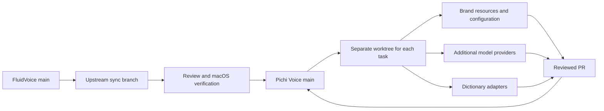

# Upstream and extension strategy

## Starting point

Pichi Voice starts from FluidVoice commit `7daffb529fb9f7c8d075f686a2d3da34695a66e4`, dated October 6, 2026. Development begins in a private, independent repository. It can later become public without discarding the commit history or the upstream relationship maintained by Git.

The repository preserves [GPL-3.0](../../LICENSE) and upstream copyright notices. A private development repository does not change the source license. Before distribution, review the obligations for the app and the separate licenses for weights, runtimes, and datasets. The public FluidVoice repository does not contain the private Fluid Intelligence runtime described in its README.

## Small downstream changes

The target is FluidVoice with Pichi branding, additional Russian speech models, custom dictionaries, and selected features. Keep the downstream changes narrow so upstream fixes remain practical to merge.



| Change | Preferred boundary |
| --- | --- |
| Branding | One identity/configuration layer and separate image/string resources; retain upstream internal names |
| Additional model using an existing backend | A model descriptor and small registry wiring |
| New inference backend | Separate provider conforming to `TranscriptionProvider`, with a narrow factory registration |
| Personal dictionaries | Separate import/schema adapter and local profiles; reuse compatible upstream vocabulary hooks |
| Optional feature | Separate implementation with a small opt-in integration point |

The current [TranscriptionProvider](../../Sources/Fluid/Services/TranscriptionProvider.swift) already abstracts transcription, streaming, final results, and dictionary-training behavior. [ParakeetSpeechModelCatalog](../../Sources/Fluid/Services/ParakeetSpeechModelCatalog.swift), [ExternalCoreMLModelRegistry](../../Sources/Fluid/Services/ExternalCoreMLModelRegistry.swift), [ParakeetVocabularyStore](../../Sources/Fluid/Services/ParakeetVocabularyStore.swift), and [DictionaryTransferService](../../Sources/Fluid/Services/DictionaryTransferService.swift) provide existing integration boundaries. Compatibility with a specific custom model or dictionary still needs to be tested.

Avoid global text replacement of FluidVoice names, wholesale directory renames, mass formatting, and a second copy of the audio pipeline. Start by extending the existing contracts. Extract a separate portable core only if a concrete feature needs it; a large early refactor would increase upstream merge conflicts.

The current implementation keeps actual engine construction in the existing provider selection boundary. GigaAM needs an inference adapter because its ONNX graph and tokenizer differ from the supplied engines; it does not need a separate dictation, file, API or meeting audio pipeline. Common consumers use `TranscriptionProvider`. Optional end-of-utterance metadata belongs to `ASRTranscriptionResult`, while provider resource retirement uses the shared `releaseResidency` capability.

Meeting backends register through the existing `MeetingTranscriptionBackendRegistry`. A provider-backed adapter reuses the upstream materialization, speaker evidence and result assembly. The pipeline has one request-bound runtime factory, not another factory field for each model. Model identifiers, supported languages, artifact snapshots and actual provider construction remain in the compiled registration boundary. Recording admission freezes and validates the chosen model/backend/artifact under the capture lease, after permission prompts.

Folder import is an optional provider capability because the original download-oriented `prepare` operation cannot describe a user-selected model directory. `ASRService.importModel` owns admission, residency, cleanup and selected-provider reset. Onboarding and settings select a directory and present operation state; they do not duplicate model-store or resource-lifecycle work.

Appearance and localization use independent resource boundaries: a portable brand package and Apple's String Catalogs. Imported branding and user content remain data. Runtime appearance imports cannot change signed installation identity, credential namespaces, telemetry destinations or updater trust. See [branding](branding.md), [localization](localization.md) and the mandatory [architecture requirements](../../AGENTS.md#architecture-requirements-for-every-agent).

Branding includes more than the visible name and icon. Before distributing or launching a branded app, separate its bundle identifier, settings and model-cache namespace, Keychain service identifiers, updater repository/feed, and analytics policy. Otherwise a rebranded build may share user state with FluidVoice or update itself back to an upstream build. Do not change every model-feed trust key merely for display branding; separate app updates from explicitly selected third-party model sources.

Store personal dictionaries, private audio, and proprietary weights outside Git from the start. Use ignored `private_assets/`, `models/`, or an authorized artifact store. Deleting a file in a later commit does not remove it from the history that would become public. Share public model metadata and synthetic fixtures only after checking their licenses and contents.

## Upstream updates

Use one integration branch for each update batch:

```bash
bash scripts/dev/prepare-upstream-sync.sh
# If an update exists, the script prints the new worktree path.
# Resolve conflicts there and review inherited workflow changes.
bash scripts/dev/check.sh
bash scripts/dev/macos.sh test
# Commit the pending merge, push the task branch to origin, and open a PR.
```

The helper fetches both `origin/main` and `upstream/main`. If there are new upstream commits, it creates a task worktree from our latest main and starts `git merge --no-ff --no-commit upstream/main`. It never modifies our main automatically and leaves conflicts in the new worktree for review.

| Method | Role |
| --- | --- |
| Merge upstream main | Default; preserves ancestry and imports the upstream changes in the selected batch |
| Rebase | Only for unpublished task branches; do not rewrite the shared main branch |
| Cherry-pick | An urgent individual fix when a full update is unsuitable; record its upstream commit |

No branching strategy guarantees zero conflicts. Separate files and small integration points reduce their frequency and make conflict resolution reviewable. Recheck our Codex files, private-data ignores, workflow guards, and app/model update configuration after every upstream merge.

A manual sync check is sufficient initially. A future scheduled update workflow should create a review branch or PR and run checks, without auto-merging or shipping. No recurring update automation is enabled by this setup.

## First implementation sequence

1. Establish and verify an unchanged upstream macOS build.
2. Add the Pichi identity layer and separate application identity without renaming the codebase.
3. Add one Russian model provider and test its compatibility, quality, and latency.
4. Adapt a dictionary using approved fixtures and keep personal profiles local.
5. Complete an upstream update rehearsal and macOS regression run before adding more providers.

Measure Russian transcription on consented or public recordings with human-checked reference text. Compare word/character error rate, names and domain terms, dictionary behavior, latency, memory, cancellation, and long-audio handling. A model should not be called better merely because it supports Russian.

## See also

- [Development setup](codex.md)
- [Agent instructions](../../AGENTS.md)
- [Upstream FluidVoice](https://github.com/altic-dev/FluidVoice)
- [License](../../LICENSE)
