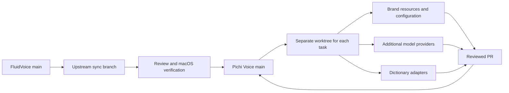

# Upstream and extension strategy

## Starting point

Pichi Voice starts from FluidVoice commit `7daffb529fb9f7c8d075f686a2d3da34695a66e4`, dated October 6, 2026. Development begins in a private, independent repository. It can later become public without discarding the commit history or the upstream relationship maintained by Git.

The repository preserves [GPL-3.0](../../LICENSE) and upstream copyright notices. A private development repository does not change the source license. Before distribution, review the obligations for the app and the separate licenses for weights, runtimes, and datasets. The public FluidVoice repository does not contain the private Fluid Intelligence runtime described in its README.

## Small downstream changes

The target is FluidVoice with Pichi branding, additional Russian speech models, custom dictionaries, and selected features. Keep the downstream changes narrow so upstream fixes remain practical to merge.



| Change | Preferred boundary |
| --- | --- |
| Branding | One identity/configuration layer and separate image/string resources; retain upstream internal names |
| Additional model using an existing backend | A model descriptor and small registry wiring |
| New inference backend | Separate provider conforming to `TranscriptionProvider`, with a narrow factory registration |
| Personal dictionaries | Separate import/schema adapter and local profiles; reuse compatible upstream vocabulary hooks |
| Optional feature | Separate implementation with a small opt-in integration point |

The current [TranscriptionProvider](../../Sources/Fluid/Services/TranscriptionProvider.swift) already abstracts transcription, streaming, final results, and dictionary-training behavior. [ParakeetSpeechModelCatalog](../../Sources/Fluid/Services/ParakeetSpeechModelCatalog.swift), [ExternalCoreMLModelRegistry](../../Sources/Fluid/Services/ExternalCoreMLModelRegistry.swift), [ParakeetVocabularyStore](../../Sources/Fluid/Services/ParakeetVocabularyStore.swift), and [DictionaryTransferService](../../Sources/Fluid/Services/DictionaryTransferService.swift) provide existing integration boundaries. Compatibility with a specific custom model or dictionary still needs to be tested.

Avoid global text replacement of FluidVoice names, wholesale directory renames, mass formatting, and a second copy of the audio pipeline. Start by extending the existing contracts. Extract a separate portable core only if a concrete feature needs it; a large early refactor would increase upstream merge conflicts.

The current implementation keeps actual engine construction in the existing provider selection boundary. GigaAM needs an inference adapter because its ONNX graph and tokenizer differ from the supplied engines; it does not need a separate dictation, file, API or meeting audio pipeline. Common consumers use `TranscriptionProvider`. Optional end-of-utterance metadata belongs to `ASRTranscriptionResult`, while provider resource retirement uses the shared `releaseResidency` capability.

Meeting backends register through the existing `MeetingTranscriptionBackendRegistry`. A provider-backed adapter reuses the upstream materialization, speaker evidence and result assembly. The pipeline has one request-bound runtime factory, not another factory field for each model. Model identifiers, supported languages, artifact snapshots and actual provider construction remain in the compiled registration boundary. Recording admission freezes and validates the chosen model/backend/artifact under the capture lease, after permission prompts.

Folder import is an optional provider capability because the original download-oriented `prepare` operation cannot describe a user-selected model directory. `ASRService.importModel` owns admission, residency, cleanup and selected-provider reset. Onboarding and settings select a directory and present operation state; they do not duplicate model-store or resource-lifecycle work.

Appearance and localization use independent resource boundaries: a portable brand package and Apple's String Catalogs. Imported branding and user content remain data. Runtime appearance imports cannot change signed installation identity, credential namespaces, telemetry destinations or updater trust. See [branding](branding.md), [localization](localization.md) and the mandatory [architecture requirements](../../AGENTS.md#architecture-requirements-for-every-agent).

`DictationProviderRoute` is an operational snapshot, including its request credential. Both route resolvers use authoritative loaded keys; retained UI credential cache is presentation data only. Stop-time AI eligibility is checked against that same route and remains frozen while ASR finishes. Direct processing and local warming check the same existing fingerprint or private capability gate before transport.

Branding includes more than the visible name and icon. Before distributing or launching a branded app, separate its bundle identifier, settings and model-cache namespace, Keychain service identifiers, updater repository/feed, and analytics policy. Otherwise a rebranded build may share user state with FluidVoice or update itself back to an upstream build. Do not change every model-feed trust key merely for display branding; separate app updates from explicitly selected third-party model sources.

Store personal dictionaries, private audio, and proprietary weights outside Git from the start. Use ignored `private_assets/`, `models/`, or an authorized artifact store. Deleting a file in a later commit does not remove it from the history that would become public. Share public model metadata and synthetic fixtures only after checking their licenses and contents.

## Upstream updates

Use one integration branch for each update batch. For a published release, pass its exact upstream tag:

```bash
bash scripts/dev/prepare-upstream-sync.sh v1.6.11
# Change into the absolute "Sync worktree" path printed by the helper.
git status --short
git diff --name-only --diff-filter=U
# Resolve conflicts there, stage the reviewed files and inspect the combined diff.
bash scripts/dev/check.sh
bash scripts/dev/macos.sh build
bash scripts/dev/macos.sh test
# Shared sources such as OnboardingComponents.swift also compile for iOS.
bash scripts/dev/mobile.sh build-for-testing
# Commit the pending merge, push the task branch to origin, and open a PR.
```

GitHub CLI may retain FluidVoice as its default repository. Pass `--repo Pichi-AI/pichi-voice` explicitly for PR creation, inspection, updates and merging. Use `repos/Pichi-AI/pichi-voice/...` for repository-specific `gh api` calls. Check both `origin` and the GitHub repository target before publication; the upstream Git push guard does not control GitHub API writes.

If the primary checkout is inside a macOS protected folder and the test host cannot open its source-relative fixtures, choose a Codex-managed worktree or set `PICHI_VOICE_WORKTREE_ROOT="$HOME/.codex/worktrees/pichi-voice"` for the sync command. Build and runtime fixtures must both be accessible. Do not bypass signing or edit the permission database to make tests run.

The helper fetches `origin/main`, `upstream/main` and upstream tags, then resolves the chosen target to an immutable commit SHA. A target outside fetched upstream main history is rejected unless it is an explicit canonical stable/beta app tag (`vX.Y.Z` or `vX.Y.Z-beta.N`) independently verified as a published nondraft release on official GitHub. This exception requires GitHub CLI access to `github.com/altic-dev/FluidVoice`, an uploaded nonempty `Fluid-oss-<version>.dmg` app image, and the authoritative exact tag ref, recursively peeled through at most eight annotated tag objects, matching the frozen local tag commit. Branches, SHA expressions, drafts, Windows/runtime artifacts, mismatches and API errors do not qualify. Common Git ancestry with downstream is still required. The default and inside-main paths do not need GitHub CLI. Before creating a worktree, the helper prints the downstream baseline, upstream target, fetched upstream main and common ancestor SHAs. If our main already contains that target, it exits without creating a worktree.

An update uses a unique task worktree at the reported downstream SHA and starts `git merge --no-ff --no-commit <upstream-SHA>`. Later changes to tracking refs cannot change either side of that attempt. The existing `new-worktree.sh` accepts an optional base ref for this purpose; its default still fetches and starts from the latest `origin/main`. The sync helper leaves every conflict unresolved and prints its path with the worktree location. It never commits, pushes or changes either repository's main branch.

Omitting the argument preserves the original `upstream/main` workflow. This intentionally includes the fetched main revision, which may contain commits after the latest release. To repeat an inside-main upstream selection later, use the recorded target SHA as the argument. For a release outside main, pass its exact release tag again; the helper rechecks its publication and identity. The helper will use the then-current downstream main. To reproduce both sides of an earlier attempt, create a new worktree with `bash scripts/dev/new-worktree.sh upstream-replay <recorded-downstream-SHA>` and merge the recorded upstream SHA there. Retain the full SHAs rather than relying on a tag or branch name that might move.

| Method | Role |
| --- | --- |
| Merge a pinned upstream release or main revision | Preserves ancestry and imports the selected batch; the helper defaults to main |
| Rebase | Only for unpublished task branches; do not rewrite the shared main branch |
| Cherry-pick | An urgent individual fix when a full update is unsuitable; record its upstream commit |

No branching strategy guarantees zero conflicts. Separate files and small integration points reduce their frequency and make conflict resolution reviewable. A clean Git merge also needs semantic review: upstream can change a contract without touching a downstream adapter's file.

For each batch, save a reviewable update report in `docs/development/` with:

1. The upstream release/ref, all baseline SHAs, integrated revision and release scope.
2. Every conflicted path, the reason both sides changed it, and the behavior preserved by the resolution. Review individual hunks rather than choosing an entire side automatically.
3. Concrete extension-boundary decisions. Check provider and meeting registries, model/artifact snapshots, cancellation, resource ownership, shared service operations, branding and localization. Refactor only when the conflict or contract change identifies a specific limitation; follow [AGENTS.md](../../AGENTS.md#architecture-requirements-for-every-agent).
4. Checks actually run against the combined result, with downstream and inherited upstream regressions listed separately. Recheck Codex files, private-data ignores, workflow guards and app/model update configuration. Reject duplicate Xcode build settings and verify the emitted Debug/Release bundle identities after version bumps; the [1.6.11 rehearsal](upstream-sync-1.6.11.md) found a silent identity override in an otherwise successful build.
5. Independent automated review of the integrated revision, corrected findings and remaining limitations. Portable checks include offline synthetic Git regressions for the sync helper; they do not compile the app or verify model inference.
6. Interactive evidence from the exact frozen signed revision when permissions, capture, typing, UI or model behavior is tested. Follow the signing and screenshot rules in [AGENTS.md](../../AGENTS.md#verification). An earlier revision's permission or capture result cannot establish the new revision's result.

Portable checks and standalone projections establish only their reported scope, not compilation of the actual native app. Reuse actual pure declarations in test harnesses wherever possible and match the production immutable configuration contracts. After shared service or input changes, compare app and helper use of the same canonical formatter, fingerprint and prompt version across languages, time zones, fractional seconds and current, stale, absent and future values. Extend the existing input source boundary rather than duplicating an implementation. Complete the required actual native app and affected target builds available on the verification host before E2E, then freeze and verify the exact bundle and signature under the rules above. Record an unavailable build as an unresolved gate.

Native regressions can expose both integration bugs and stale expectations inherited from the current downstream baseline. Compare the exact changed declarations and use bounded baseline/current negative controls before changing a production policy. Pin a fixture's intended audio scope and speaker policy explicitly, then retain separate current-default assertions. Never relax timing bounds, privacy publication, attribution evidence or cancellation to make a suite pass. If a source projection needs a new constant or type, extract the actual shared declaration rather than copying a new magic value. The [1.6.12 update report](upstream-sync-1.6.12.md) records concrete examples and retained failures.

LLM semantic regression requires the captured default profile, a pinned model artifact and literal checks of state, tasks, owners, dates and supporting evidence, including negative controls for unsupported or contradicted claims. Independently audit the raw inputs and outputs. A runner's zero exit status, nonempty output, valid schema or citation membership cannot establish semantic correctness. A passing alternative or larger model does not erase a failed default profile case or authorize a silent preference change. Keep experiments bounded and retain failed raw outputs with their profile, artifact, prompt and source provenance in ignored local storage; committed reports must exclude private content.

Changes to model, verification proof or cache formats require compatibility with earlier data and checks that stored versions are current, as well as resource ownership, joined cancellation and chronology regressions. Cover stale or missing proof and reordered or future timestamps where those states enter the contract. Reuse the existing service and input source operations so app, helper and tests agree on the immutable attempt and its evidence.

A local Codex thread automation checks published stable and beta/prerelease macOS application releases daily and prepares a separate review branch/draft PR when needed. Read all GitHub release pages, excluding drafts, Windows builds and runtime/artifact releases. Keep checking the stable channel even when a newer beta exists. Compare semantic versions and ancestry, peel annotated tags to exact commits, and deduplicate both main and open PRs by SHA. Consolidate related releases only when the newest published target contains the others; never import unpublished main commits as a release update or roll back a newer integrated version. The automation requires the local execution host and repository access. It does not auto-merge or ship. The repository helper also supports manual checks independently of that app-local schedule.

## Embedded dictation cleanup

The public FluidVoice source supplies `PrivateAIProviderFeatureProviding` and `PrivateAIIntegrationProviding`, but does not supply the private Fluid Intelligence inference engine. The downstream registers S1-mini by Superwhisper through those contracts and bundles llama.cpp in the small `Vendor/NativeTextInference` package. This package owns native pointers, greedy decoding, exact context accounting, UTF-8 streaming and joined cancellation. It does not start a local HTTP server or require Ollama or LM Studio.

S1-mini is the default registered dictation cleanup model. Onboarding and Settings share the existing preparation, verification, activation and resource-coordination operations. Its task catalog contains dictation only; meeting summaries, edit instructions and commands continue to use their existing providers. Supported runtimes and acceleration controls come from feature capabilities, so common orchestration does not branch on a model identifier. Model presentation metadata lives with the registered descriptor. The existing private build bridge retains its conditional registration.

The artifact is the smallest author-published GGUF, `superwhisper/s1-mini-GGUF/s1-mini-q4_k_m.gguf`, pinned to Hugging Face revision `34add00a48a2e5d24e5a4ee5405a99620a3a240c`. It contains 484,219,808 bytes and has SHA-256 `3b41ebe2502cbd03e811d5d16b022f5ab551eda58d62597d152f89535003c634`. Downloads use the existing progressive downloader, bounded file validation and atomic installation in the trusted application storage namespace. Model weights remain outside Git. Verification fingerprints bind the model, runtime, version and digest.

The adapter follows the [author's exact prompt format](https://huggingface.co/superwhisper/s1-mini-GGUF#input-format), including the styling controls, non-thinking assistant prefix and greedy decoding. It accepts transcripts in any language without a language filter. Language quality must be evaluated using actual model outputs; the multilingual base alone does not establish cleanup quality after fine-tuning. Empty output is valid for filler-only input. Input or output limit errors must not publish partial cleanup.

The shipped Russian speech route selects GigaAM for a fresh installation. Existing saved engine choices retain their migration behavior. GigaAM's existing provider prepares the same public Q8_0 GGUF on every device through the ASRService operation used by Settings and onboarding. Metal GPU is preferred independently of total device RAM; CPU fallback uses the same file and reports unavailable GPU, accelerator failure or insufficient current process headroom. Older ONNX exports remain registered for explicit imports and pinned jobs. Its native inference contract is unchanged. The public HF export is the default source even when old imported weights exist. A verified folder import explicitly selects that export, and the shared model-source operation restores the public default without deleting imported files. The public export reports no EOU capability. A synthetic Russian WAV can be tested through FileTranscriptionService followed by DictationPostProcessingService, using opt-in local paths and actual GigaAM and S1-mini weights.

The native runtime release and checksum are pinned in the vendor package. S1-mini's full license and attribution notice, plus llama.cpp's MIT license, are included in the app's `Notices` resources. Preserve these when distributing a build.

## First implementation sequence

1. Establish and verify an unchanged upstream macOS build.
2. Add the Pichi identity layer and separate application identity without renaming the codebase.
3. Add one Russian model provider and test its compatibility, quality, and latency.
4. Adapt a dictionary using approved fixtures and keep personal profiles local.
5. Complete an upstream update rehearsal and macOS regression run before adding more providers.

Measure Russian transcription on consented or public recordings with human-checked reference text. Compare word/character error rate, names and domain terms, dictionary behavior, latency, memory, cancellation, and long-audio handling. A model should not be called better merely because it supports Russian.

## See also

- [Development setup](codex.md)
- [Agent instructions](../../AGENTS.md)
- [Least-change refactoring review](least-change-refactoring.md)
- [Upstream FluidVoice](https://github.com/altic-dev/FluidVoice)
- [License](../../LICENSE)
